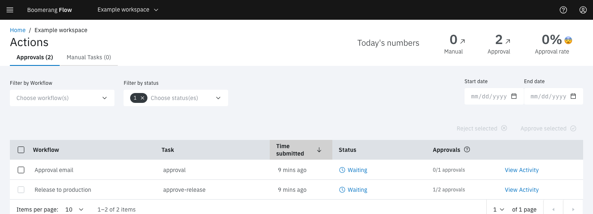

<!-- Written against flow.service.workflow 5.0.0-beta.39. UI labels checked against the live webapp (build 490ba3894, 2026-11-06): 15 of 31 bolded terms seen live; the rest are states the walk didn't reach or aren't labels, and were verified in client-web source. -->

# Actions

An action is a point in a workflow where a person has to decide before the run carries on. There are two kinds: an approval, where someone approves or rejects, and a manual task, where someone does a step by hand and says whether it worked.

Put an action where automation shouldn't act alone: a release to production, a refund over a set amount, an access request. The run waits at that task, without using up its timeout, until someone answers.

## Add an action to a workflow

Drag one of these tasks from the canvas's **Workflow** category:

- **Manual Approval.** Set **Approver Group (optional)** to limit who can decide, and **Number of Approvals (optional)** to need more than one decision.
- **Manual Task.** Write the steps in **Instructions**, in Markdown. The person completing it sees them.

When the run reaches the task, the task shows **Waiting** and the action appears on the Actions page, on Home, and on the run page.

## Who can answer

Anyone with the owner or editor role in the workspace can complete a manual task or decide an approval. Readers can see actions but not answer them.

When an approval names an approver group, only that group's members can decide it, and a machine token can't. Owners and editors create groups from the workspace's members under **Manage workspace › Approver Groups**. Deleting a group removes it from any approval that named it.

## How an approval is decided

An approval needs 1 decision by default. With **Number of Approvals (optional)** set, Flow waits for that many people to decide. Once it has them, the approval is approved only if every one of them approved; one rejection makes it rejected.

An approved approval ends the task **Succeeded**, and a rejected one ends it **Failed**, so the links leaving the task decide what happens next. The task also sets five results, taken from the person whose decision completed it:

| Result | Value |
| --- | --- |
| `approvalStatus` | `approved` or `rejected` |
| `approvalDate` | When they decided, in ISO 8601, UTC |
| `approvalUserName` | Their name |
| `approvalUserEmail` | Their email |
| `approvalComments` | Their comment, if they left one |

A later task reads them as `$(tasks.<task name>.results.approvalStatus)`.

A manual task ends **Succeeded** when someone selects **Complete Successfully**, and **Failed** with **Complete Unsuccessfully**.

## Where to answer

### The Actions page

Select **Actions** in the side navigation. The page has two tabs, **Approvals** and **Manual Tasks**, each with a count. The header's **Today's numbers** shows the last 24 hours: manual tasks, approvals, and the share of decided approvals that were approved.

Filter with **Filter by Workflow**, **Filter by status** (**Waiting**, **Approved** or **Rejected**; the page opens on **Waiting**) and a date range. The table lists each action's workflow, task, time submitted and status, and for approvals how many decisions it has, such as "1/2 approvals". **View Activity** opens the run.

- **An approval:** select its row to open **Action details**, add an optional comment of up to 200 characters, then select **Approve** or **Reject**. The dialog lists the approvers who have already decided. To decide several at once, tick their rows and select **Approve selected** or **Reject selected**.
- **A manual task:** select its row to open **Action Manual Task**, read the instructions, then select **Complete Successfully** or **Complete Unsuccessfully**.

### Home

**Needs your attention** on [Home](./home) lists what's waiting for you across every workspace. An approval there has **Approve** and **Reject**, which send no comment. A manual task has **Open in Actions**.

### The run page

On a waiting approval or manual task in the run's task log, select **Action**. Once it's answered, **View Action** shows who decided, when, and what they said.

## When the run ends first

Cancelling a run, or the run timing out, closes its open actions; nobody can answer them afterwards. An action waits indefinitely otherwise, unless its task declares a timeout. See [Runs](./runs#timeouts).

## Example: two release managers sign off

The "release-train" workflow builds a release, then asks for sign-off before deploying.

1. Under **Manage workspace › Approver Groups**, create a group "Release managers" with the three people who can sign off.
2. On the canvas, add a **Manual Approval** task named `approve-release` between build and deploy. Set **Approver Group (optional)** to "Release managers" and **Number of Approvals (optional)** to `2`.
3. Link `approve-release` to deploy on success, and to a notification task on failure. That task's message can include `$(tasks.approve-release.results.approvalComments)`.

When a run reaches the approval, it appears for all three managers. Once two of them have decided, the approval completes: if both approved, the task succeeds and deploy starts; if either rejected, the task fails and the notification task runs instead.

## Next steps

- [Runs](./runs): how waiting affects a run's status and timeout.
- [Parameters](./parameters): read task results in later tasks.
- [Manage](./manage): approver groups and the rest of Manage workspace.
