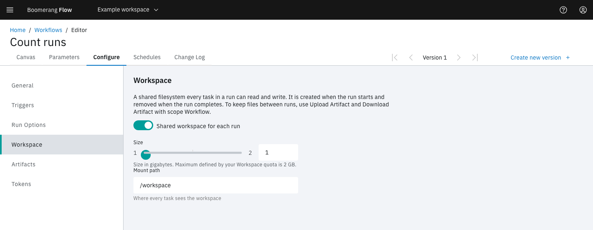

<!-- Written against flow.service.workflow 5.0.0-beta.39. UI labels checked against the live webapp (build 490ba3894, 2026-11-06): 24 of 29 bolded terms seen live; the rest are states the walk didn't reach or aren't labels, and were verified in client-web source. -->

# Artifacts and the run workspace

The run workspace is a volume that the tasks of one run share. An artifact is a file a task uploads so it outlasts the run. This page is for workflow authors: when to use each, how long artifacts are kept, and where to find them.

## The run workspace

A workflow can give each of its runs one shared filesystem. Every task in the run mounts it at the same path, so one task can write a file and the next can read it.

Turn it on in the workflow editor under **Configure › Workspace**:

- **Shared workspace for each run:** the switch. A workflow without it has no shared storage.
- **Size:** in GB. The most you can choose is your workspace's **Workspace Storage - Per Run** quota (2 GB unless an admin changed it).
- **Mount path:** where every task sees it. Blank means `/workspace`.

Each run gets its own run workspace. It's created when the run starts and removed when the run completes. Nothing carries over between runs: a retry starts with an empty run workspace too. To keep a file for later, upload it as an artifact.

A run with a run workspace waits for a dispatcher to create the volume before it starts. If the dispatcher can't create it, the run shows the cause and tries again a minute later, and fails on the third attempt.

A workflow upgraded from v3 keeps its mount path, or `/workspace/workflowrun` if it had none.

## Artifacts

Two catalogue tasks, in the palette's **Artifacts** category, move files between the run workspace and Flow's artifact store.

| Task | Fields | What it does |
| --- | --- | --- |
| **Upload Artifact** | **Artifact name**, **Path**, **Scope**, **Retention days** | Uploads a file, or a folder as one `.tar.gz` |
| **Download Artifact** | **Artifact name**, **Destination path**, **Scope**, **Optional** | Downloads the artifact, unpacks a folder, checks its SHA-256, and sets the result `found` |

A relative path resolves against `/workspace`.

Every artifact has a scope:

| Scope | Belongs to | Downloaded by | Kept |
| --- | --- | --- | --- |
| `run` (the default) | The run that uploaded it | Later tasks in the same run | Until its retention ends |
| `workflow` | The workflow | Any later run of the workflow, by name | Until a later upload of the same name replaces it, or someone deletes it |

An artifact name starts with a letter or digit, then letters, digits, `.`, `_` and `-`, up to 128 characters. Names are unique within a run: a second upload of the same name fails with `ARTIFACT_ALREADY_EXISTS`.

When Download Artifact finds no artifact of that name, the task fails. With **Optional** on, it succeeds instead, with `found` set to `false`, so a first run can carry on without a file.

### Limits

- **Largest artifact:** 1,024 MB (**Admin › Settings › Artifacts › Largest Artifact (MB)**).
- **Artifact storage:** 5 GB per workspace by default, for both scopes together (the workspace's **Artifact Storage** quota).

An upload that breaks a limit fails its task, and its file is deleted. Flow never deletes another artifact to make room.

Artifacts need an artifact store, which an operator connects. Until then, every artifact call answers `ARTIFACTS_NOT_CONFIGURED`. See [Connect the artifact store](../hosting/configuring#connect-the-artifact-store).

## How long is an artifact kept?

A run-scoped artifact's retention comes from three settings:

1. The workspace's **Artifact Retention** quota. Without its own value, the workspace takes **Admin › Settings › Artifacts › Default Retention (days)**, 30 days.
2. The upload task's **Retention days**, which can shorten that but not lengthen it.
3. **Maximum Retention (days)**, 90 days, which caps the result. The shortest retention is 1 day.

When an artifact expires, its file is deleted, but its record stays, so the run still shows what it produced. A finished run is purged after **Admin › Settings › Run limits › Activity Retention (days)**, 365 days, and its run-scoped artifacts go with it.

A workspace whose Artifact Retention quota is `0` gives run-scoped artifacts no expiry date, unless the upload task sets **Retention days**: they stay until their run is purged. The webapp's lowest value is 1, so `0` is set through the API.

A workflow-scoped artifact never expires, and the run purge never removes it. An upload with scope `workflow` can't set **Retention days**: it fails with `ARTIFACT_INVALID_SCOPE`.

## Where do I find artifacts?

| Place | Shows |
| --- | --- |
| The run page's **Artifacts (n)** tab | This run's artifacts, with **Download**, **View Details** and **Delete** |
| **Configure › Artifacts** in the workflow editor | The workflow's kept artifacts |
| **Manage workspace › Artifacts** | Every artifact in the workspace, filtered by **Scope** and **Show expired**, with the storage used against the quota |

## Stored task logs

When a task ends, its dispatcher sends the finished log to Flow, which keeps it in the artifact store. The run page serves the stored log after the task's pod is gone.

- **Store Task Logs** (on by default) and **Task Log Retention (days)**, 7 days, are in **Admin › Settings › Artifacts**.
- A stored log is capped at 10 MiB and doesn't count toward artifact storage.

## Example: keep a dependency cache between runs

A build workflow can keep its downloaded dependencies from one run to the next:

1. First task: **Download Artifact** with **Artifact name** `deps-cache`, **Destination path** `cache/`, **Scope** `workflow` and **Optional** on.
2. The build tasks read and fill `/workspace/cache`.
3. Last task: **Upload Artifact** with **Artifact name** `deps-cache`, **Path** `cache`, **Scope** `workflow`.

The first run finds nothing and carries on. Every later run starts with the cache the previous run uploaded. See [Keep files between runs](../guides/keep-files-between-runs).

## Next steps

- [Keep files between runs](../guides/keep-files-between-runs).
- [Quotas](./quotas): the storage and retention limits.
- [Tasks](./tasks): the rest of the catalogue.
