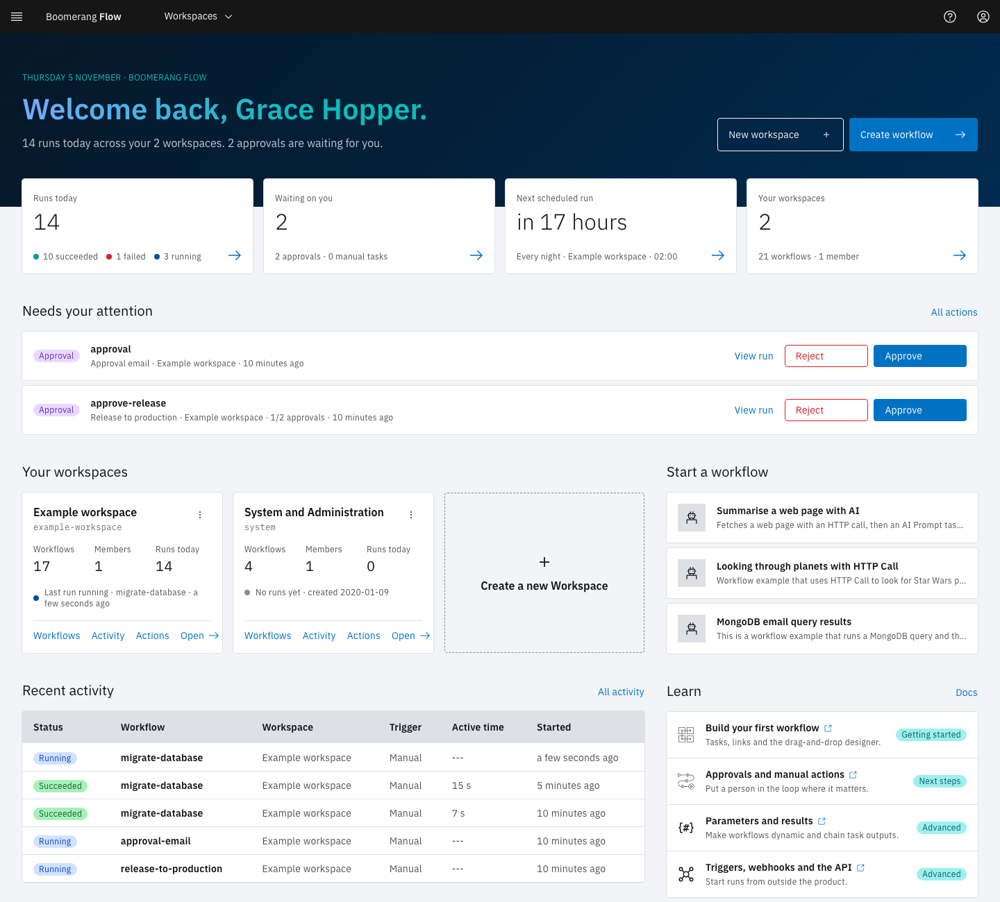

<!-- Written against flow.service.workflow 5.0.0-beta.39. UI labels checked against the live webapp (build 490ba3894, 2026-11-06): 17 of 30 bolded terms seen live; the rest are states the walk didn't reach or aren't labels, and were verified in client-web source. -->

# Home

Home is the page you land on after signing in. It sums up today across every workspace you belong to, lists what is waiting for you, and links each number to the page that owns it. Select **Home** in the side navigation, or the product name in the header, to come back to it.

## What's on the page

Home changes with what you have. A returning user sees the sections below, in this order.

### The day in one sentence

The welcome band says how many runs ran today across your workspaces and how many approvals and manual tasks are waiting for you, for example "3 runs today across your 2 workspaces. 1 approval is waiting for you." It also holds **Create workflow**, which opens the Workflows page of the workspace that ran most recently, and **New workspace**.

### Four tiles

| Tile | Shows | Opens |
| --- | --- | --- |
| **Runs today** | Today's runs, split into succeeded, failed and running | [Activity](./activity) |
| **Waiting on you** | Approvals and manual tasks waiting for a decision | [Actions](./actions) |
| **Next scheduled run** | When the next schedule fires, which one, and in which workspace | [Schedules](./schedules) |
| **Your workspaces** | How many workspaces you're in, with their workflows and members | The workspace cards further down |

A tile that can't be read shows `---` and "Could not load. Refresh to try again."

### Needs your attention

This list appears when an approval or a manual task is waiting for you. Each row is tagged **Approval** or **Manual task** and names the task, workflow and workspace. When an approval needs more than one decision, the row shows how many it has, such as "1/2 approvals".

- On an approval, select **View run** to see the run, then **Approve** or **Reject**. The two buttons appear only if you can decide in that workspace, which takes the owner or editor role. A decision made here carries no comment; to add one, decide on the [Actions](./actions) page instead.
- On a manual task, select **Open in Actions** to read its instructions and complete it.

**All actions** opens the Actions page.

### Your workspaces

One card per workspace, with its **Workflows**, **Members** and **Runs today**, and a line about its last run. The card's links open the workspace's Workflows, Activity and Actions pages. Its menu adds **Manage workspace** and **Leave**. The **Create a new Workspace** tile, and **New workspace** in the welcome band, create a workspace with you as its owner. An administrator can stop users who aren't admins from creating workspaces.

### Recent activity

The five newest runs across your workspaces, with their status, workflow, workspace, trigger, active time and when they started. Select a workflow name to open the run. **All activity** opens the [Activity](./activity) page.

### Start a workflow

Ready-made starter workflows. Select one to open **Create Workflow from Template**: choose the **Workspace**, adjust the **Workflow Name** and description, pick an icon, then select **Create and View**. Flow copies the starter into that workspace and opens it in the editor. The copy is yours to change.

### Learn

Four links into these docs: building a workflow, approvals, parameters, and triggers.

## Your first visit

With no workspace yet, Home shows **Get started**, three steps that unlock in turn: **Create a workspace**, **Build a workflow**, and **Run it and watch Activity**. Below them, **Four things to know** defines workflows, tasks, actions and parameters. If you can't create a workspace, Home asks you to have an administrator add you to one.

Get started stays until you have a workspace, a workflow and a run, or until you close it.

## Example: approve a release from Home

You sign in and the welcome band reads "1 run today across your 2 workspaces. 1 approval is waiting for you." Under **Needs your attention**, an **Approval** row names the task "Approve release" in the workflow "release-train".

1. Select **View run** and check the build task's results on the run page.
2. Go back to Home and select **Approve**.

A toast confirms "Your decision was recorded", and the row leaves the list. The run carries on to its next task.

## Next steps

- [Workflows](./workflows): create, run and manage the workflows in a workspace.
- [Actions](./actions): approvals and manual tasks in detail.
- [Getting started](../introduction/getting-started): build and run your first workflow.
