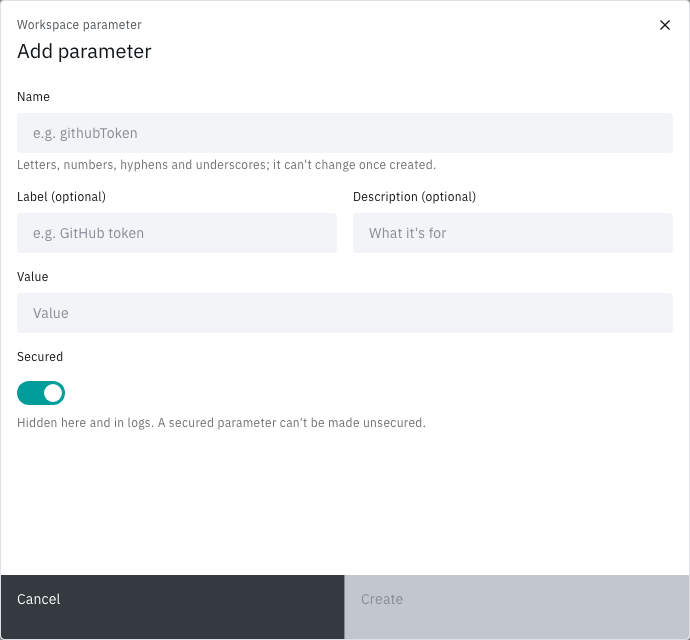

<!-- Written against flow.service.workflow 5.0.0-beta.39. UI labels checked against the live webapp (build 490ba3894, 2026-11-06): 17 of 22 bolded terms seen live; the rest are states the walk didn't reach or aren't labels, and were verified in client-web source. -->

# Parameters

A parameter is a named value a workflow or task reads when it runs, written as a reference such as `$(params.registry)`. This page is for workflow authors and task developers: where values come from, which one wins, and how secrets stay hidden.

## Where does a value come from?

A value can come from six places. Each has its own reference.

| Layer | Where you set it | Reference |
| --- | --- | --- |
| Global | **Admin › Parameters** | `$(global.params.x)` |
| Workspace | **Parameters** in the side nav | `$(workspace.params.x)` |
| Workflow | The workflow editor's **Parameters** tab, and the values a run starts with | `$(workflow.params.x)` |
| Task | The fields of a node on the canvas | `$(params.x)`, inside the task's script, command, arguments and environment |
| Context | Flow, for each run and task run | `$(context.params.x)` |
| Results | An earlier task's output | `$(tasks.<name>.results.<result>)` |

`$(params.x)` reads whichever layer holds `x`; the next section says which wins. A reference can also follow a JSON path into an object value or a result, such as `$(params.config.region)` or `$(tasks.lookup.results.data.owner)`. A path that matches nothing gives an empty string.

The context keys are `workflowrun-trigger`, `workflowrun-initiator`, `workflowrun-ref`, `workflowrun-status`, `workflowrun-status-reason`, `workflow-name`, `workflow-displayname`, `workflow-ref`, `workflow-version`, `taskrun-ref`, `taskrun-name`, `taskrun-type`, `webhook-url`, `wfe-url` and `event-url`.

`$(team.params.x)`, the v3 form, still reads the workspace layer. It logs a warning and goes away in the next major version, so use `$(workspace.params.x)`.

## Which value wins?

For `$(params.x)`, the highest layer that holds `x` with a value wins:

1. context;
2. task (only inside the task's script, command, arguments and environment);
3. workflow;
4. workspace;
5. global.

A layer whose `x` has no value doesn't win. A task's own fields never read each other: `$(params.url)` in a node's field reads the workflow's `url`, or the workspace's or global one.

For example, a global parameter `registry` is `docker.io`, and the workspace sets its own `registry` to `ghcr.io`. In that workspace, `$(params.registry)` and `$(workspace.params.registry)` give `ghcr.io`, while `$(global.params.registry)` still gives `docker.io`. A workflow parameter named `registry` would win over both.

## When do values resolve?

Global, workspace and context values aren't copied onto a run. Flow reads them when the run starts, when each task is admitted, when a dispatcher claims the task, and when a for-each task fans out.

- **A task's fields** resolve when the task is admitted, and are then fixed for that task run.
- **The script, command, arguments and environment** are filled in when a dispatcher claims the task. A `$(workspace.params.x)` or `$(global.params.x)` written straight into them is read fresh at that point.
- **Edits** reach tasks admitted afterwards. Each instance caches the layers for 10 seconds, so allow 10 seconds for a change to reach every instance.

Substitution inserts text exactly, quotes and newlines included. Task results, and run parameters that arrive with a webhook, an event, a GitHub delivery, a Run Workflow task or a retry, are inserted as written: a `$(...)` inside them stays text.

## Why did a task fail with `ParamUnresolved`?

Before a task can run, Flow checks every reference in its fields, script, command, arguments and environment. `$(date)` and other shell forms stay text.

| The reference names | Result |
| --- | --- |
| Something declared that has no value, or a task that was skipped or hasn't run | An empty string |
| A parameter no layer declares | The task fails with reason `ParamUnresolved` |
| A task not in the workflow, or a result it doesn't declare | The task fails with reason `ParamUnresolved` |

The message names the task, the field, the reference and why, for example:

```text
Task 'deploy': script references $(params.registryTokn): no such param 'registryTokn'
```

Other limits:

- A task's resolved parameters over 16,384 bytes end it `invalid`.
- Results over 1,048,576 bytes fail it with `ResultsTooLarge`.
- A workspace or global parameter deleted between admission and claim fails the task with `SpecFillFailed`.
- With **Admin › Settings › Features › Workspace Parameters** or **Global Parameters** off, that layer isn't read, so its references fail.

## Names

- A name starts with a letter or underscore, then letters, digits, hyphens and underscores (`^[a-zA-Z_][a-zA-Z0-9_-]*$`). It can't change once created.
- References match names ignoring case: `$(params.myparam)` finds `MyParam`.
- Names that differ only by case, `-` or `_` (`my-key` and `MY_KEY`) are refused at save with `PARAM_NAME_COLLISION`. A task receives each parameter as the environment variable `PARAM_<NAME>`, and those names would collide.
- `names` is reserved, in any case.
- On a for-each task, `item` and `index` are reserved: Flow adds them to each item.

## Types

A workflow parameter's **Type** is **Boolean**, **Email**, **Number**, **Password**, **Select**, **Text**, **Text Area** or **URL**. Task fields add more, such as **Slider** and the text editors. Each reaches a run as one of four value types: Password becomes `secret`, a JSON field becomes `object`, a multi-select becomes `array`, and every other type becomes `string`.

## Secured parameters

A secured parameter is stored encrypted, shown masked in the webapp, and scrubbed from logs. Make one with the **Password** type on a workflow or task, or the **Secured** toggle when you add a workspace or global parameter. A secured parameter can't be made unsecured.



- A string built from a secret, such as `postgres://app:$(params.dbPassword)@db`, becomes a secret too.
- Through the API, a set secret reads as `*****`. To keep it when you write, send `*****` or leave it out; to clear it, send `""`.
- The task's container receives the real value, as `PARAM_<NAME>` and wherever a reference was substituted.

See [Use secrets](../guides/use-secrets).

### What `*****` means when you start a run

On a run request (submit, start or retry), Flow treats each parameter value like this:

| You send | Flow uses |
| --- | --- |
| No value, or `null` | The declared or stored value, for every type |
| `*****` for a secret parameter | The declared or stored secret |
| `*****` for any other type | The literal text `*****` |
| `""` | An empty value |
| Anything else | That value |

Before 5.0, a blank kept a secret. Now it clears it.

## Parameters an integration manages

When a workspace connects an [integration](./integrations), it can share credentials as workspace parameters, such as `github-token`. These show the tag **Managed by GitHub** (or the integration's name) and offer only **Copy reference**. Writing or deleting one is refused with `409 PARAMS_MANAGED_BY_INTEGRATION`. Stop sharing, or disconnect, to remove them.

## Next steps

- [Use secrets](../guides/use-secrets).
- [Tasks](./tasks): the catalogue and its credential defaults.
- [Integrations](./integrations): share credentials as parameters.
- [Repeat a task for each item](../guides/repeat-a-task-for-each-item): `item` and `index`.
