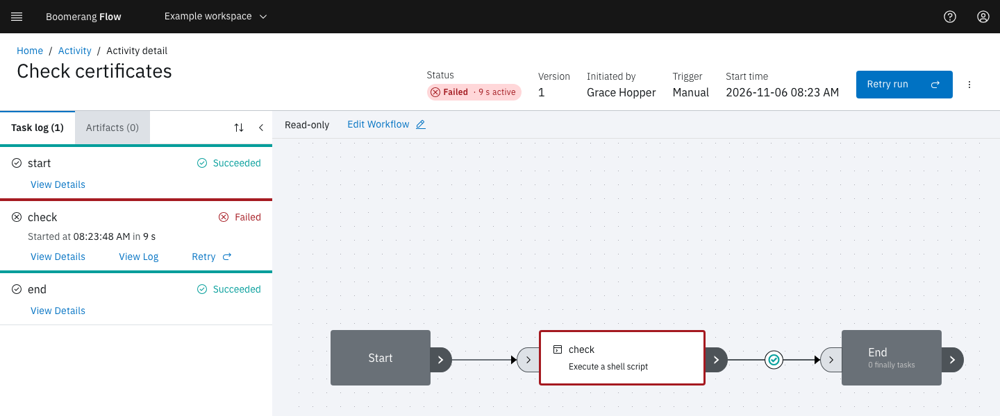

<!-- Written against flow.service.workflow 5.0.0-beta.39. UI labels checked against the live webapp (build 490ba3894, 2026-11-06): 53 of 65 bolded terms seen live; the rest are states the walk didn't reach or aren't labels, and were verified in client-web source. -->

# Runs

A run is the record of one execution of a workflow: the version it ran, what started it, its status, and a task run for every task on the canvas. This page explains how a run moves from start to finish and what you can do to one in flight. It's for workflow authors.

## The run page

Select a row on the [Activity](./activity) page to open its run. The header shows:

- **Status:** the run's status as a coloured tag. While the run executes, the tag adds how long it has been running; once it finishes, its active time, the time spent executing.
- **Workspace** and **Version:** where the run belongs and which version of the workflow it ran.
- **Initiated by:** the person or token that started it. For a scheduled run it links to the schedule, for a child run to its parent run, and for a retry to the run it retried.
- **Trigger** and **Start time.**

Beside these sit the run's controls, **View results** when the run set workflow results, and the **View run error** icon when it has a status message. The **Task log** tab lists each task with its status, duration and buttons, and **Artifacts** lists the files the run uploaded. Select a task on the read-only canvas to jump to its entry in the task log.

## Status and phase

Every run and every task run carries two values. **Status** is the outcome you read; the webapp shows it everywhere. **Phase** is where the run sits in its lifecycle: `pending`, `queued`, `running`, then `completed`. The webapp never shows the phase, but it decides which controls appear.

| Label | Value | On a run | On a task |
| --- | --- | --- | --- |
| **Not Started** | `notstarted` | Created, not yet admitted | Not reached yet |
| **Ready** | `ready` | Admitted, and waiting for a dispatcher to provision its run workspace | Waiting for a dispatcher to claim and start it |
| **Running** | `running` | Executing, including while its tasks wait on people or events | Executing on a dispatcher |
| **Waiting** | `waiting` | Parked until its workflow's concurrency limit frees a slot | Waiting on an approval, a manual task, an event, a child run, a sleep or a lock, or for its next retry |
| **Succeeded** | `succeeded` | Reached the end of the graph | Finished successfully |
| **Failed** | `failed` | Didn't reach the end, because a task failed with no path onward | Failed, for example with a non-zero exit code |
| **Invalid** | `invalid` | The workflow was incomplete or invalid, or its version no longer exists | Refused before it ran, for example because its parameters are over 16 KB |
| **Skipped** | `skipped` | — | Its path wasn't taken, or the run ended first |
| **Cancelled** | `cancelled` | Cancelled, or skipped over its concurrency limit | Stopped by a cancel |
| **Timed Out** | `timedout` | Ran out of time | Ran out of time |

A run that a person must act on stays **Running**: the waiting task shows **Waiting** and the run's clock stops (see [Timeouts](#timeouts)). A Set Workflow Result Status task can choose the status a run ends with.

When the workflow has finally tasks, which run after the graph ends however it ended, the run takes its final status when the graph ends and completes once the finally tasks finish.

## Pause, resume and cancel

The run controls need the owner or editor role in the workspace. Readers see the run but not the buttons.

| Control | Shown when | What it does |
| --- | --- | --- |
| **Pause run** | The run is running | Stops new tasks from starting. Tasks already claimed, running or ready carry on to the end, and still time out on their own deadlines. The run shows a **Paused** tag. |
| **Resume run** | The run is paused | Lets new tasks start again |
| **Cancel run**, under **More run actions** | The run is Not Started, Waiting, Ready or Running | Ends the run **Cancelled**. Running tasks are stopped, tasks not yet started are skipped, open approvals and manual tasks are closed, and child runs are cancelled. |
| **Start run** | The run was submitted through the API without starting, and has no run workspace | Starts it |

While a run is paused, its timeout doesn't run down.

## Retry a run

A retry is a new run of the same workflow version, with the trigger `retry`. The original run is left as it was, and the new run's **Initiated by** links back to it.

- **Retry run** in the header retries a run that is Succeeded, Failed, Timed Out, Cancelled or Invalid.
- **Retry** on a task in the task log opens the same dialog with that task chosen.

The dialog's **Re-run** choice sets the scope:

| Option | Re-runs |
| --- | --- |
| **Everything, from the start** | The whole graph |
| **The tasks that did not succeed, and everything after them** | Every task that didn't succeed, and the tasks downstream of it |
| **Selected tasks, and everything after them** | The tasks you choose in **Tasks to retry from**, and the tasks downstream of them |

With either of the last two, each task that succeeded before the retry point is copied into the new run with its results, marked **Reused**, and doesn't run again. Keep in mind:

- **The run workspace starts empty.** A re-run task won't find files that reused tasks wrote there. Pass those files as [artifacts](./artifacts), or re-run everything.
- **A run still in flight is cancelled** when the retry starts, so one lineage never has two live runs.
- **A retry is a new run** for the workspace's run quotas.
- **A for-each task re-runs whole,** and you can't retry from a task between an Acquire Lock and its Release Lock.

[Retry a run](../guides/retry-a-run) walks through it.

### Retry automatically after a timeout

**Configure › Run Options › Retries** sets how many times Flow retries the whole workflow when a run times out. Each retry is a new run of the whole graph. Flow retries only timeouts; a failed run waits for you.

### Let a task retry its own failures

A task that runs on a dispatcher can retry its own failures. On the task's **Configure** tab, under **Retry**:

- **Retries:** attempts after the first, 0 to 10.
- **Backoff:** **Exponential** doubles the wait each time, up to **Maximum wait (seconds)**; **Fixed** waits **Initial wait (seconds)** every time. Without values, the wait starts at 10 seconds and stops growing at 300. Flow adds up to 5 seconds at random to each wait.

Flow never retries a failure that a retry can't change, such as an image the platform doesn't allow, results over the size limit, or a parameter that doesn't resolve. Approvals, manual tasks, waits and other workflow tasks have no retry setting.

Separately, Flow requeues a task up to 3 times when an attempt is lost or cut short: its dispatcher went away or stopped reporting, the cluster couldn't start it, or it passed its deadline. Only then does the task fail or time out. From the second attempt the task log shows ", attempt 2", and **View Details** lists every earlier attempt under **Attempts**, with its status, reason and duration.

## Timeouts

A run's timeout is fixed when it is submitted, from the first of these that is set:

1. **Configure › Run Options › Timeout**, in minutes, unless an API caller sends its own with the run;
2. the workspace's **Run Duration** quota;
3. the platform default, 30 minutes.

The workspace's run duration quota is also a ceiling: a longer timeout is cut to it. A timeout shorter than the longest chain of task timeouts through the graph is refused with `WORKFLOWRUN_TIMEOUT_TOO_SHORT`.

**What counts.** A timeout measures execution, not waiting. While every task in flight is waiting, on an approval, a manual task, an event, a child run, a sleep or a lock, the run's clock stops, and it stops while the run is paused. Time a task spends waiting for a dispatcher does count. The **Active time** Flow reports is the same measure.

**Waits.** A wait has no limit of its own unless its task declares a timeout. An approval nobody answers keeps the run going until someone cancels it.

**Tasks.** A task's timeout is the smallest of its own timeout, the platform's **Maximum task duration**, and the run's timeout. When a task finally times out, after any requeues, its run times out too.

A run or task that runs out of time ends **Timed Out** with the reason `DeadlineExceeded`. Flow checks deadlines every 30 seconds and allows 5 seconds' grace, so a timeout can land up to about half a minute late. A run with a run workspace waits as **Ready** for a dispatcher to provision it; if none does within the run's timeout, the run times out.

## Limit how many runs overlap

**Configure › Run Options › Concurrency limit** caps how many runs of the workflow are in flight at once, counting runs that are Ready or Running. Leave it blank for no limit. **Over the limit** says what happens to a run that would go over:

| Option | The extra run |
| --- | --- |
| **Queue until a run ends** (default) | Waits as **Waiting** with "Waiting for a slot: the workflow's concurrency limit of … in-flight runs is reached." When a run ends, the oldest waiting run starts. |
| **Skip the run** | Ends at once as **Cancelled**, with the reason `ConcurrencyLimit` |

The workspace's concurrent run quota is a separate count, and it wins: a queued run counts against it while it waits. To allow one run at a time per value, such as per customer, use the Acquire Lock and Release Lock tasks instead.

## Child workflows

The **Run Workflow** task starts another workflow in the workspace as a child run. Choose it under **Workflow**; that workflow's parameters then appear in the form to fill in.

- **Parameters go down only as you set them.** The child gets the values its node passes, which can include an earlier task's result. It doesn't inherit the parent's parameters. It does inherit the parent's timeout, retries and labels.
- **Results come back only if you wait.** With **Wait for the child run to finish** off, the task records the child's id as its `workflowRunRef` result and succeeds at once. With it on, the task waits, and the parent's clock stops while nothing else in it runs. A child that succeeds passes its results back, so a later task reads `$(tasks.<task name>.results.<result>)`. A child that ends any other way fails the task with `ChildRunFailed`.
- **Lineage.** The child's trigger is `task`, and its **Initiated by** links to the parent run. **View Activity** on the parent's task opens the child.
- **Cancels cascade.** When a parent is cancelled or times out, its child runs in flight are cancelled too. A pause doesn't cascade.
- **Nesting is limited** to 5 levels by default (**Maximum Child Workflow Nesting Depth**). A Run Workflow task at the limit fails with `NestingDepthExceeded` and starts nothing.

## How long runs are kept

Flow deletes a finished run, with its task runs, actions, run-scoped artifacts and stored logs, once it is older than **Admin › Settings › Run limits › Activity Retention (days)**: 365 days by default, and never less than 60. The purge runs every hour. A run that a retry or a child run still points to is kept until that run goes. Workflow-scoped artifacts and audit records are never purged, and no setting keeps runs forever, so export any history you need.

## Example: a release that fails at the last step

The "release-train" workflow runs **build**, then the approval **approve-release**, then **deploy**. A run fails at **deploy** because the container registry was briefly unavailable.

1. On the failed run, select **Retry run**.
2. Choose **The tasks that did not succeed, and everything after them**, then **Retry run**.

The page moves to the new run. **build** and **approve-release** show **Reused**, so nobody has to approve the release again, and only **deploy** runs. Its **Initiated by** links to the failed run, followed by "from the tasks that did not succeed".

## Next steps

- [Retry a run](../guides/retry-a-run): the retry dialog step by step.
- [Actions](./actions): approvals and manual tasks, the waits that people answer.
- [Triggers](./triggers): the ways a run can start.
- [Quotas](./quotas): the workspace limits every run counts against.
