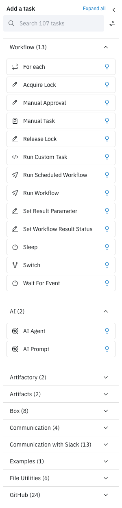
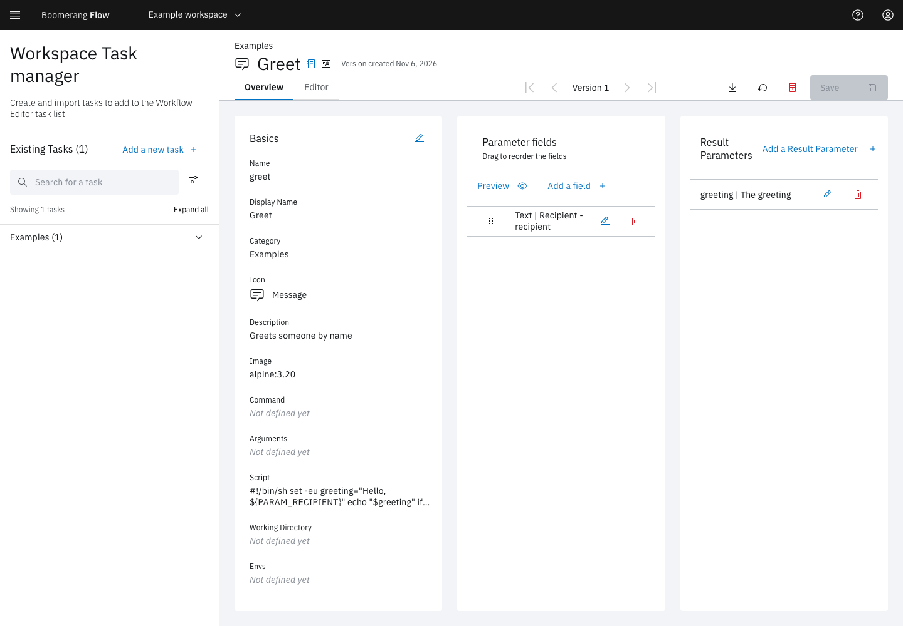

<!-- Written against flow.service.workflow 5.0.0-beta.39. UI labels checked against the live webapp (build 490ba3894, 2026-11-06): 34 of 40 bolded terms seen live; the rest are states the walk didn't reach or aren't labels, and were verified in client-web source. -->

# Tasks

A task is one unit of work in a workflow: a container a dispatcher runs, or a step Flow runs itself, such as an approval. This page is for workflow authors. It covers the catalogue Flow ships, the task types, and the tasks you add yourself.

## What is a task?

You drag a task from the palette onto the canvas, where it becomes a node. Each node is configured with the task's parameters, and passes values on as results that later tasks read as `$(tasks.<name>.results.<result>)`. See [Parameters](./parameters).

Every task has revisions. The palette shows the latest revision of each task, and a node is pinned to its revision when you save the workflow. A new revision changes nothing for a saved workflow until you upgrade the node in the editor and save again.

Tasks come from two places:

- **The catalogue:** the global tasks Flow seeds, available in every workspace. Admins manage them in **Admin › Tasks**.
- **Workspace tasks:** tasks a workspace adds in **Task Manager**. They appear only in that workspace's palette.

## Task types

A task's type decides who runs it. Container types wait for a dispatcher, which runs them as a pod. Every other type runs inside Flow and needs no image.

| Type | Runs in | What it does | Catalogue tasks |
| --- | --- | --- | --- |
| `template` | A dispatcher | Runs an image with a command and arguments | Most catalogue tasks, and tasks started from scratch in Task Manager |
| `script` | A dispatcher | Runs a script inside an image | Execute Shell, Run Python Script |
| `custom` | A dispatcher | Runs the image, command, arguments and script you set on the node | Run Custom Task |
| `ai` | A dispatcher | Calls an OpenAI-compatible model | AI Prompt, AI Agent |
| `uploadartifact`, `downloadartifact` | A dispatcher | Moves a file between the run workspace and the artifact store | Upload Artifact, Download Artifact |
| `approval`, `manual` | Flow | Creates an action and waits for a person | Manual Approval, Manual Task |
| `decision` | Flow | Picks the links to follow | Switch |
| `acquirelock`, `releaselock` | Flow | Takes or releases a named lock | Acquire Lock, Release Lock |
| `runworkflow`, `runscheduledworkflow` | Flow | Starts another workflow now, or schedules it | Run Workflow, Run Scheduled Workflow |
| `setwfproperty`, `setwfstatus` | Flow | Sets a result or the status on the run | Set Result Parameter, Set Workflow Result Status |
| `sleep`, `eventwait` | Flow | Waits for a time, or for an event | Sleep, Wait For Event |

A `template` or `script` task whose revision names no image runs on the image in **Admin › Settings › Tasks › Default Image Path**, seeded as `boomerangio/task-flow:3.3.0`.

## The catalogue

The catalogue is the set of global tasks Flow seeds. The palette groups them by category, with the **Workflow** category first and the rest A to Z, and lists each task's latest revision.

The [task catalogue](../catalogue/overview) lists every catalogue task by category, with its parameters, results, image and latest revision.

> [!WARNING]
> A few catalogue tasks end `succeeded` without doing anything, such as the HTTP Call tasks on the default task image. The catalogue marks each one. See [Known issues](../introduction/known-issues).

### Credentials in catalogue tasks

A field of type Password is a secret: it's stored encrypted, reads back as `*****`, and is scrubbed from logs. Many catalogue tasks default their credential to a workspace parameter that an [integration](../webapp/integrations) shares, so you don't type a token into every node:

| Tasks | Field | Default |
| --- | --- | --- |
| All 24 GitHub tasks | `token`, and `url` where the task has one (Add Issue to Project has none) | `$(workspace.params.github-token)`, `$(workspace.params.github-url)` |
| The 10 Slack tasks that call the Slack API | `token` | `$(workspace.params.slack-token)` |
| Google Sheets and Google Drive | `serviceAccountKey` | `$(workspace.params.google-service-account-key)` |
| Microsoft Teams (Add Teams Member, Create Teams Channel) and SharePoint | `tenantId`, `clientId`, `clientSecret` | `$(workspace.params.microsoft-tenant-id)`, `-client-id`, `-client-secret` |

A value you type on the node wins over the default. In a workspace that doesn't share the parameter, a task left on its default fails before it runs, for example with `no such workspace param 'github-token'`. The editor warns when you save.

The Box tasks take `privateKey` as a Password field, so it's a secret. The upgrade to 5.0 encrypts any key a workflow already holds.

## For each

**For each** is the first entry in the palette's **Workflow** category. It isn't a catalogue task: dropping it opens **Repeat a task for each item**, which turns an ordinary task into one that runs once per item of a list.

- Each item is its own task run, named `<name>[<index>]`. It runs in parallel with the others, in the same run, and shares the run workspace.
- Each item gets the task's parameters plus `item` and `index`, counted from 0.
- The items are a JSON array, or one reference whose value is an array, such as `$(tasks.list-repos.results.repos)`.
- The task succeeds when every item succeeds. Each result becomes an array in item order, with `null` for an item that didn't succeed.
- At most 256 items, set by **Admin › Settings › Run limits › Maximum For-Each Items**. A task whose items resolve to more fails before any item runs.

For each works on container tasks (`template`, `script`, `custom`, `ai` and the two artifact types) and on Run Workflow. See [Repeat a task for each item](../guides/repeat-a-task-for-each-item).

## Run Workflow

Run Workflow starts another workflow as a child run.

- **Workflow Reference** names the workflow to run.
- **Wait for the child run to finish** is off by default. Off, the task succeeds as soon as the child is submitted, with the child's id as its `workflowRunRef` result. On, the task waits, takes the child's status, and on success receives the child's results.
- The child gets only the parameters the node passes. The parent run's parameters aren't handed down, so pass a secret on the node if the child needs it.
- When a parent run is cancelled or times out, its children still in flight are cancelled too.
- Runs nest at most 5 deep (**Admin › Settings › Run limits › Maximum Child Workflow Nesting Depth**). At the cap, the task fails with `NestingDepthExceeded`.

Run Scheduled Workflow schedules a workflow to run once, later. It doesn't wait for the run.

## AI tasks

AI Prompt and AI Agent call an OpenAI-compatible model, such as one behind OpenRouter, LiteLLM, Azure AI Foundry or Ollama. Both run on `boomerangio/task-ai:2.1.0`.

- **AI Prompt** makes one call: a prompt in, the reply out as the `output` result. Its other results include `totalTokens` and `cost`.
- **AI Agent** runs a tool-calling loop. The model calls tools served by MCP servers until it gives a final answer, within **Max turns** (10 by default). It adds the results `turns` and `toolCalls`.

**Model** is required. When **Endpoint** and **API token** are blank, the dispatcher's defaults apply. See [Use AI tasks](../guides/use-ai-tasks).

## Artifact tasks

Upload Artifact stores a file or folder from the run workspace. Download Artifact fetches it again, in the same run or, with scope **workflow**, in a later run. See [Artifacts and the run workspace](./artifacts).

## Add your own tasks in Task Manager

**Task Manager** in the side nav holds a workspace's own tasks. It appears while the **Workspace Tasks** feature is on. Saving a task needs a role that can write in the workspace: owner or editor.

1. Select **Add a new task**.
2. Choose **Start from scratch**, or **Import a template** to load a `.yaml` or `.json` file of up to 1 MiB.
3. Fill in **Name**, **Display Name**, **Category**, **Icon** and **Description**. A new task's **Category** puts it in that palette category, matched exactly as you type it.
4. Select **Create**.
5. On the **Overview** tab, add parameters with **Add a field**, and results with **Add a Result Parameter**. Or edit the task as YAML on the **Editor** tab.
6. Select **Save**, then **Save new version** (with a comment) or **Overwrite this version**.

The task appears in the workspace's palette. **Overwrite this version** changes the task in every workflow that uses that version. **Save new version** leaves workflows on their version until someone upgrades the node.

The webapp doesn't delete tasks. **Archive** removes a task from the palette, and **Restore** brings it back. A workflow that still uses an archived task can't be saved or run: Flow refuses it with `TASK_INACTIVE_STATUS`. Move those workflows to another task before you archive one.

**Admin › Tasks** shows the same screens for the global catalogue. A verified catalogue task can be edited only while **Admin › Settings › Tasks › Enable Verified Tasks to be edited** is on.

## Next steps

- [Task catalogue](../catalogue/overview): every catalogue task's parameters, results and image.
- [Parameters](./parameters): how a task reads values and results.
- [Artifacts and the run workspace](./artifacts): pass files between tasks and runs.
- [Integrations](../webapp/integrations): share credentials with the catalogue tasks.
- [Use AI tasks](../guides/use-ai-tasks).
