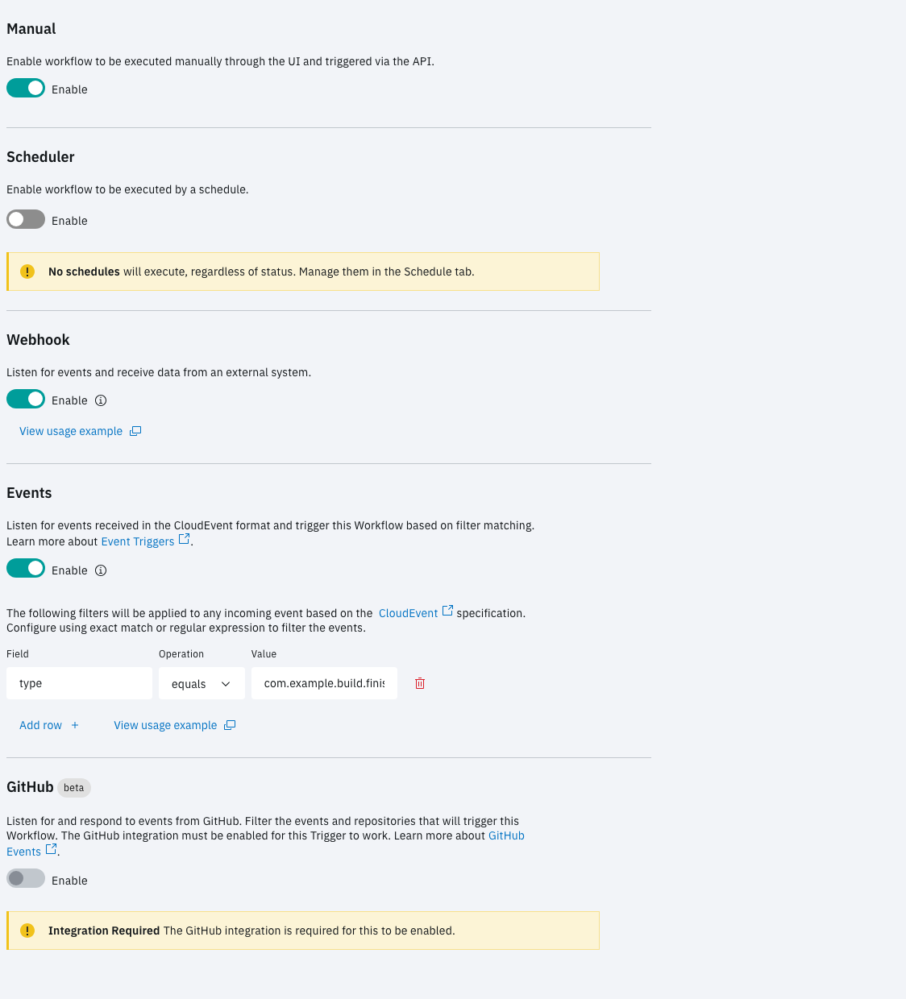

<!-- Written against flow.service.workflow 5.0.0-beta.39. UI labels checked against the live webapp (build 490ba3894, 2026-11-06): 17 of 26 bolded terms seen live; the rest are states the walk didn't reach or aren't labels, and were verified in client-web source. -->

# Triggers

A trigger is a way a workflow's runs can start. Each workflow has five, and you switch each one on or off under **Configure › Triggers** in the editor, then save with **Create new version**. A new workflow has **Manual** on and the rest off.

| Trigger | Starts a run when | Parameters the run gets |
| --- | --- | --- |
| **Manual** | Someone selects **Run it**, or an API caller submits a manual run | The values entered, or the defaults |
| **Scheduler** | One of the workflow's [schedules](../webapp/schedules) fires | The schedule's values |
| **Webhook** | A system posts to the webhook route | `data`: the request body |
| **Events** | A CloudEvent arrives that matches every filter | `event` and `data` |
| **GitHub** | A GitHub App delivery matches the repository and event filters | `data` and `event` |

A run through a trigger that is off is refused with `WORKFLOWRUN_TRIGGER_DISABLED`. Every triggered run counts against the workspace's [quotas](../webapp/quotas); while quotas are on, a run over one is refused with `429 QUOTA_EXCEEDED`. The run records its trigger, which Activity shows as **Manual**, **Schedule**, **Webhook**, **Event** or **GitHub**.



## Manual and Scheduler

**Manual** lets people start the workflow with **Run it** on the Workflows page. With it off, **Run it** is unavailable.

**Scheduler** lets the workflow's schedules fire. Switching it off stops every schedule at once, and switching it back on restarts the ones that were enabled before.

## Webhook

Switch on **Webhook**, then select **View usage example** for the workflow's URL:

```http
POST /api/v2/webhook?workspace=<workspace>&ref=<workflow name>
```

Send a JSON body. The body becomes the run's `data` parameter, so a task reads a field of it as `$(params.data.<field>)`. The route answers `200` with no body; find the run on the Activity page.

**Authenticate** with a token that holds the `webhook/action` permission, for example a workflow token created under **Configure › Tokens** with that permission. Send it as an `Authorization: Bearer` header, an `x-access-token` header, or, for a sender that can't set headers, an `access_token` query parameter. See [Configure a workflow](../guides/configure-workflow) for workflow tokens.

## Events

**Events** starts a run from a [CloudEvent](https://cloudevents.io) 1.0, sent in structured mode (`Content-Type: application/cloudevents+json`) or binary mode (`ce-*` headers), to:

```http
POST /api/v2/event?workspace=<workspace>&ref=<workflow name>
```

Without `ref`, the first segment of the event's `subject` names the workflow. Authentication is the same as for the webhook. The route answers with the new run.

Filter which events start a run with **Add row**. Each row has a **Field**, a path into the event as sent, such as `type`, `subject` or `data.tag`; an **Operation**; and a **Value**. **equals** matches the value exactly, and **matches** treats it as a regular expression. Every row must hold. At this release an **in** row saved from this form never matches, so use **equals** or **matches**.

The run gets two parameters: `event`, the event's attributes, and `data`, its data. A task reads `$(params.data.tag)` or `$(params.event.type)`. [Eventing](../architecture/eventing) covers the protocol, and the events Flow sends out.

## GitHub

The **GitHub** trigger, marked beta, needs the workspace's GitHub integration; until it's connected the section shows "Integration Required". See [Connect GitHub](../guides/connect-github).

Choose repositories under **Repository Filter** and events under **Events Filter**. When a delivery arrives, Flow offers it to every workflow in the linked workspace whose GitHub trigger is on, and starts each one whose filters match. The run gets `data`, the delivery's payload, and `event`, with the event's `type` and `id`.

## Resume a waiting run with a callback

A **Wait For Event** task pauses its run until a callback names the run and the task's **Topic**:

```http
POST /api/v2/callback?ref=<run id>&topic=<topic>&status=<status>&eventId=<id>
```

- `status` is `succeeded`, the default, or `failed`, which ends the task that way. Any other value is refused with `400 QUERY_INVALID_FILTERS`.
- A JSON body becomes the task's `data` result. `GET` works too, without a body, for example from a link in an email.
- `eventId` is optional. A repeat with the same `eventId` for the same run is acknowledged and ignored for 7 days.
- A callback that arrives before the task starts waiting is kept and applied when it does.

An earlier task can build the URL from `$(context.params.wfe-url)` and `$(context.params.workflowrun-ref)`. The route takes the same tokens as the webhook.

## Example: deploy when a build finishes

A build server should start the "deploy-service" workflow in the "payments" workspace with the commit it built. Switch on **Webhook**, create a workflow token with the `webhook/action` permission, then have the build server send:

```bash
curl -X POST "https://flow.example.com/api/v2/webhook?workspace=payments&ref=deploy-service" \
  -H "Authorization: Bearer $FLOW_TOKEN" \
  -H "Content-Type: application/json" \
  -d '{"commit": "4f2a9c1", "branch": "main"}'
```

The deploy task reads the commit as `$(params.data.commit)`. The run appears on the Activity page with the trigger **Webhook** and the token's name under **Initiated By**.

## Next steps

- [Schedules](../webapp/schedules): run a workflow on a timetable.
- [Configure a workflow](../guides/configure-workflow): triggers, tokens and the other Configure sections.
- [Eventing](../architecture/eventing): CloudEvents in and out of Flow.
