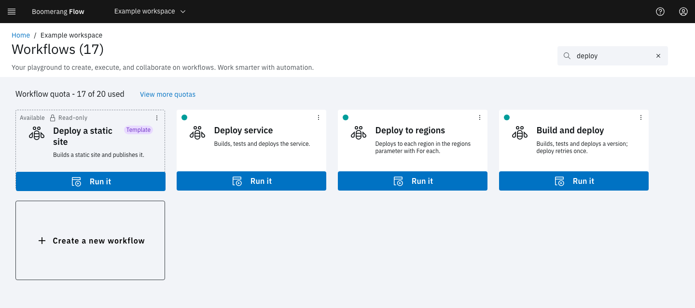

<!-- Written against flow.service.workflow 5.0.0-beta.39. UI labels checked against the live webapp (build 490ba3894, 2026-11-06): 24 of 31 bolded terms seen live; the rest are states the walk didn't reach or aren't labels, and were verified in client-web source. -->

# Workflows

A workflow is a graph of tasks that automates a process the same way every time. Each workflow belongs to one workspace, and every time it runs, Flow records a [run](./runs) you can follow and look back on.

Use a workflow for any process you repeat: a nightly report, a release, onboarding a new starter. Build it once on the canvas, then run it by hand, on a [schedule](../webapp/schedules) or from a [trigger](./triggers).

## The Workflows page

Select **Workflows** in the side navigation to see the current workspace's workflows as cards. The title counts them, for example **Workflows (3)**. Use **Search for a workflow** to filter the cards by name.

When workspace quotas are on, a line such as "Workflow quota - 3 of 10 used" sits above the cards. **View more quotas** opens the workspace's limits on workflows, concurrent runs, runs a month, run workspace size and run duration. See [Quotas](../webapp/quotas).

### What a card shows

- **The name and description.** Select either to open the workflow in the editor.
- **Run it.** Starts a run. When the workflow has parameters you can set, **Workflow Parameters** opens first; select **Run** to start, or **Run and View** to start and open the run page. **Run it** is unavailable while the workflow's **Manual** trigger is off or the workspace has reached its monthly or concurrent run quota.
- **A status icon.** Hover over it to read why the workflow can or can't run: **Active**, **Inactive**, **Trigger disabled**, or a quota message.
- **A warning icon,** when a task on the canvas has a newer version: "New version of a task available! To update, edit your workflow."
- **The menu,** with **Edit**, **View Activity** (the [Activity](../webapp/activity) page filtered to this workflow), **Update** (replace it from an exported file), **Export** (download it as JSON), **Duplicate** and **Delete**.

Deleting a workflow can't be undone. Flow cancels any run still in flight, then removes the workflow, its runs and its schedules. The workspace's monthly run count keeps counting runs it already made.

### Create a workflow

Select the **Create a new workflow** tile at the end of the cards. Choose **Start from scratch** to give it a name and an icon, or **Import a workflow** to load an exported JSON file. Either way the editor opens on the new workflow. [Create a workflow](../guides/create) walks through both.

Home's **Start a workflow** list is the third way: it copies a starter workflow into a workspace you choose.

## Templates

Some workflows are shared with every workspace as templates. A template's card carries a **Template** tag and reads **Available** until your workspace first uses it, and its menu offers only **View** and **Export**.

Running a template, or saving its settings, makes it your workspace's own workflow. Its tasks, parameters and run options stay the template's and follow its versions, so the editor shows them read-only. Its name, display name, description, icon, labels, triggers and schedules are your workspace's to change.

## Versions

Every change you save in the editor becomes a new version: select **Create new version** and add a comment. A run uses the latest version unless it asks for another. **Change Log** lists each version with who made it, when, and the comment.

## The editor

Opening a workflow shows five tabs:

| Tab | What you do there |
| --- | --- |
| **Canvas** | Drag tasks on, link them, and set each task's parameters |
| **Parameters** | Declare the workflow's own parameters, the values a run starts with |
| **Configure** | Set the name and labels, [triggers](./triggers), timeout, retries, concurrency limit, run workspace, kept artifacts and tokens |
| **Schedules** | Add and manage this workflow's [schedules](../webapp/schedules) |
| **Change Log** | Read the version history |

See [The workflow editor](../guides/workflow-editor) and [Configure a workflow](../guides/configure-workflow).

## Example: run a report with a different date

A workflow "weekly-sales-report" declares a parameter `reportDate`. To run it for last Friday:

1. On its card, select **Run it**.
2. In **Workflow Parameters**, enter the date for `reportDate`. Fields you leave alone keep their defaults.
3. Select **Run and View**.

The run page opens with the run's status at the top and each task in the task log as it starts.

## Next steps

- [Runs](./runs): what happens to a run, and how to pause, cancel or retry one.
- [Tasks](./tasks): the catalogue of tasks you can put on the canvas.
- [Parameters](./parameters): pass values into a workflow and between its tasks.
