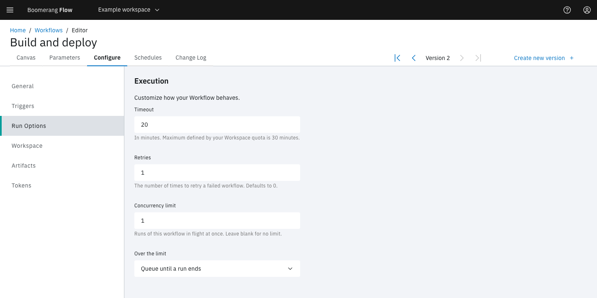

<!-- Written against flow.service.workflow 5.0.0-beta.39. UI labels checked against the live webapp (build 490ba3894, 2026-11-06): 55 of 77 bolded terms seen live; the rest are states the walk didn't reach or aren't labels, and were verified in client-web source. -->

# Configure a workflow

The **Configure** tab holds a workflow's settings: its name, what starts it, how its runs behave, the run workspace its tasks share, the artifacts it keeps and its tokens. This guide is for workflow authors.

## Before you start

- The Editor or Owner role in the workspace. See [Manage a workspace](../webapp/manage).
- Open the workflow in the editor and select **Configure**. The sections are listed on the left: **General**, **Triggers**, **Run Options**, **Workspace**, **Artifacts** and **Tokens**.

> [!NOTE]
> **Configure** has no Save button. Changes under **General**, **Triggers**, **Run Options** and **Workspace** are saved with the workflow's next version: select **Create new version** in the tab row (see [Save a version](./workflow-editor#save-a-version)). Deleting an artifact and creating or deleting a token take effect at once.

## Set the name, description and icon

**General** opens first. Its **Basic Information** section holds:

| Field | What it sets |
| --- | --- |
| **Name** | The workflow's identifier: letters, numbers and dashes, up to 100 characters, unique in the workspace. Webhook and event URLs name the workflow by it. |
| **Display Name (optional)** | The name on the workflow's card and in the editor. Blank shows **Name**. |
| **Description (optional)** | Up to 250 characters, shown on the card. |
| **Pick an icon (any icon)** | The icon on the card. |

### Add a label

Labels are key-value pairs in the Kubernetes label format, such as `cost-centre=platform`. The API can find workflows by label.

1. Under **Labels**, select **Add a new label**.
2. Enter a **Label Key**, such as `cost-centre`. A key can have a prefix that is a DNS subdomain, such as `example.com/cost-centre`.
3. Enter a **Label Value**, such as `platform`.
4. Select **Add**.

The label shows as a tag, `cost-centre=platform`. Select the tag to edit it, or its × to remove it. Keys and values start and end with a letter or number, may contain dashes, underscores and dots, and are at most 63 characters.

## Choose what starts a run

**Triggers** lists each way a run can start, each with an **Enable** toggle. If the section is empty, your administrator has turned workflow triggers off for the platform.

| Trigger | Starts a run when | Notes |
| --- | --- | --- |
| **Manual** | Someone selects **Run it**, or a client calls the API | On for a new workflow. Turning it off disables **Run it** on the card. |
| **Scheduler** | One of the workflow's schedules is due | Add schedules on the **Schedules** tab. While this is off, no schedule runs, whatever its status. |
| **Webhook** | A system sends a request to the workflow's webhook URL | **View usage example** shows the URL. The sender needs a token: see [Create a workflow token](#create-a-workflow-token). |
| **Events** | A CloudEvent arrives that matches the filters | Add a row per filter with **Add row**: a **Field**, such as `type`, an **Operation** (**in**, **matches** or **equals**) and a **Value**. **View usage example** shows the URL and an example event. |
| **GitHub** | A GitHub event you chose arrives from a repository you chose | Needs the GitHub integration; until then the toggle is disabled and **Integration Required** shows. Choose repositories under **Repository Filter** and events under **Events Filter**. See [Connect GitHub](./connect-github). |

The webhook and event URLs name the workflow by its workspace and **Name**: `?workspace=<workspace>&ref=<name>`. See [Triggers](../fundamentals/triggers) for each trigger's payload and how a run reads it.

## Set the timeout, retries and concurrency

**Run Options** opens a section titled **Execution**.

| Field | What it does |
| --- | --- |
| **Timeout** | Minutes a run may spend executing before it ends **Timed Out**. Time spent waiting on an approval, a manual task, an event, a sleep, a lock or a child run isn't counted, nor is time paused. Leave it blank to use the workspace's run-duration quota, 30 minutes unless your administrator changed it. It can't exceed that quota. |
| **Retries** | How many times Flow starts the run again after it times out. Each retry is a new run. Defaults to 0. |
| **Concurrency limit** | How many runs of this workflow can be in progress at once, 1 or more. Leave it blank for no limit. |
| **Over the limit** | What happens to a run that would go over the limit. **Queue until a run ends** (the default) holds it as **Waiting** until a run of this workflow ends. **Skip the run** ends it at once as **Cancelled**. |

**Retries** applies only to a run that times out, although its helper text says "a failed workflow". To retry failed tasks, set retries on the task (see [Retry a failed task](./workflow-editor#retry-a-failed-task)), or retry the run yourself (see [Retry a run](./retry-a-run)).

The workspace's concurrent runs quota still applies: while it's reached, **Run it** is disabled whatever this workflow's limit. See [Runs](../fundamentals/runs) and [Quotas](../webapp/quotas).

For example, a nightly report that must never overlap itself: **Timeout** `20`, **Concurrency limit** `1`, **Over the limit** **Skip the run**. A run that starts while the last one is still going ends **Cancelled**, and the next night's run goes ahead.

## Give tasks a shared run workspace

The **Workspace** section sets up the run workspace: a shared filesystem every task in a run can read and write. Flow creates it when the run starts and removes it when the run completes.

1. Turn on **Shared workspace for each run**.
2. Set **Size**, in gigabytes. It goes up to the workspace's storage quota, or to 100 GB without one.
3. Optional: change **Mount path**, where every task sees the run workspace. Blank means `/workspace`.
4. [Save a version](./workflow-editor#save-a-version).

The next run has the run workspace. For example, an **Execute Shell** task writes `/workspace/version.txt`, and a later **Read File to Parameter** task with **File Path** `/workspace/version.txt` returns the file's text as its `content` result.

The run workspace doesn't outlive the run. To keep files between runs, use **Upload Artifact** and **Download Artifact** with scope **Workflow**: see [Keep files between runs](./keep-files-between-runs).

> [!NOTE]
> A workflow from Flow v3 that used Workflow storage shows **Workflow storage was removed in Flow 5**. It can't run until you save a new version.

## Manage kept artifacts

**Artifacts** lists the files this workflow keeps between runs. An **Upload Artifact** task with scope **Workflow** writes one, and a **Download Artifact** task with scope **Workflow** reads it in a later run. Each name keeps its newest upload until it's replaced or deleted.

The list shows each artifact's **Name** (select it to download the file), **Size** and **Uploaded by**, with a **View run** link to the run that uploaded it.

To delete a kept artifact:

1. On its row, select **Delete**.
2. In **Are you sure?**, select **Delete**.

The message `"<name>" deleted` appears, and the artifact leaves the list. A later run's Download Artifact task no longer finds it. This can't be undone.

## Create a workflow token

A workflow token lets another system call Flow as this workflow, for example to send its webhook. **Tokens** lists the workflow's tokens with their **Status**, **Expiration Date** and **Last Used**. If **Feature Required** shows, your administrator has turned workflow tokens off for the platform.

1. Select **Create token**. **Create new token** opens.
2. Enter a **Name**: lowercase letters, numbers and dashes, unique.
3. Choose a **Role**, or open **Customise permissions** and select the resources and actions the token needs.
4. Optional: set an expiry date, and enter a **Description (optional)**. A token with no expiry never expires.
5. Select **Create**.

**Token successfully created** shows the token. Copy it now: Flow doesn't show it again. The token appears in the list with the status **Active**. Send it in the `Authorization` header, or add `&access_token=<token>` to the webhook URL for a sender that can't set headers.

> [!WARNING]
> Anyone holding the token can act as this workflow, with its permissions, until the token expires or is deleted. Store it as a secret, and delete it from this list when it's no longer needed.

## Choose a template version

A workflow that follows a template shows "This workflow is a template." at the top of **General**, then a **Template** section:

- **Template** names the template, read-only.
- **Version** sets which template version runs: **Follow the latest**, or **Pin to v`<n>`** to stay on one.

**Run Options**, **Workspace** and **Artifacts** show **Set by the template.** and can't be changed. The name, display name, description, icon, labels, triggers and schedules are your workspace's own. Save them with **Save settings** in the tab row; the message **Successfully saved workflow settings** appears.

## Not seeing what you expected?

- [Why is **Run it** greyed out?](../introduction/troubleshooting#run-it-is-greyed-out)
- [Why didn't a webhook or event start a run?](../introduction/troubleshooting#a-webhook-or-event-didnt-start-a-run)
- [Why did the run end **Timed Out**?](../introduction/troubleshooting#a-task-timed-out)

## Next steps

- [Run a workflow](./run): start a run and follow it.
- [Triggers](../fundamentals/triggers) and [Schedules](../webapp/schedules): start runs without selecting **Run it**.
- [Artifacts](../fundamentals/artifacts) and [Keep files between runs](./keep-files-between-runs).
- [Runs](../fundamentals/runs): statuses, timeouts and concurrency in a run.
