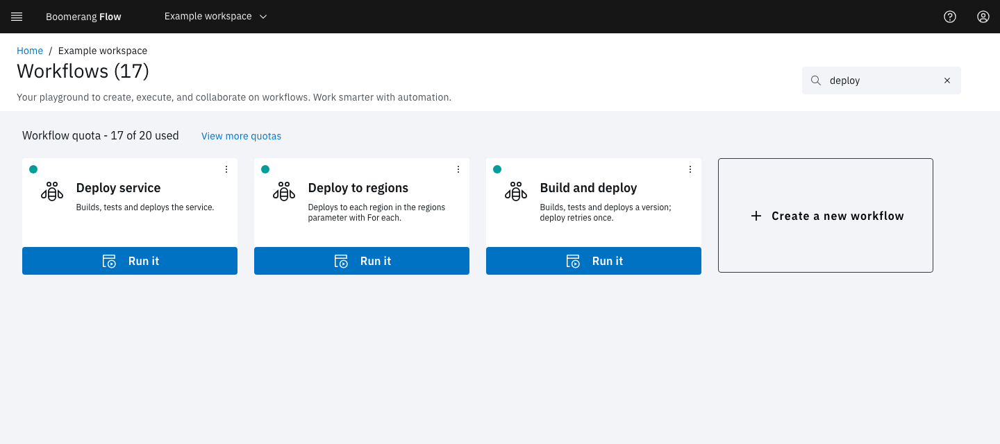
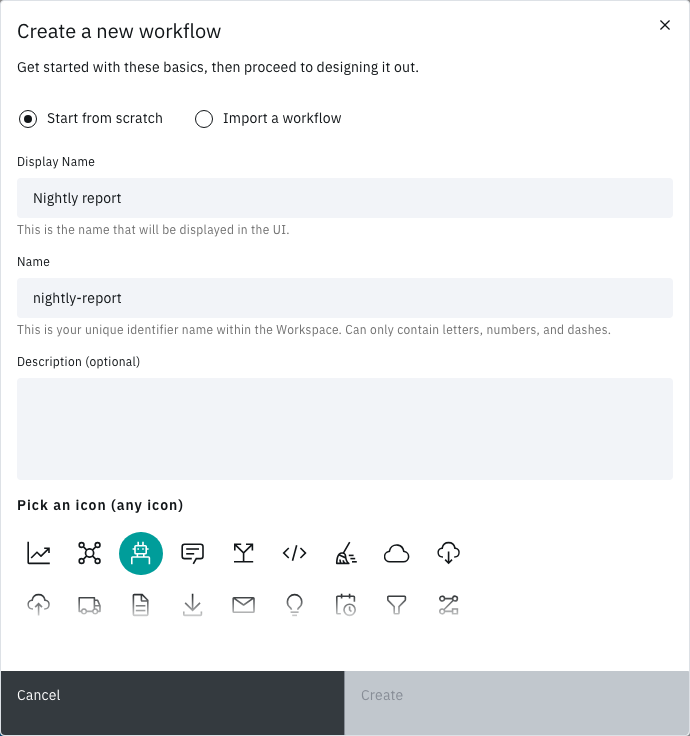

<!-- Written against flow.service.workflow 5.0.0-beta.39. UI labels checked against the live webapp (build 490ba3894, 2026-11-06): 29 of 49 bolded terms seen live; the rest are states the walk didn't reach or aren't labels, and were verified in client-web source. -->

# Create a workflow

Create a workflow in a workspace, then look after it from the **Workflows** page: find it, copy it, move it to another Flow installation and delete it. This guide is for workflow authors.

## Before you start

- You need a workspace and the Editor or Owner role in it. Deleting a workflow needs Owner. See [Manage a workspace](../fundamentals/manage).
- When workspace quotas are on, the **Workflows** page shows **Workflow quota - `<n>` of `<m>` used**. At the limit, the **Create a new workflow** tile is disabled until a workflow is deleted or the quota is raised. See [Quotas](../fundamentals/quotas).

## Open the Workflows page

Select the workspace switcher (the two-arrows icon in the header), then the workspace. Its **Workflows** page opens. If you're already in the workspace, select **Workflows** in the side nav.

The page shows a card for each workflow, then the **Create a new workflow** tile. Each card shows the workflow's icon, display name, description and status, a **Run it** button and an overflow menu. Select a card's name to open the workflow in the [workflow editor](./workflow-editor).

## Create a workflow from scratch

1. On the **Workflows** page, select **Create a new workflow**. The **Create a new workflow** modal opens on **Start from scratch**.
2. In **Display Name**, enter the name people see, for example `Nightly report`. Flow fills **Name** with `nightly-report`.
3. Optional: change **Name**. It's the workflow's identifier: letters, numbers and dashes, up to 100 characters, unique in the workspace. Webhook and event URLs name the workflow by it.
4. Optional: enter a **Description (optional)** of up to 250 characters. It shows on the workflow's card.
5. Under **Pick an icon (any icon)**, select an icon. **Bot** is selected to start with.
6. Select **Create**.

The workflow editor opens on the **Canvas** tab with the message **Workflow successfully created**. The canvas holds only **Start** and **End**. To add tasks, see [Workflow editor](./workflow-editor).

**Create** stays disabled until the form is valid. If **Name** shows "There’s already a workflow with that name in this workspace. Names must be unique.", choose another name.

## Start from a starter

A starter is a ready-made workflow that you copy into a workspace. The copy is an ordinary workflow, yours to change. Starters appear on **Home** under **Start a workflow** when the installation has any.

1. Select **Home** in the side nav.
2. Under **Start a workflow**, select a starter. The **Create Workflow from Template** modal opens.
3. In **Workspace**, choose the workspace. It's preset when you belong to only one.
4. Optional: change **Workflow Name** (up to 64 characters), **Description (optional)** and the icon.
5. Select **Create and View**.

The new workflow opens on the **Canvas** tab with the message **Successfully created workflow from template**. The copy keeps the starter's display name; change it under **Configure › General** (see [Configure a workflow](./configure-workflow#set-the-name-description-and-icon)).

> **Note:** The starters seeded with Flow have known problems. Check [Known issues](../introduction/known-issues) before you rely on one.

## Find a workflow

Type in **Search for a workflow** at the top of the **Workflows** page. The cards narrow to the workflows whose **Name** matches, so search for `nightly-report` rather than `Nightly report`. The search is kept in the page's URL, so you can share the filtered view. When nothing matches, the page shows "No results from that search, try again."

The search box is disabled while the workspace has no workflows.

### Templates on the Workflows page

An administrator can share a workflow with every workspace as a template. A template's card has a **Template** tag and the status **Available** until your workspace first runs it or saves its settings. Its menu offers only **View** and **Export**.

After that first use, the template is your workspace's own workflow: the card shows **Template** and **Read-only**. The tasks and parameters still belong to the template, and **Duplicate** isn't offered. See [Workflows](../fundamentals/workflows) for how templates and starters differ.

## What's on a card's menu

Open a card's overflow menu. Every item is disabled while the card shows **Executing...**, **Duplicating...** or **Deleting...**.

| Item | What it does |
| --- | --- |
| **Edit** | Opens the workflow on the **Canvas** tab. |
| **View Activity** | Opens **Activity**, filtered to this workflow's runs. Shown when Activity is turned on. See [Activity](../fundamentals/activity). |
| **Update** | Replaces the workflow from an exported file, as a new version. See [Update a workflow from a file](#update-a-workflow-from-a-file). |
| **Export** | Downloads the workflow as a JSON file. |
| **Duplicate** | Copies the workflow within the workspace. |
| **Delete** | Deletes the workflow and its run history. |

## Duplicate a workflow

1. On the workflow's card, open the overflow menu and select **Duplicate**.

The card shows **Duplicating...**, then the message **Successfully duplicated workflow**, and the copy appears on the page. The copy's **Name** ends in `-duplicate` and its display name in `(duplicate)`. It keeps the tasks, the parameters (secured values included) and the settings. It doesn't get the original's schedules, tokens or runs.

If the workspace already has a workflow with the copy's name, the copy fails with **Request to duplicate workflow failed**. Rename or delete that workflow, then try again.

## Export a workflow

Export saves a workflow's latest version as a JSON file. Import it into another workspace or Flow installation, or keep it under version control.

1. On the workflow's card, open the overflow menu and select **Export**.

Flow shows **Export starting soon**, then your browser downloads `<name>.json`, for example `nightly-report.json`.

The file doesn't carry secrets. A secured parameter's default, and a task's secret value, read `*****` when one is set. Set them again after you import the file.

## Import a workflow from a file

1. On the **Workflows** page, select **Create a new workflow**.
2. Select **Import a workflow**.
3. Drop the `.json` file on **Choose a file or drag one here**, or select it to browse. The file must be 1 MiB or less and be a workflow export.
4. Check **Name**, **Display Name (optional)** and **Description (optional)**, which Flow fills from the file. **Name** must be unique in the workspace.
5. Select **Create**.

The imported workflow opens on the **Canvas** tab with the message **Workflow successfully imported**. Set its secured values again: see [Use secrets](./use-secrets).

A file Flow can't use shows "Whoops!" and the reason, such as "File is larger than 1MiB" or "File is invalid". Export the workflow again, or choose a different file.

## Update a workflow from a file

**Update** replaces a workflow's tasks, parameters and settings with those in an exported file of the same workflow, for example one you changed in version control. Flow saves the file as a new version, so the earlier versions stay in the **Change Log**.

1. On the workflow's card, open the overflow menu and select **Update**. The **Update workflow** modal opens.
2. Drop the `.json` file on **Choose a file or drag one here**. The file's `name` must match this workflow's **Name**. A good file shows "All set! This workflow is valid, and will fully replace the existing workflow."
3. Select **Update**.

Flow shows the message **workflow successfully updated**. Open the workflow to check the new version.

## Delete a workflow

> **Warning:** Deleting a workflow can't be undone. Flow cancels the workflow's runs in progress and deletes its schedules, tokens and open actions. Once those runs have ended, it removes the workflow with its versions, runs and artifacts. Audit records are kept. Export the workflow first if you might want it back.

1. On the workflow's card, open the overflow menu and select **Delete**.
2. In **Delete workflow**, select **Delete**.

The card shows **Deleting...**, then the workflow leaves the page with the message **Workflow successfully deleted**.

If deletion fails, Flow shows **Request to delete workflow failed**. Check that you have the Owner role in the workspace.

## Next steps

- [Workflow editor](./workflow-editor): add tasks, link them and save a version.
- [Configure a workflow](./configure-workflow): set triggers, run options and the run workspace.
- [Run a workflow](./run): start a run and follow it.
- [Workflows](../fundamentals/workflows): what a workflow is, and how templates and starters work.
