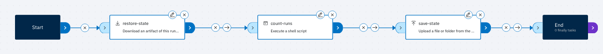
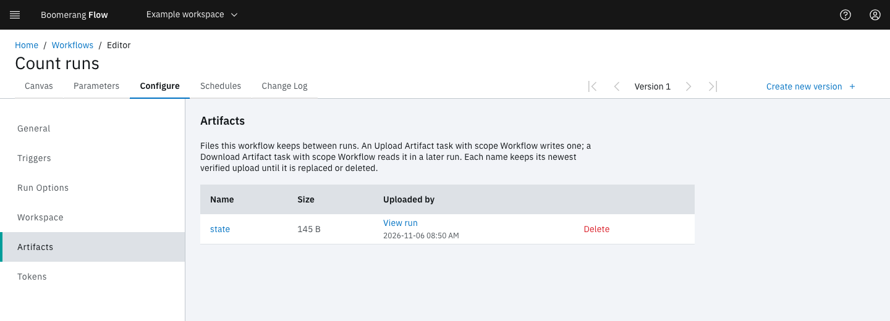

<!-- Written against flow.service.workflow 5.0.0-beta.39. UI labels checked against the live webapp (build 490ba3894, 2026-11-06): 36 of 51 bolded terms seen live; the rest are states the walk didn't reach or aren't labels, and were verified in client-web source. -->

# Keep files between runs

Each run gets its own run workspace, which Flow removes when the run completes. To keep files for the next run, download them as a workflow-scoped artifact at the start of the workflow and upload them again at the end. This guide is for workflow authors.

## Before you start

- **A workflow you can edit.** You need the owner or editor role in its workspace.
- **An artifact store.** Your operator connects one; without it, artifact tasks fail with `ARTIFACTS_NOT_CONFIGURED`. See [Configuring](../hosting/configuring#connect-the-artifact-store).
- **Room in the workspace's artifact storage quota.** Kept artifacts count toward it until they're replaced or deleted. See [Artifacts and the run workspace](../fundamentals/artifacts).

## How it works

A workflow-scoped artifact belongs to the workflow, not to one run. Any later run of the workflow can download it by name, it never expires, and a later upload of the same name replaces it.

The pattern has three parts:

1. A **Download Artifact** task at the start, with scope `workflow` and **Optional** on, restores the files. On the first run there's nothing to restore, and **Optional** lets the task succeed anyway.
2. Your tasks read and change the files in the run workspace.
3. An **Upload Artifact** task at the end, with scope `workflow`, saves them for the next run.

Both artifact tasks use the same **Artifact name** and the same path.

## Count the runs of a workflow

This example keeps a counter in `/workspace/state/count` and adds one on every run.

### Turn on the run workspace

1. In the editor, open the **Configure** tab and select **Workspace**.
2. Turn on **Shared workspace for each run**.
3. Set **Size** to `1`.
4. Leave **Mount path** blank, so tasks see the run workspace at `/workspace`.

The artifact tasks read a relative path from `/workspace`. If you change **Mount path**, give them absolute paths under it instead.

### Add the tasks

1. Open the **Canvas** tab. From the **Artifacts** category, drag **Download Artifact** onto the canvas and select its edit icon.
2. Fill in **Edit Download Artifact**, then select **Apply**:

   | Field | Value |
   | --- | --- |
   | **Task name** | `restore-state` |
   | **Artifact name** | `state` |
   | **Destination path** | `state` |
   | **Scope** | `workflow` |
   | **Optional** | On |

   Leave the read-only fields, such as **Download link**, empty: Flow fills them in when the task runs.

3. From the **Utilities** category, drag **Execute Shell** onto the canvas and select its edit icon.
4. In **Task name**, enter `count-runs`.
5. Select **Shell Script**, enter the script below, and select **Update**:

   ```sh
   mkdir -p /workspace/state
   count=$(cat /workspace/state/count 2>/dev/null || echo 0)
   count=$((count + 1))
   echo "$count" > /workspace/state/count
   echo "This workflow has run $count times"
   ```

6. Select **Apply**.
7. From the **Artifacts** category, drag **Upload Artifact** onto the canvas and select its edit icon.
8. Fill in **Edit Upload Artifact**, then select **Apply**:

   | Field | Value |
   | --- | --- |
   | **Task name** | `save-state` |
   | **Artifact name** | `state` |
   | **Path** | `state` |
   | **Scope** | `workflow` |

   Leave **Retention days** blank: a workflow-scoped upload can't set it.

9. Link the tasks in order: **Start**, `restore-state`, `count-runs`, `save-state`, **End**.
10. [Save a version](./workflow-editor#save-a-version).



### Run it twice

1. On the **Workflows** page, select **Run it**, then **Run and View**.

   On this first run, `restore-state` finds no artifact and succeeds without downloading anything. Its `found` result is `false`.

2. When the run ends, run the workflow again the same way.
3. On the second run's page, select **View Log** on `count-runs`.

The log reads `This workflow has run 2 times`, and the run's status is **Succeeded**.

`state` is a folder, so **Upload Artifact** sends its contents as one `.tar.gz`, and **Download Artifact** unpacks them into the destination folder. A single file works the same way: give both tasks the file's path.

## Find kept artifacts

| Where | What it shows |
| --- | --- |
| **Configure › Artifacts** in the editor | This workflow's kept artifacts: **Name** (select it to download), **Size**, and **Uploaded by** with a **View run** link |
| **Manage workspace › Artifacts** | Every artifact in the workspace. Set **Scope** to **Workflow** to see only kept ones, which read **Kept until replaced** under **Expires** |
| The run page's **Artifacts** tab | The artifacts that run uploaded, each with **Scope** **Workflow** or **Run** |



To start again from nothing, delete the artifact: on its row in **Configure › Artifacts**, select **Delete**, then **Delete** in **Are you sure?**. The next run's **Download Artifact** task finds nothing, and with **Optional** on it succeeds. This can't be undone.

## Avoid lost updates

Two runs in flight at once both download the same artifact, and the upload that completes last wins: the other run's changes are lost. To keep updates in order, open **Configure › Run Options**, set **Concurrency limit** to `1`, and leave **Over the limit** on **Queue until a run ends**.

## Limits and failures

- **One upload per name per run.** A second upload of the same name in one run fails with `ARTIFACT_ALREADY_EXISTS`.
- **Names** start with a letter or digit, then letters, digits, `.`, `_` or `-`, up to 128 characters.
- **Size.** **Admin › Settings › Artifacts › Largest Artifact (MB)** caps one file, 1024 MB by default. An upload over it, or over the workspace's artifact storage, fails its task with `ArtifactRefused`. Flow never deletes another artifact to make room.
- **Without Optional,** a download of an artifact that doesn't exist fails the task with `ArtifactRefused`.
- **Retries don't carry files.** A retried run starts with an empty run workspace, so a re-run task can't see files a carried-over task wrote. Kept artifacts still download. See [Retry a run](./retry-a-run).
- **Workflow storage** from Flow v3 is gone. A v3 workflow that used it shows **Workflow storage was removed in Flow 5** under **Configure › Workspace** and can't run until you save a new version; use this pattern instead.

## Not seeing what you expected?

- [Why did **Download Artifact** succeed but restore nothing?](../introduction/troubleshooting#a-task-succeeded-but-did-nothing)
- [Why is the next run **Waiting** instead of running?](../introduction/troubleshooting#a-run-didnt-start)

## Next steps

- [Artifacts and the run workspace](../fundamentals/artifacts): scopes, retention and stored logs.
- [Configure a workflow](./configure-workflow): the run workspace, run options and kept artifacts.
- [Retry a run](./retry-a-run): what a retry keeps and what it doesn't.
