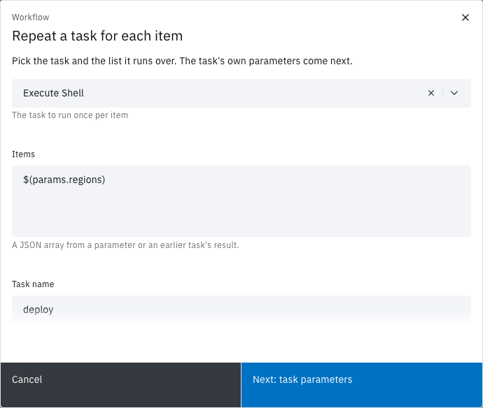
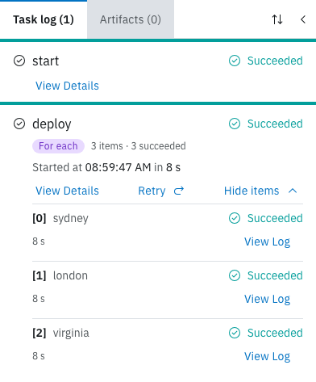

<!-- Written against flow.service.workflow 5.0.0-beta.39. UI labels checked against the live webapp (build 490ba3894, 2026-11-06): 44 of 53 bolded terms seen live; the rest are states the walk didn't reach or aren't labels, and were verified in client-web source. -->

# Repeat a task for each item

A for-each task runs one task once for every item in a list, in parallel, inside the same run. Use it to deploy to several regions, process each file in a batch, or call a service once per record. This guide is for workflow authors.

## Before you start

- **A workflow you can edit.** You need the owner or editor role in its workspace. See [Create a workflow](./create).
- **The list, as a JSON array.** Type it in, keep it in a parameter, or take it from an earlier task's result.

## How for-each works

The task stays one node on the canvas. When the run reaches it, Flow resolves its items to an array and creates one task run per item, named `<task name>[<index>]` with the index counted from 0. Items run in parallel, as fast as dispatchers claim them, and share the run workspace.

Inside each item, `$(params.item)` is the current item and `$(params.index)` its position. The task succeeds when every item succeeds.

Only tasks that run as a container can repeat: catalogue and workspace tasks, **Execute Shell**, **Run Python Script**, **Run Custom Task**, the AI tasks, **Upload Artifact** and **Download Artifact**. Switches, approvals, waits, locks and **Run Workflow** can't.

## Add a for-each task

This example deploys to three regions. The region list is a workflow parameter, so each run can change it.

1. In the editor, open the **Parameters** tab and select **Add parameter**.
2. Enter the **Name** `regions`, leave **Type** as **Text**, and enter the **Default value (optional)** `["sydney","london","virginia"]`.
3. Select **Add**.
4. Open the **Canvas** tab. In **Add a task**, the **Workflow** category is open: drag **For each** onto the canvas.

   **Repeat a task for each item** opens.

5. In **Task**, choose **Execute Shell**.
6. In **Items**, enter `$(params.regions)`.
7. In **Task name**, enter `deploy`. Flow fills in the task's display name until you type your own.
8. Select **Next: task parameters**.

   The task's own form, **Edit Execute Shell**, opens.

9. Select the **Shell Script** field. In **Update Shell Script**, enter:

   ```sh
   echo "Deploying item $(params.index) to $(params.item)"
   ```

10. Select **Update**, then **Apply**.

    The node shows a purple **For each** badge and is drawn as a stack of cards.

11. Drag a link from **Start** to `deploy`, and from `deploy` to **End**.
12. [Save a version](./workflow-editor#save-a-version).
13. On the **Workflows** page, select **Run it** on the workflow's card, then **Run and View**.

The run page opens. When the run ends, the `deploy` node's badge reads **For each · 3 of 3 succeeded** and the run's status is **Succeeded**.



To turn for-each on for a task that's already on the canvas, open its form, select the **Configure** tab and turn on **Run for each item**, then enter the **Items**. The tab shows a purple **For each** tag while it's on. Turning it off makes the task an ordinary one again.

## Where the items come from

**Items** takes a JSON array, or a single reference whose value is an array or text holding one.

| Items | Example | Checked |
| --- | --- | --- |
| A JSON array | `["sydney","london","virginia"]` | When you save the version |
| A parameter | `$(params.regions)` | When the run reaches the task |
| An earlier task's result | `$(tasks.list-regions.results.regions)` | When the run reaches the task |

Anything else shows **Enter a JSON array or a single reference such as $(params.items)**, and **Next: task parameters** and **Apply** stay disabled.

An item can be text, a number, an object or an array. An object or array reaches the task as JSON text, and `$(params.index)` is always text. A container reads the same values as the environment variables `PARAM_ITEM` and `PARAM_INDEX`.

Two names are reserved:
- A task that declares its own `item` or `index` parameter can't run for each item. Saving refuses it.
- A task name can't end in `[` and a number `]`, such as `deploy[2]`, because item names take that form. The form shows **Task names cannot end in [ and a number ]; that form is reserved for for-each items**. Other brackets, such as `Deploy [prod]`, are allowed.

## Follow the items on the run page

The run page groups every item under its task:

- **On the canvas,** the badge reads **For each** before the task fans out, then **For each · `<succeeded>` of `<total>` succeeded**. It reads **For each · 0 items** when the array was empty.
- **In the task log,** the task's entry carries a purple **For each** tag and a summary such as `3 items · 3 succeeded`, adding `· 1 running` or `· 1 failed` while either isn't zero. The task itself runs nothing, so it has no **View Log**.
- **Select Show items** to list one row per item: its index, such as `[0]`, the item, its status, the failure reason, its duration, the attempt from the second one on, and its own **View Log**.
- **Select View Details** on the task to read the outcome: **Message** reads `All 3 items succeeded.` or, for example, `1 of 3 items did not succeed.`



## Use the results

After the task, `$(tasks.<name>.results.<result>)` is an array in item order, with `null` for an item that didn't succeed. For example, if `deploy` declared a result `url` and the second item failed, a later task reading `$(tasks.deploy.results.url)` gets:

```json
["https://sydney.example.com", null, "https://virginia.example.com"]
```

A task that declares no results collects each result its items produced into such an array. An empty array of items succeeds at once, with empty arrays as its results.

Each item's results are capped like any task's: 4096 bytes on Flow's Kubernetes dispatcher. If the combined arrays pass MongoDB's 16 MB document limit, the task fails with `ResultsTooLarge` and keeps no results.

## When an item fails

Any item that doesn't succeed fails the whole task, with the reason `ItemFailed`. The other items still finish.

- **To carry on to the next task anyway,** set the link after the for-each task to always: select the link's condition icon until it shows always.
- **To retry a failing item,** set **Retries** on the task's **Configure** tab. Each item retries on its own budget. See [Retry a run](./retry-a-run).
- **An item that times out** times out the whole run, which cancels the remaining items. Cancelling the run cancels every item.
- **Retrying the run** re-runs the for-each task whole, every item included.

## Limits

- **Maximum items.** **Admin › Settings › Run limits › Maximum For-Each Items** caps the items, 256 by default. Saving refuses a typed array over the cap. Items that resolve over the cap at run time fail the task with `ForeachTooManyItems`, and no item runs.
- **Not an array.** Items that don't resolve to an array fail the task with `ForeachItemsInvalid`.
- **Not built.** There's no batching, failure tolerance, parallel limit, re-run of only the failed items, or repeating a group of several tasks. To repeat several tasks, put them in their own workflow. The API accepts for-each on a **Run Workflow** task, which starts one child run per item, but the canvas doesn't offer it.

**Insights** counts a for-each task's items under the task's name, and its **Task runs** panel can group by **For-each item**. See [Insights](../fundamentals/insights).

## Next steps

- [Workflow editor](./workflow-editor): links, conditions and the task form.
- [Parameters](../fundamentals/parameters): how `$(params.x)` and `$(tasks.t.results.r)` resolve.
- [Runs](../fundamentals/runs): statuses, timeouts and attempts.
- [Retry a run](./retry-a-run): run a failed for-each task again.
