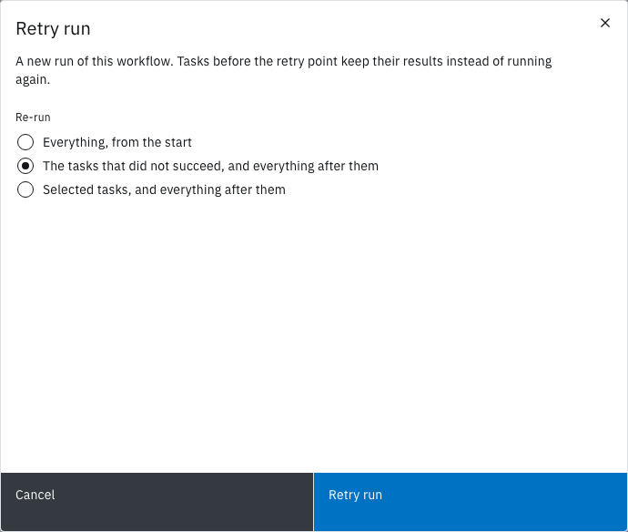
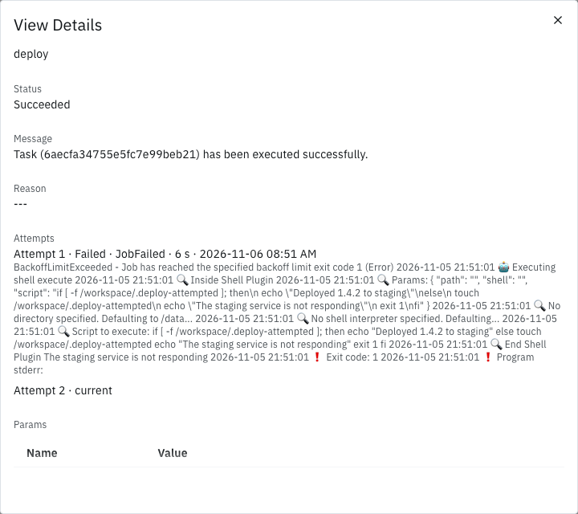

<!-- Written against flow.service.workflow 5.0.0-beta.39. UI labels checked against the live webapp (build 490ba3894, 2026-11-06): 32 of 37 bolded terms seen live; the rest are states the walk didn't reach or aren't labels, and were verified in client-web source. -->

# Retry a run

A retry starts a new run of the same workflow version. Tasks before the retry point keep their results instead of running again, so a run that failed at its last step doesn't repeat the work before it. A task can also retry its own failures before the run gives up. This guide is for workflow authors.

## Before you start

- **The owner or editor role** in the workspace. A reader can't retry a run.
- **A finished run** to retry from the header, or a finished task to retry from. See [Run a workflow](./run).

## Choose what to re-run

| Option in **Re-run** | What runs again | Use it when |
| --- | --- | --- |
| **Everything, from the start** | Every task | The failure came from something every task depends on |
| **The tasks that did not succeed, and everything after them** | Each task that failed, timed out, was cancelled or is invalid, and every task after it | A task failed for a passing reason, such as a service that was down |
| **Selected tasks, and everything after them** | The tasks you choose in **Tasks to retry from**, and every task after them | You want to repeat part of a run that succeeded, such as its deploy |

Tasks that don't re-run are carried over with their results, and a later task reads those results as usual. A skipped task is planned again, so its condition decides afresh. A for-each task re-runs whole, every item included.

## Retry the tasks that failed

In this example, `build` and `test` succeeded and `deploy` failed because the target service was down.

1. Open the failed run's page, from **Activity** or the workflow card's **View Activity**.
2. Select **Retry run**.

   **Retry run** opens: "A new run of this workflow. Tasks before the retry point keep their results instead of running again."

3. Under **Re-run**, choose **The tasks that did not succeed, and everything after them**.
4. Select **Retry run**.

The message **Retry started**, "Back for another go. You’re on the new run.", appears and the page moves to the new run. Its **Initiated by** shows the origin run's ID followed by `from the tasks that did not succeed`, and its **Trigger** reads `retry`. In the task log, `build` and `test` carry a gray **Reused** tag, and `deploy` runs again. When `deploy` succeeds, the run's status is **Succeeded**.

**Retry run** shows on a run that ended **Succeeded**, **Failed**, **Timed Out**, **Cancelled** or **Invalid**. On a run where every task succeeded or was skipped, the failed-tasks option is disabled.

## Retry from one task

Each finished task in the run's task log has a **Retry** button.

1. In the task log, select **Retry** on the task to start from.

   **Retry run** opens with **Selected tasks, and everything after them** chosen and the task in **Tasks to retry from**. It reads: "Starting from `<task>`: the tasks before it keep their results, and it and everything after it run again."

2. Optional: add more tasks in **Tasks to retry from**.
3. Select **Retry run**.

The page moves to the new run, whose **Initiated by** ends with `from task <name>`.

**Retry** shows on a task that Succeeded, Failed, Timed Out, was Cancelled or is Invalid, and works on a run that's still going. Retrying an active run cancels it once the new run starts, so one line of retries never has two live runs; the modal warns **This run is still active.**

## Know what a retry keeps

- **The same workflow version.** A retry never picks up a newer version. To run your fix, start a new run with **Run it** instead.
- **The same parameter values.** The modal doesn't change them; through the API, the retry request can.
- **No files from the run workspace.** The new run starts with an empty run workspace, so a re-run task can't read files a carried-over task wrote. When that applies, the modal warns **Workspace files are not carried over.** Pass such files as artifacts, or re-run everything. See [Keep files between runs](./keep-files-between-runs).
- **Quotas.** A retry counts as a new run against the workspace's run quotas, and is refused with `QUOTA_EXCEEDED` when they're full.

The origin run doesn't change. Flow keeps it while a retry of it exists.

Flow refuses a retry with `WORKFLOWRUN_RETRY_INVALID`, naming the cause, when the version no longer exists, when a chosen task sits between an **Acquire Lock** and its **Release Lock**, or when a task name is unknown.

## Retry a run that times out

**Configure › Run Options › Retries** sets how many times Flow retries the whole run on its own. Despite the field's helper text, Flow uses it only when the run times out: it then starts a retry of everything at once. Blank or `0` means no automatic retry. If the workspace's quota refuses the retry, the timed-out run stays as it is.

## Let a task retry its own failures

A task can retry a failure before the run moves on. On the task's **Configure** tab, under **Retry**:

1. In **Retries**, enter the attempts after the first, from 0 to 10.
2. In **Backoff**, choose **Exponential** to double the wait each time, or **Fixed** to keep it the same.
3. In **Initial wait (seconds)**, enter the first wait. Blank means 10 seconds.
4. In **Maximum wait (seconds)**, enter the longest wait. Blank means 300 seconds. It's disabled for **Fixed**.
5. Select **Apply**, and [save a version](./workflow-editor#save-a-version).

For example, **Retries** `3`, **Exponential**, **Initial wait** `10` and **Maximum wait** `60` give a task four attempts in all:

| Attempt | Starts after the previous one fails, plus up to 5 seconds |
| --- | --- |
| 2 | 10 seconds |
| 3 | 20 seconds |
| 4 | 40 seconds |

With **Fixed**, each wait is 10 seconds. Flow adds up to 5 seconds of random jitter to every wait.

The **Configure** tab exists on tasks that run as a container: catalogue and workspace tasks, script tasks, **Run Custom Task**, the AI tasks and the artifact tasks. Under for-each, each item retries on its own budget.

A task's retries never repeat a failure a retry can't change:

| Reason | Why |
| --- | --- |
| `ImageNotAllowed`, `AdmissionDenied` | The cluster or dispatcher refused the task |
| `ResultsTooLarge` | The task's results are over the limit |
| `ParamUnresolved`, `SpecFillFailed`, `DispatchPrepareFailed` | A reference or the task's set-up is wrong |
| `ArtifactNotFound`, `ArtifactRefused` | The artifact is missing or over a limit |

Separately from **Retries**, Flow requeues a container task up to 3 times when an attempt never starts or goes unreported: the cluster has no capacity to start it, its dispatcher stops or loses its lease, or it passes its deadline with no word from the dispatcher.

## Read the attempts

A task that ran more than once shows it on the run page:

- **In the task log,** its time line ends with the attempt, such as `Started at 04:25:37 PM in 6 secs, attempt 2`. For-each items show the same on their own rows under **Show items**.
- **In View Details,** **Attempts** lists one line per earlier attempt, such as `Attempt 1 · failed · JobFailed · 6 secs · <ended at>`, then `Attempt 2 · current`.

## Next steps

- [Runs](../fundamentals/runs): statuses, timeouts and how a run ends.
- [Workflow editor](./workflow-editor): the task form's **Configure** tab.
- [Repeat a task for each item](./repeat-a-task-for-each-item): how for-each items retry.
- [Activity](../fundamentals/activity): find the run to retry.
