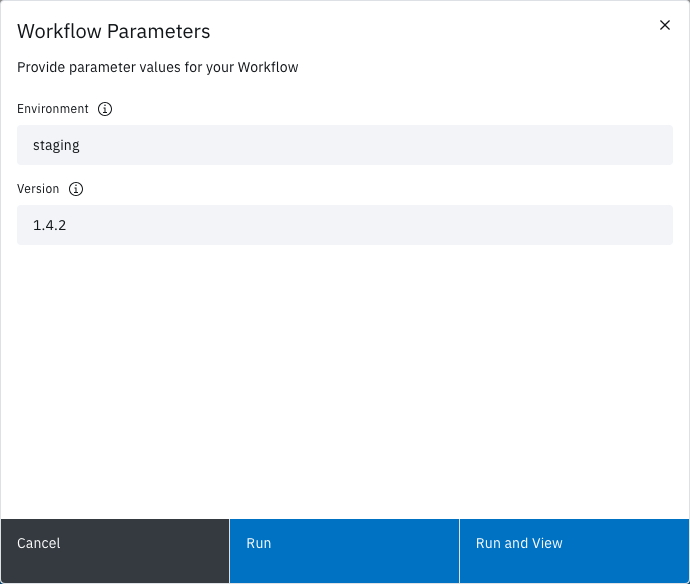

<!-- Written against flow.service.workflow 5.0.0-beta.39. UI labels checked against the live webapp (build 490ba3894, 2026-11-06): 22 of 29 bolded terms seen live; the rest are states the walk didn't reach or aren't labels, and were verified in client-web source. -->

# Run a workflow

Start a run from the workflow's card on the **Workflows** page, then follow it on the run page. Flow runs the workflow's latest saved version. This guide is for workflow authors.

## Before you start

- Save your changes as a version. The editor has no run button, and **Run it** runs the latest version. See [Save a version](./workflow-editor#save-a-version).
- The Editor or Owner role in the workspace. The Reader role can't start a run. See [Manage a workspace](../webapp/manage).
- The workflow's **Manual** trigger on. It's on for a new workflow. See [Choose what starts a run](./configure-workflow#choose-what-starts-a-run).

## Start a run

1. On the **Workflows** page, select **Run it** on the workflow's card.
2. If the workflow has parameters, **Workflow Parameters** opens: fill in the fields. Otherwise **Execute workflow** opens with no fields.
3. Select **Run** to stay on the **Workflows** page, or **Run and View** to open the run.

The buttons show **Running...** while Flow starts the run, then the message **Successfully started workflow execution** appears. With **Run and View**, the run page opens and shows each task's status as the run goes. With **Run**, the modal closes and you stay on the **Workflows** page.

## Give parameter values

**Workflow Parameters** shows one field for each of the workflow's parameters that isn't read-only. Each field takes its parameter's label (or its name, with no label) and starts with its default value. **Run** and **Run and View** stay disabled until every required field is filled in.

- A field's type follows the parameter: a toggle for **Boolean**, a list for **Select**, a text box for **Text**, and so on.
- A field can hold a reference instead of a value, such as `$(workspace.params.deploy-key)`.
- A secured (**Password**) parameter with a stored default starts empty, with the helper "Leave blank to use the stored default." Leave it blank to use the stored value, or type a reference to a stored secret. See [Use secrets](./use-secrets).

The values apply to this run only. To change a default, edit the parameter on the editor's **Parameters** tab.

For example, a workflow with a required Select parameter `environment` and a Text parameter `version` with the default `latest`: choose `production`, leave `version` as it is, and select **Run and View**. Tasks read the values as `$(params.environment)` and `$(params.version)`.

## Follow the run

**Run and View** opens the run page, under **Activity**. It shows the workflow's canvas with each task's status, and a log for each task. From the run page you can pause, resume, cancel and retry the run.

To find a run later, select **View Activity** on the workflow card's overflow menu, or **Activity** in the side nav.

- [Runs](../fundamentals/runs): statuses, pausing, cancelling and timeouts.
- [Activity](../webapp/activity): find and filter runs.
- [Retry a run](./retry-a-run): run a failed run again.

## Why is Run it disabled?

The status icon on the card says why. Hover over it to read its tooltip.

| What you see | Why | What to do |
| --- | --- | --- |
| **Trigger disabled** | The workflow's **Manual** trigger is off. | In the editor, select **Configure › Triggers**, turn on **Enable** under **Manual**, then select **Create new version**. |
| "This workspace has reached the maximum number of runs (executions) allowed this month…" | The workspace's monthly run quota is used up. | Wait until it resets, or ask a workspace owner or administrator to raise it. **View more quotas** on the **Workflows** page shows the reset date. |
| "This workspace has reached the maximum number of concurrent runs (executions) allowed…" | The workspace's concurrent runs quota is reached. | Wait for a run in the workspace to end. |
| **Deleting...** on the card | The workflow is being deleted. | None: it leaves the page when deletion finishes. |

The quota checks apply only when your administrator has turned workspace quotas on. See [Quotas](../webapp/quotas).

A workflow's own **Concurrency limit** doesn't disable **Run it**: a run over the limit waits or is skipped, as **Over the limit** says. See [Set the timeout, retries and concurrency](./configure-workflow#set-the-timeout-retries-and-concurrency).

## When a run won't start

If Flow refuses the run, the modal stays open and shows why:

- **Quota Exceeded**, with the server's message: a workspace quota refused the run. Check **View more quotas**.
- Any other refusal shows the server's title and message, or **Run Workflow Failed** when the server gives none.

Fix the cause, then select **Run** or **Run and View** again, or **Cancel** to close the modal.

## Run a template

A template card with the status **Available** runs the same way: select **Run it**. The first run makes the template your workspace's own workflow. The run, its quotas and its audit records belong to your workspace. The run asks only for the parameters the template declares.

## Other ways to start a run

- **On a schedule:** turn on the **Scheduler** trigger and add schedules. See [Schedules](../webapp/schedules).
- **From another system:** a webhook, a CloudEvent or a GitHub event. See [Triggers](../fundamentals/triggers).
- **From another workflow:** the **Run Workflow** task.
- **From a script:** the REST API. See the [API reference](../apis/overview).

## Next steps

- [Runs](../fundamentals/runs): what happens during a run.
- [Retry a run](./retry-a-run).
- [Configure a workflow](./configure-workflow): timeout, retries and concurrency.
