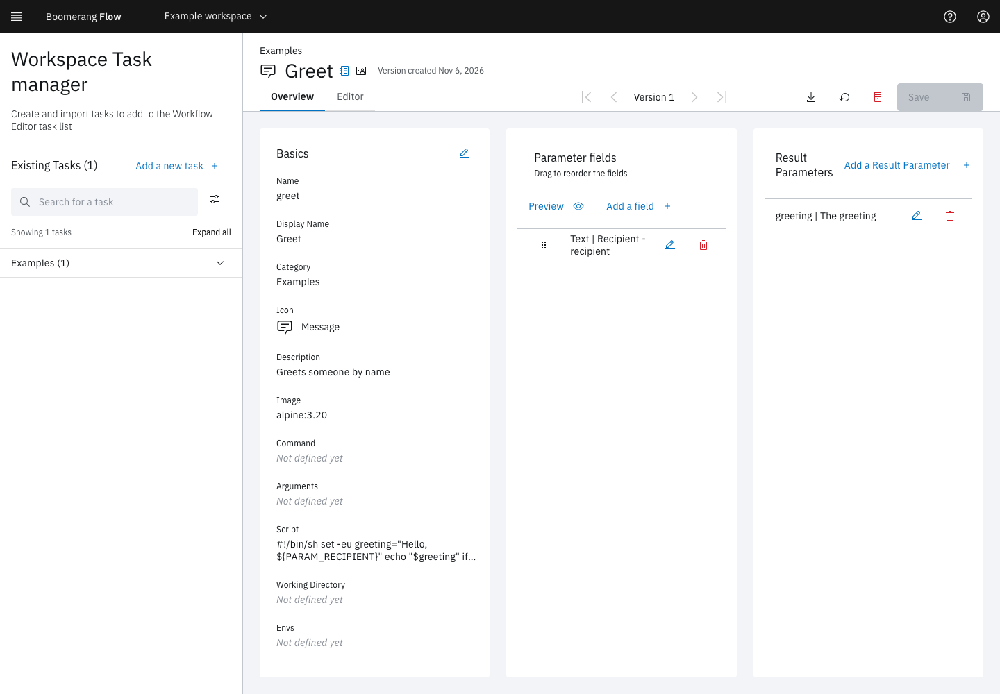

<!-- Written against flow.service.workflow 5.0.0-beta.39. UI labels checked against the live webapp (build 490ba3894, 2026-11-06): 50 of 55 bolded terms seen live; the rest are states the walk didn't reach or aren't labels, and were verified in client-web source. -->

# Develop a task

A task is a container that Flow runs once for each task run. This guide covers what the container receives, how it returns results, the size caps it works within, and how to add it to a workspace in **Task Manager**. It's for task developers.

## Before you start

- **An image the cluster can pull,** either your own or a public base image that runs a script.
- **Task Manager** in the side nav. It shows while **Admin › Settings › Features › Workspace Tasks** is on, which is the default.
- **The owner or editor role** in the workspace.

## How Flow runs a task

Flow resolves a task's parameters when the run reaches it, then a dispatcher claims the task and runs one container. Flow's Kubernetes dispatcher runs it as a Tekton TaskRun with the default `tekton` executor, or as a Kubernetes Job with the `kube-jobs` executor. Your operator picks the executor, so write tasks that work on both.

A task defines its container with these fields:

| Field | What it does |
| --- | --- |
| **Image** | The image to run. Blank uses **Admin › Settings › Tasks › Default Image Path**, `boomerangio/task-flow:3.3.0` by default. |
| **Command** | Replaces the image's entrypoint, one element per line. |
| **Arguments** | The arguments, one per line. |
| **Script** | A script that runs instead of the command. Start it with a shebang, such as `#!/bin/sh`: the Jobs executor runs it as a file. |
| **Working Directory** | The directory the container starts in. |
| **Environments** | Extra environment variables, each a name and a value. |

The container exits 0 to succeed, and any other exit code fails the task. Everything it writes to standard output and standard error is the task's log, under **View Log** on the run page.

When the workflow turns on its run workspace, the container sees it at the workflow's mount path, `/workspace` by default. Every task also gets `/data`, a scratch directory of its own.

## What the container receives

Flow fills in every reference before the dispatcher runs the task, then sets these environment variables:

| Variable | Value |
| --- | --- |
| `PARAM_<NAME>` | One per parameter, with the name folded as described below |
| `PARAM_NAMES` | The parameters' original names, comma-separated |
| `RESULTS_PATH` | Where to write results: `/tekton/results`, a directory, on Tekton; `/dev/termination-log`, a file, on Jobs |
| `RESULTS_MAX_BYTES` | The most bytes all results together may take: 4096 by default |
| `DEBUG` | The run's debug flag |
| `CI` | `true` |
| `FLOW_VERSION` | The dispatcher's `flow.version` property |
| `TRACEPARENT` | The task's W3C trace context, so spans the task exports join its run's trace |
| `HTTP_PROXY`, `HTTPS_PROXY`, `NO_PROXY` | The proxy, in upper and lower case, when the operator turns one on |
| The task's **Environments** | As declared |

There's no parameters file and no JSON variable holding every parameter. Pass large inputs on the run workspace, with a parameter carrying the path.

### How parameter names and values arrive

Flow upper-cases each name and replaces any character outside `A-Z`, `0-9` and `_` with `_`:

| Parameter | Variable |
| --- | --- |
| `recipient` | `PARAM_RECIPIENT` |
| `api-url` | `PARAM_API_URL` |
| `privateKey` | `PARAM_PRIVATEKEY` |

`PARAM_NAMES` maps a variable back to its exact name, such as `privateKey`. Names start with a letter or underscore and hold letters, digits, `-` and `_`; `names` is reserved. Saving refuses two names that fold to the same variable, such as `my-key` and `MY_KEY`, with `PARAM_NAME_COLLISION`.

A text value arrives as it is and an empty one as an empty string. Numbers, booleans, arrays and objects arrive as JSON. Under for-each, each item also receives `PARAM_ITEM` and `PARAM_INDEX`: see [Repeat a task for each item](./repeat-a-task-for-each-item).

A secret arrives as a plain `PARAM_<NAME>` like any other value, visible to anyone who can read the pod. See [Use secrets](./use-secrets).

### Reference parameters in the script, command, arguments and environment

Flow substitutes references in the task's **Script**, **Command**, **Arguments** and **Environments** when a dispatcher claims the task:

- `$(params.x)` reads the task's own parameter `x`;
- `$(workspace.params.x)`, `$(global.params.x)` and `$(context.params.x)` read the other layers;
- `$(tasks.t.results.r)` reads an earlier task's result.

Flow inserts each value byte for byte, quotes, newlines and `$` included, so quote it as your shell needs. In a script, reading the environment variable, as in `"$PARAM_RECIPIENT"`, keeps the shell's quoting in your hands. Shell syntax such as `$(date)` isn't a Flow reference and stays as written.

Only these four fields read the task's own parameters. A parameter's value never reads another parameter of the same task: `$(params.y)` in a parameter's value names the workflow's `y`.

Flow checks every reference before the task runs. An unknown one fails the task with the reason `ParamUnresolved` and a message such as `Task 'deploy': script references $(params.registryTokn): no such param 'registryTokn'`.

## Return results

1. Declare each result on the task, under **Result Parameters** in **Task Manager**. Tekton collects only declared results, and on Jobs Flow keeps only the declared names.
2. Write the results to `RESULTS_PATH`:
   - when it's a directory (Tekton), one file per result, named after the result;
   - when it's a file (Jobs), one JSON object of result names and values.

<!-- tabs -->

### Shell

This snippet works on both executors:

```sh
if [ -d "$RESULTS_PATH" ]; then
  printf '%s' "$greeting" > "$RESULTS_PATH/greeting"
else
  printf '{"greeting":"%s"}' "$greeting" > "$RESULTS_PATH"
fi
```

The JSON branch doesn't escape quotes or backslashes in the value: build the object with a JSON tool when a value can hold them.

### Node

In a Node task, `@boomerang-io/task-core` 3.0.0 or later reads `PARAM_NAMES` and writes to either kind of `RESULTS_PATH`:

```js
import { params, results } from "@boomerang-io/task-core";

const { recipient } = params;
await results({ greeting: `Hello, ${recipient}` });
```

<!-- /tabs -->

A later task reads a result as `$(tasks.<task name>.results.<result>)`.

## Stay within the size caps

| Cap | Limit | Over it |
| --- | --- | --- |
| All results together | `RESULTS_MAX_BYTES`, 4096 bytes by default. An operator can raise it on Tekton to match the cluster. | The task fails with the reason `ResultsTooLarge`. Nothing is cut short, and a task retry doesn't repeat it. |
| All parameters together, resolved | 16384 bytes, set by `flow.engine.task.params.max-bytes` | The task ends `invalid` before it runs: `PARAMS_TOO_LARGE - resolved params total <n> bytes, exceeding the 16384 byte cap. Pass large values by reference (workspace path or URI).` |

To move more data, write it to the run workspace and pass the path, or upload it with an **Upload Artifact** task. See [Keep files between runs](./keep-files-between-runs).

## Add the task in Task Manager

This example adds a `greet` task that greets a recipient and returns the greeting.

1. In the side nav, select **Task Manager**.
2. Select **Add a new task**. **Add a new task** opens with **Start from scratch** chosen.
3. Fill in the basics:

   | Field | Value |
   | --- | --- |
   | **Name** | `greet` |
   | **Display Name** | `Greet` |
   | **Category** | `Examples` |
   | **Icon** | Any icon, such as **Message** |
   | **Description** | `Greets someone by name` |
   | **Image (optional)** | `alpine:3.20` |

4. In **Script (optional)**, enter:

   ```sh
   #!/bin/sh
   set -eu
   greeting="Hello, ${PARAM_RECIPIENT}"
   echo "$greeting"
   if [ -d "$RESULTS_PATH" ]; then
     printf '%s' "$greeting" > "$RESULTS_PATH/greeting"
   else
     printf '{"greeting":"%s"}' "$greeting" > "$RESULTS_PATH"
   fi
   ```

5. Select **Create**.

   The message **Task Template Greet created** appears, and the task's **Overview** tab opens.

6. Under **Parameter fields**, select **Add a field**.
7. In **Create field**, choose the **Type** **Text**, enter the **Name** `recipient` and the **Label** `Recipient`, turn on **Required**, and select **Create**.
8. Under **Result Parameters**, select **Add a Result Parameter**.
9. Enter the **Name** `greeting` and the **Description (optional)** `The greeting`, and select **Create**.
10. Select **Save**.
11. In **Save changes**, select **Overwrite this version**. No workflow uses the task yet, so overwriting is safe.

The message **Task Template Updated** appears. In the workflow editor's palette, the task is listed under **Examples** as `<workspace display name> - Greet`, marked **Workspace Task**.



To try it, drag it onto a canvas, enter a **Recipient** such as `Ada`, link it between **Start** and **End**, save a version and run it. In the task's **View Details** on the run page, the `greeting` result reads `Hello, Ada`.

## Change a task that workflows use

Each **Save** offers two choices in **Save changes**:

- **Save new version** needs **Comments (required for new versions)**. Workflows keep the version they were saved with, and their nodes show a yellow warning icon that offers the update.
- **Overwrite this version** changes the task in every workflow that uses this version. Use it only for changes that break nothing.

To retire a task, select **Archive** instead of deleting it. It leaves the palette, and **Restore** brings it back. A workflow that still uses an archived task can't be saved or run (`TASK_INACTIVE_STATUS`), so move those workflows to another task first.

**Import a template** in **Add a new task** loads a task from a `.yaml` or `.json` file instead of the form, and the **Editor** tab edits a task as YAML.

## Not seeing what you expected?

- [Why did my task fail with `ParamUnresolved`?](../introduction/troubleshooting#a-task-failed-with-paramunresolved)
- [Why does my task stay **Ready**, or fail with `ImagePull`?](../introduction/troubleshooting#a-run-didnt-start)
- [Why does **View Log** show a message instead of my task's log?](../introduction/troubleshooting#live-logs-are-empty)

## Next steps

- [Tasks](../fundamentals/tasks): task types and how tasks run.
- [Task catalogue](../catalogue/overview): every task, its parameters and its results.
- [Parameters](../fundamentals/parameters): the layers a reference reads.
- [Use secrets](./use-secrets): what happens to a secret parameter in the container.
- [Repeat a task for each item](./repeat-a-task-for-each-item): run your task once per item.
