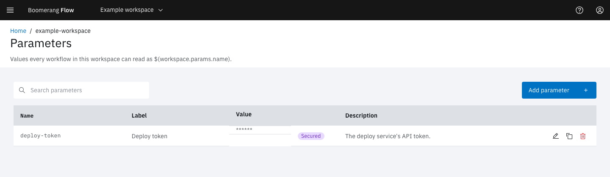

<!-- Written against flow.service.workflow 5.0.0-beta.39. UI labels checked against the live webapp (build 490ba3894, 2026-11-06): 36 of 42 bolded terms seen live; the rest are states the walk didn't reach or aren't labels, and were verified in client-web source. -->

# Use secrets

A secret is a parameter whose value Flow hides in the webapp, in API reads and in task logs, and encrypts where it's stored. This guide covers where to keep a secret, how a task reads it, how to change it, and what Flow can't protect. It's for workflow authors.

## Before you start

- **For a workspace secret,** the owner or editor role in the workspace, with **Admin › Settings › Features › Workspace Parameters** on (the default).
- **For a global secret,** a platform role that can write global parameters, such as admin.

## Choose where to keep a secret

| Where | Create it in | Tasks read it as | Use it when |
| --- | --- | --- | --- |
| A secured workspace parameter | **Parameters** in the side nav | `$(workspace.params.<name>)` | Several workflows in one workspace use the same credential |
| A secured global parameter | **Admin › Parameters** | `$(global.params.<name>)` | Every workspace uses it |
| A workflow parameter of type **Password** | The editor's **Parameters** tab | `$(params.<name>)` | One workflow owns it, or a person supplies it at each run |
| A task field of type **Password** | The task's form | (the task reads its own field) | A task asks for a credential, such as **Github Access Token** |
| A parameter an integration shares | **Integrations** | `$(workspace.params.github-token)`, `$(workspace.params.slack-token)` | GitHub or Slack, which fill the credential when you connect them, or Google or Microsoft, which take it in a form. See [Connect GitHub](./connect-github) and [Integrations](../webapp/integrations) |

Prefer a workspace or global secret over typing a value into a task field. The workflow then holds only a reference, so exporting or duplicating it copies no secret.

## Store a token as a workspace secret

1. In the side nav, select **Parameters**.
2. Select **Add parameter**.
3. In **Name**, enter `deploy-token`. Tasks read it as `$(workspace.params.deploy-token)`.
4. In **Label (optional)**, enter `Deploy token`.
5. Turn on **Secured**. A secured parameter can't be made unsecured later.
6. In **Value**, paste the token.
7. Select **Create**.

The message **Parameter Created** appears. The table lists `deploy-token` with the value `******` and a purple **Secured** tag.



A secured global parameter is the same, from **Admin › Parameters**.

## Use the secret in a task

Reference the secret wherever a task takes text. This example calls a service with the token.

1. In the editor's **Canvas** tab, drag **Execute Shell** onto the canvas and select its edit icon.
2. In **Task name**, enter `call-api`.
3. Select **Shell Script**, enter the script below with your service's URL, and select **Update**:

   ```sh
   curl -fsS -H "Authorization: Bearer $(workspace.params.deploy-token)" https://deploy.example.com/api/health
   ```

4. Select **Apply**, link **Start** to `call-api` and `call-api` to **End**, and [save a version](./workflow-editor#save-a-version).
5. On the **Workflows** page, select **Run it**, then **Run and View**.

The run's status is **Succeeded**. In the task's **View Details**, the `script` parameter reads `******`: once the token was substituted in, the script became a secret too. Wherever the token appears in the task's log, Flow shows `*****`.

The editor keeps showing `$(workspace.params.deploy-token)`, because the workflow stores the reference, never the value. In a **Password** field, a value that is exactly one reference also shows as written.

## Ask for a secret when a run starts

1. In the editor's **Parameters** tab, select **Add parameter**.
2. Enter the **Name** `api-key` and choose the **Type** **Password**.
3. Optional: turn on **Required** so a run must supply it, or enter a **Default value (optional)**. You can enter a reference to a stored secret instead, such as `$(workspace.params.deploy-token)`.
4. Select **Add**, and use `$(params.api-key)` in your tasks.
5. [Save a version](./workflow-editor#save-a-version).

When someone selects **Run it**, **Workflow Parameters** asks for the value in a masked field. If the parameter has a stored default, the field starts empty with **Leave blank to use the stored default.**

Through the API, send a run parameter with `type: secret` to make it a secret. Its value must be a string, or the request fails with `PARAM_SECRET_NOT_STRING`.

## How Flow hides a secret

- **In the webapp,** a set secret shows as `******`. **In the API,** it reads as `*****`, and an unset one reads as nothing.
- **At rest,** Flow encrypts it with the platform's encryption key.
- **Values built from a secret become secrets.** A parameter such as `postgres://app:$(params.db-password)@db` is masked like the password it contains.
- **On a run,** every secret value is masked in the run's parameters, and replaced with `*****` in task logs, results, status messages and manual task instructions.
- **In the audit trail,** a change names the secrets it set or cleared, never their values.
- **Values from outside stay inert.** A webhook body, an event or a GitHub payload is inserted as written and never expanded, so a sender can't pull a stored secret into a task.
- **Child workflows** receive a secret only when the **Run Workflow** node passes it.

## Change or clear a secret

To change a secret in the webapp, select **Edit** on its row. The field shows the placeholder **Set** and **Set. Type a new value to replace it.**

- **To replace it,** type the new value and select **Save**.
- **To clear it,** select **Clear**, then **Save**. Until you save, **Undo clear** puts it back.
- **To keep it,** leave the field alone.

Through the API, every layer that holds a secret reads a write the same way:

| You send | Flow |
| --- | --- |
| `*****`, `null`, or no value | Keeps the stored secret |
| `""` | Clears it |
| Anything else | Replaces it |

On a JSON Merge Patch, such as `PATCH /api/v2/parameters/{name}` for a global parameter, `null` clears the secret instead: send `*****` or leave the member out to keep it. On a run request, `*****` for a secret keeps its declared default.

After you change a workspace or global secret, tasks that start from then on get the new value, within 10 seconds on every Flow instance. Tasks already started keep the value they started with.

## Know what Flow can't protect

> [!WARNING]
> A task's container receives every secret in plain text: as the environment variable `PARAM_<NAME>`, and wherever a reference was substituted into its script, command, arguments or environment. Anyone who can read the task's pod in Kubernetes can read them, and on the Tekton executor they're in the TaskRun object too. Use secrets only with task images you trust, because the image can send the value anywhere.

- **Pod logs aren't scrubbed.** Flow scrubs a log when it serves it. Whatever the task prints is in the pod's own log in Kubernetes as printed.
- **Rotated values reappear in old runs.** Flow scrubs runs using the secrets' current values, so after you rotate a workspace or global secret, older runs show the old value in their logs and results. Revoke the old credential where it was issued.
- **Short secrets** of fewer than 4 characters are hidden by name, but not scrubbed from logs and other text.
- **Arrays and objects** that contain a secret aren't secrets themselves; only the log and result scrub covers them.
- **Results aren't encrypted.** Never write a secret into a task result.
- **Machine tokens never reach a task.** Give a task a credential through a secret parameter.

## Not seeing what you expected?

- [Why did a task fail with `no such workspace param 'deploy-token'`?](../introduction/troubleshooting#a-task-failed-with-paramunresolved)
- [Why did a run use the literal value `*****`?](../introduction/known-issues#a-run-request-that-sends--for-an-ordinary-parameter-uses-)

## Next steps

- [Parameters](../fundamentals/parameters): layers, references and how a value resolves.
- [Connect GitHub](./connect-github): a GitHub token Flow refreshes for you.
- [Develop a task](./tasks): how a task reads `PARAM_<NAME>`.
- [Security](../architecture/security): encryption, tokens and roles inside Flow.
