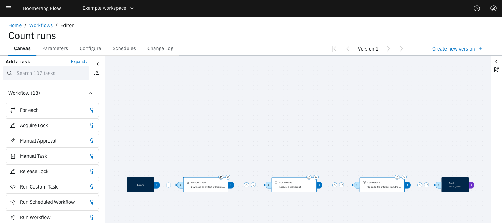
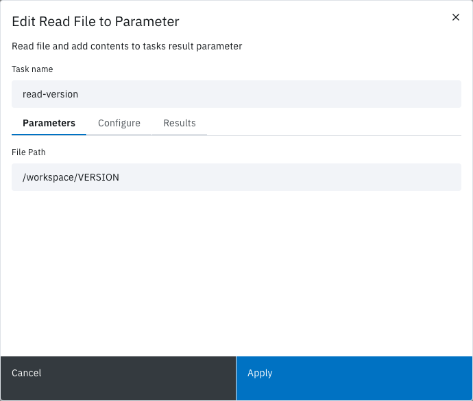

<!-- Written against flow.service.workflow 5.0.0-beta.39. UI labels checked against the live webapp (build 490ba3894, 2026-11-06): 74 of 95 bolded terms seen live; the rest are states the walk didn't reach or aren't labels, and were verified in client-web source. -->

# Workflow editor

The workflow editor is where you build a workflow: place tasks on the canvas, link them in the order they run, give the workflow parameters, and save each change as a version. This guide is for workflow authors.

## Before you start

- A workflow to edit. See [Create a workflow](./create).
- The Editor or Owner role in the workspace, to save a version. See [Manage a workspace](../webapp/manage).
- An idea of the tasks you need. [Tasks](../catalogue/overview) describes the catalogue.

## Open the editor

On the **Workflows** page, select a workflow's name on its card, or select **Edit** from the card's overflow menu. The editor opens on the **Canvas** tab.

| Tab | What it holds |
| --- | --- |
| **Canvas** | The task palette, the canvas and the Notes panel. |
| **Parameters** | The workflow's parameters. See [Add workflow parameters](#add-workflow-parameters). |
| **Configure** | The workflow's name, triggers, run options, run workspace, kept artifacts and tokens. See [Configure a workflow](./configure-workflow). |
| **Schedules** | The workflow's schedules. Shown when schedules are turned on. See [Schedules](../webapp/schedules). |
| **Change Log** | Every saved version, who saved it and why. |

The version switcher and **Create new version** sit at the right of the tab row.

> [!NOTE]
> Changes on **Canvas**, **Parameters** and **Configure** are kept while you move between tabs, and saved only when you select **Create new version**. Leaving the workflow with unsaved changes asks "Are you sure? You have unsaved changes to your workflow that will be lost."

The editor has no run button. Save a version, then run the workflow from the **Workflows** page: see [Run a workflow](./run).

## Add a task

The task palette, **Add a task**, lists the catalogue by category, each titled with its count, for example **AI (2)**. The **Workflow** category comes first and starts open; the rest are alphabetical. Your workspace's own tasks show as `<workspace> - <task>` with the subtext **Workspace Task**.

1. Find the task: type in the search box (**Search `<n>` tasks**), or open the **Filter** menu and choose **Verified Tasks** or types under **Filter by Task Type**.
2. Drag the task's tile onto the canvas.

The task appears as a node named after the task, for example **Read File to Parameter**. A second copy of the same task is named **Read File to Parameter 2**.

To run a task once for each item in a list, drag **For each**, the first tile in the **Workflow** category. See [Repeat a task for each item](./repeat-a-task-for-each-item).

## Configure a task

Each node has an edit icon (a pencil) and a delete icon (×).

1. Select the node's edit icon. The **Edit `<task>`** modal opens.
2. In **Task name**, give the task a short name, unique in the workflow, such as `read-version`. Later tasks read this task's results by that name.
3. On the **Parameters** tab, fill in the task's inputs. Each label, default and description comes from the task's catalogue entry; hover over a label to read its description.
4. Optional: on the **Configure** tab, set the task's retries or turn on **Run for each item**.
5. Select **Apply**.

The modal closes and the node shows its new name. **Apply** saves every tab at once. It's disabled while any field is invalid, and the tab holding that field shows a warning icon.

A task name can't end in `[` and a number `]`, such as `build[2]`: Flow keeps that form for for-each items.

| Tab | Shown for | What it holds |
| --- | --- | --- |
| **Parameters** | Every task | The task's inputs. **Run Custom Task**, **Execute Shell** and **Run Python Script** add **Result Parameters**: the results your script returns, each with a **Name** and **Description**. |
| **Configure** | Tasks that run as a container. Not Manual Approval, Manual Task, Wait For Event, Sleep, Acquire Lock, Release Lock, Set Result Parameter, Set Workflow Result Status, Switch, Run Workflow or Run Scheduled Workflow. | **Retry**, and **Run for each item** with its **Items**. |
| **Results** | Tasks whose catalogue entry declares results | Each result's name and description, read-only. For example, **Read File to Parameter** returns `content`. |

### Use a value from elsewhere

A field can hold a reference instead of a fixed value:

- `$(params.environment)`: a parameter of the workflow, the workspace or the platform.
- `$(workspace.params.github-token)`: a workspace parameter.
- `$(tasks.read-version.results.content)`: the `content` result of the earlier task named `read-version`.

Fields that open a larger text editor, such as **Shell Script** on Execute Shell, suggest references as you type; press `Ctrl-Space` to list them. See [Parameters](../fundamentals/parameters) for how references resolve.

### Retry a failed task

On the task's **Configure** tab, under **Retry**:

| Field | What it sets |
| --- | --- |
| **Retries** | Attempts after the first when the task fails, 0 to 10. Blank or 0 means no retry. |
| **Backoff** | **Exponential** (the default) doubles the wait each time; **Fixed** keeps it the same. |
| **Initial wait (seconds)** | The wait before the first retry. Blank means 10 seconds. |
| **Maximum wait (seconds)** | The longest wait between retries. Blank means 300 seconds. Disabled for **Fixed**. |

Flow doesn't retry a failure a retry can't change, such as an image the platform doesn't allow. To retry a whole run after it ends, see [Retry a run](./retry-a-run).

### Update a task to its latest version

When the catalogue has a newer version of a task, its node shows a yellow warning icon, and so does the workflow's card.

1. Select the node's warning icon. **New version available** opens, with **Current version in this workflow** on the left and **Latest version available** on the right.
2. Review the right-hand fields. Each one says "This field has been added.", "This field has been removed." or "This field has not changed". Fill in any new field the task needs.
3. Select **Update task**.
4. [Save a version](#save-a-version).

The warning icon goes. Only this workflow changes: other workflows that use the task keep their version.

## Link tasks

Links set the order tasks run in. Flow runs a task once the tasks linked into it have ended and their links' conditions are met. Tasks with no path between them run in parallel.

1. Drag from **Start**'s right port to the first task's left port.
2. Drag from each task's right port to the next task's left port.
3. Link the last tasks to **End**.
4. Optional: select the condition icon on a link to change when the next task runs. Each select moves it on: always, success, failure, then always again.

A new link's condition is always. To remove a link, select its × icon; to remove a task with its links, select the node's × icon.

| Condition | The next task runs when the previous task |
| --- | --- |
| Success | succeeds |
| Failure | fails |
| Always | ends, whatever its status |

For example, link a deploy task to a notification task with a failure link, so the notification goes only when the deploy fails.

At the bottom left of the canvas, **Zoom In**, **Zoom Out** and **Fit View** move the view, and **L** lays the graph out again.

### Run a task after the run ends

**End** has an output port. Link it to a task that nothing else links into, and that task becomes a finally task: it runs once the run has ended, whether the run succeeded, failed, was cancelled or timed out. Use one to clean up or to report the outcome.

- The task shows a **Finally** badge and has no output port, and its link's condition can't change. **End** counts them, for example **1 finally task**.
- Finally tasks run in parallel. Together they have 5 minutes to finish, unless your administrator changed **Finally Timeout (minutes)**.
- A finally task reads the run's outcome as `$(context.params.workflowrun-status)`.
- If a finally task fails, a run that had succeeded ends **Failed**.

## Branch with a switch

A **Switch** task sends the run down the links whose value matches the switch's **Value**. For example, with a Select parameter `environment` of `dev` or `production`, send production runs to a Manual Approval task and every other run straight on.

1. Drag **Switch** from the **Workflow** category onto the canvas, and link the previous task to it.
2. Edit the Switch, set **Value** to `$(params.environment)`, and select **Apply**.
3. Link the Switch to the first task of each path. Each new link shows a purple button reading **default**.
4. Select the button on the production link. In the **Switch** modal, turn **Default** off, enter `production` in **Switch Parameter Value**, and select **Save**.
5. Leave the other link on **default**.

The production link's button now shows its value. When a run reaches the Switch, Flow takes every link whose value matches. When none matches, it takes the **default** links.

How values match:

- Put one value per line. One matching line is enough.
- Each line is a regular expression matched against the whole value: `prod.*` matches `production`, but `prod` doesn't. The modal's tips: `.*` matches anything, and `\w` matches any word character.
- Links from a Switch have a value instead of a success, failure or always condition.

## Add workflow parameters

A workflow parameter is a value a run receives, such as the environment to deploy to. Tasks read it as `$(params.<name>)`.

1. Select the **Parameters** tab, then **Add parameter**.
2. Enter a **Name**, such as `environment`: letters, numbers, hyphens and underscores, starting with a letter or underscore. It can't change later.
3. Optional: enter a **Label (optional)**, which a run shows instead of the name, and a **Description (optional)**.
4. Choose a **Type**: **Boolean**, **Email**, **Number**, **Password**, **Select**, **Text**, **Text Area** or **URL**. For **Select**, add each choice under **Options**.
5. Optional: set a default value, and turn on **Required** so that **Run it** and schedules ask for a value.
6. Select **Add**.

The parameter appears in the table. While you fill in the form, **When a run starts** previews the field a run shows.

- On a row, **Copy reference** copies `$(params.<name>)`; **Edit** and **Delete** change or remove the parameter.
- A **Password** parameter is secured: its value is hidden in the webapp and in logs. See [Use secrets](./use-secrets).
- See [Parameters](../fundamentals/parameters) for workspace and global parameters, and how the layers combine.

## Leave notes

The Notes panel holds Markdown notes for whoever maintains the workflow. Open it with the icon at the right edge of the canvas. Write on the **Write** tab and check the result on **Preview**. Notes are saved with the version.

## Save a version

Every saved change is a new version. **Run it** runs the latest one.

1. Select **Create new version**.
2. In **Create New Version**, enter a **Version comment** of up to 128 characters, such as `Ask for approval before production deploys`.
3. Select **Create**.

The message **Successfully created workflow version** appears, the version switcher shows the new number, and the **Change Log** lists the version with your comment.

If a task reads a workspace parameter that the workspace doesn't have, Flow still saves, then warns **Workspace parameter missing** and names the task. Add the parameter on the workspace's **Parameters** page, or runs fail at that task.

If the save fails, the modal shows **Request to create version failed** and Flow shows the reason. Fix what it names, then select **Create** again.

### View or restore an earlier version

The version switcher shows **Version `<n>`** between first, back, forward and last buttons. It's disabled on **Schedules** and **Change Log**. When you view an older version, **Create new version** becomes **Set version to latest**.

To make an older version current again:

1. Move to that version with the switcher.
2. Select **Set version to latest**.
3. In **Set version `<n>` to be the latest**, select **Yes**.

Flow saves that version as a new latest version, with the message **Successfully created workflow version**. The versions in between stay in the **Change Log**.

### Read the Change Log

The **Change Log** tab lists every version, newest first, with its **Version**, **User**, **Reason** and **Date**. **Search** filters by version, user or reason.

## Edit a workflow that follows a template

A workflow that follows a template shows **Template** and **Read-only** next to its name. Its tasks and parameters belong to the template:

- the palette is replaced by **Tasks are the template's**, and the canvas can't be changed;
- there is no Notes panel and no **Create new version**: **Save settings** saves the display name, description, icon, labels and triggers you set on **Configure**.

Select **Save settings**, and the message **Successfully saved workflow settings** appears. To choose which template version the workflow runs, see [Configure a workflow](./configure-workflow#choose-a-template-version).

## Not seeing what you expected?

- [Why did a task fail with `ParamUnresolved` after the save warned **Workspace parameter missing**?](../introduction/troubleshooting#a-task-failed-with-paramunresolved)
- [Why does an older task end **Succeeded** without doing anything?](../introduction/known-issues#some-older-task-revisions-do-nothing)

## Next steps

- [Configure a workflow](./configure-workflow): triggers, timeout, concurrency and the run workspace.
- [Run a workflow](./run): start a run and follow it.
- [Repeat a task for each item](./repeat-a-task-for-each-item) and [Use AI tasks](./use-ai-tasks).
- [Tasks](../fundamentals/tasks) and [Parameters](../fundamentals/parameters).
