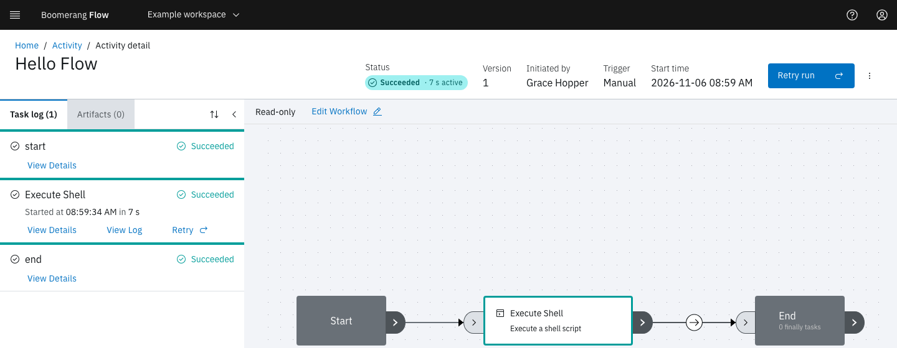

<!-- Written against flow.service.workflow 5.0.0-beta.39. -->
<!-- Commands are from the tag's README.md and docker-compose.yml. UI labels are source-verified at the tag (client-web), and the IDPZero page, health answers, docker compose ps and the dispatcher's log line were read from a running stack built at 5.0.0-beta.39-26. The compose stack was not started for this page. -->

# Try Flow locally

This quickstart runs Boomerang Flow on your laptop from the product repository's Docker Compose stack, then runs a first workflow. It's for operators evaluating Flow, and takes about 10 minutes plus the first build.

## What you'll have at the end

Flow at `http://localhost:3000/apps/flow`, with you signed in as its admin, a dispatcher running tasks on your laptop's Kubernetes, and a **Hello Flow** run with status **Succeeded**.



## Before you start

You need:

- **Git.**
- **Docker with Compose v2**: the `docker compose` command, not the older `docker-compose`.
- **OrbStack, with its Kubernetes turned on.** The stack's dispatcher is set up for it. Turn it on with `orb config set k8s.enable true`, then restart OrbStack.
- **`kubectl`**, to copy OrbStack's cluster details for the dispatcher.
- **These ports free:** 3000 (webapp), 7700 (core's API), 4380 (sign-in provider), 8333 (artifact store), 7702 (dispatcher), and 27017 on `127.0.0.1` (MongoDB).

> [!WARNING]
> The stack is for evaluation only. Its encryption keys and activation code are published in the repository, and it turns off the dispatcher's authentication. Never carry its settings into a real install.

## Start Flow

1. Clone the repository at the release tag:

   ```bash
   git clone --branch 5.0.0-beta.39 https://github.com/boomerang-io/flow.git
   cd flow
   ```

2. Give the dispatcher your cluster's details. It reads a kubeconfig at `docker/kube/config`, which the repository doesn't include:

   ```bash
   mkdir -p docker/kube
   kubectl config view --context orbstack --minify --flatten --raw \
     | sed 's#https://127.0.0.1:#https://host.docker.internal:#' > docker/kube/config
   ```

   OrbStack's context points at `127.0.0.1`, which inside the dispatcher's container is the container itself. `host.docker.internal` reaches the cluster from there.

3. Start the stack with the dispatcher:

   ```bash
   FLOW_ENGINE_URL=http://service-core:7700 \
   FLOW_DISPATCHER_LOGS_URL=http://service-dispatcher:7702/api/v1/logs/stream \
   docker compose --profile stack --profile dispatcher up -d --build
   ```

   Without a profile, the stack runs MongoDB, the sign-in provider and the artifact store. The `stack` profile adds core and the webapp, and the `dispatcher` profile adds Flow's Kubernetes dispatcher, with the `kube-jobs` executor. The two variables point the dispatcher at core on the stack's network. Every image builds from source, and core migrates and seeds the database before it serves anything, so the first start takes the longest.

4. Wait until `docker compose ps` shows `service-core` and `client-web` as `(healthy)`.

## Sign in and activate

1. Open `http://localhost:3000/apps/flow`. Flow shows **You're not signed in**. Select **Sign in**.
2. Flow sends you to IDPZero, a local sign-in provider with no passwords. On **Sign In to Account**, choose **Grace Hopper (Admin)** under **Select user to login as:**, then select **Sign In**.
3. Flow shows **G’day! Let’s activate Boomerang Flow**. Enter `flow-local-activation-code-for-development` in **Activation code**, and select **Submit**.

   The code is `FLOW_ACTIVATION_CODE` on `service-core` in `docker-compose.yml`. On a new database, the first person to sign in enters it and becomes the admin. [Sign-in and the first admin](./sign-in) explains how a real install sets its own.

Flow opens on **Home**, with **Admin** in the side nav.

## Run a first workflow

The starters under **Start a workflow** on Home don't make a good first run. Two depend on the HTTP Call tasks, which [do nothing in 5.0.0](../introduction/known-issues#two-starters-depend-on-the-http-call-tasks). The third needs a MongoDB to query and a SendGrid account to email the results. Build a one-task workflow instead:

1. On **Home**, select **New workspace**. In **Create Workspace**, enter the **Display Name** `Quickstart`, and select **Create**.
2. Under **Your workspaces**, select **Workflows** on the **Quickstart** card.
3. Select **Create a new workflow**, enter the **Display Name** `Hello Flow`, and select **Create**. The editor opens on its **Canvas** tab.
4. From **Add a task**, drag **Execute Shell** onto the canvas. Link **Start** to it, and it to **End**.
5. Select the node's edit (pencil) icon, then the **Shell Script** field. Enter `echo "Hello from Boomerang Flow"`, then select **Update** and **Apply**.
6. Select **Create new version**, enter a **Version comment**, and select **Create**.
7. Select **Workflows** in the breadcrumb. On the **Hello Flow** card, select **Run it**, then **Run and View**.

The run page shows **Running**, then **Succeeded**. [Getting started](../introduction/getting-started) walks through the same steps with screenshots.

## Verify it worked

Select **Activity** in the side nav. The **Hello Flow** run is listed with status **Succeeded**. A succeeded run proves every part works: sign-in, core, the dispatcher and your Kubernetes.

From the repository folder, check the services:

```bash
docker compose ps --format "table {{.Service}}\t{{.Status}}"
```

Each of the six services shows `(healthy)`. The two one-shot setup containers have exited, so they aren't listed.

```text
SERVICE              STATUS
client-web           Up 2 hours (healthy)
idpzero              Up 3 hours (healthy)
mongo                Up 3 hours (healthy)
seaweedfs            Up 3 hours (healthy)
service-core         Up 2 hours (healthy)
service-dispatcher   Up 3 hours (healthy)
```

The webapp and core each answer a health check without signing in:

```bash
curl http://localhost:3000/apps/flow/health
curl http://localhost:7700/health
```

```json
{"status":"UP"}
{"groups":["liveness","readiness"],"status":"UP"}
```

The dispatcher is connected when its log shows `registered as`:

```bash
docker compose logs service-dispatcher | grep "registered as"
```

```text
service-dispatcher-1  | [2026-11-05 21:19:46.345] [INFO] [44] io.bo.di.sd.Dispatcher                   : Dispatcher orbstack-kube-jobs (b6d777337d75) registered as <id> for task types [template, custom, script, ai, uploadartifact, downloadartifact].
```

## If a step fails

| Symptom | Cause | Fix |
| --- | --- | --- |
| `up` stops with "port is already allocated" | Something else uses one of the ports in [Before you start](#before-you-start) | Stop it, then run the `up` command again |
| `http://localhost:3000` doesn't answer for the first minutes | Core migrates and seeds the database before it serves anything | Wait until `docker compose ps` shows `service-core` as `(healthy)` |
| No activation screen, and **Admin** is missing | Someone else signed in first and became the admin | Sign in as that user, or reset as in [Stop or reset](#stop-or-reset) |
| **Execute Shell** stays **Ready** | No dispatcher is connected | Check the dispatcher's log for `registered as`. If `docker/kube/config` is a folder, Docker made it because the file was missing: remove it, repeat step 2 of [Start Flow](#start-flow), and run the `up` command again. |

## Stop or reset

Stop the stack and keep its data:

```bash
docker compose --profile stack --profile dispatcher down
```

Name the same profiles as `up`. Without them, `down` leaves core, the webapp and the dispatcher running.

To start again from an empty database, add `-v`:

```bash
docker compose --profile stack --profile dispatcher down -v
```

> [!WARNING]
> `down -v` deletes the stack's volumes: the MongoDB database, stored artifacts and the sign-in provider's state. There's no undo. The next start is a new install that asks for the activation code again.

## Next steps

- [Installing](./installing): what a real install needs, and deploying Flow to a Kubernetes cluster.
- [Configuring](./configuring): the properties, routes and probes core needs.
- [Getting started](../introduction/getting-started): build and run workflows in the webapp.
- [Make your first API call](../extend/api-quickstart): call core's API at `http://localhost:7700` with a token.
