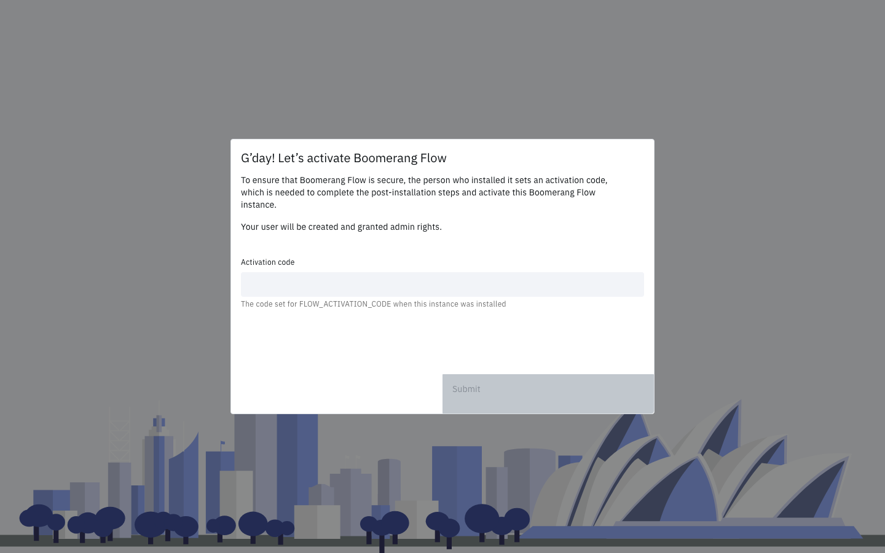

<!-- Written against flow.service.workflow 5.0.0-beta.39. -->
<!-- UI labels are source-verified at the tag (seed/settings.json, client-web), not seen in a running webapp. -->

# Sign-in and the first admin

This page is for operators setting up a secured Flow install. It covers how people sign in, how the first person becomes admin, and who else may sign in. [Security](../architecture/security) explains how authentication works inside Flow.

## Before you start

- Security is on: `flow.security.enabled` is `true`, the default.
- You can set environment variables on service-core and restart it. [Configuring](./configuring) lists the other properties.
- For OpenID Connect (OIDC), you can register a client with your identity provider.

## Which sign-in mode applies?

Flow picks the mode from its configuration. There is no property that names the mode.

| Mode | Applies when | Use it when |
| --- | --- | --- |
| `oidc` | Both the **OIDC Issuer** and **OIDC Client ID** settings are set | Your identity provider speaks OIDC. The webapp's own server runs the sign-in, so no proxy is needed. |
| `proxy` | Security is on and either setting is empty | An authenticating proxy in front of the webapp already signs people in. |
| `none` | `flow.security.enabled=false` | Local development, or a headless engine nobody signs in to. Every request runs as a built-in admin. |

## Sign in with OpenID Connect

Set two variables on service-core, and Flow signs people in with your provider from the first start.

```bash
FLOW_AUTH_OIDC_ISSUER=https://idp.example.com/realms/flow
FLOW_AUTH_OIDC_CLIENT_ID=flow
```

Register Flow with the provider like this:

- **Client type:** a public client with no client secret, using PKCE (S256).
- **Redirect URI:** the webapp's public address, its base path, then `/auth/callback`. For example, `https://flow.example.com/apps/flow/auth/callback`.
- **Scopes:** Flow asks for `openid`, `profile` and `email`.
- **Email:** the id_token must carry one, in `email`, `emailAddress`, or an email-shaped `preferred_username`. Without one, sign-in fails with `AUTH_TOKEN_INVALID`.
- **Signing:** an asymmetric algorithm (RS, PS or ES families). Flow refuses symmetric algorithms and `none`.

The proxy or ingress in front of the webapp must forward the `Host` header with its port, and send `X-Forwarded-Proto` when it terminates TLS. Otherwise the redirect URI doesn't match the one you registered. If service-core reaches the internet through a forward proxy, set `proxy.host` and `proxy.port` so it can fetch the provider's signing keys.

### How the variables reach the settings

At startup, Flow writes each variable into **Admin › Settings › Authentication**, but only while that setting is empty. A value an admin sets there later wins: changing the variable afterwards doesn't overwrite it, and the start logs `The stored oidc.issuer setting is kept; flow.auth.oidc.issuer does not overwrite it.` To change the issuer on a running install, change the setting, not the variable.

Flow trusts one issuer. The issuer must be an absolute `https` URL with no credentials or fragment. `http` is allowed only for `localhost`, `*.localhost`, `127.0.0.0/8` and `::1`.

| Symptom | Cause | Fix |
| --- | --- | --- |
| service-core stops at start: `flow.auth.oidc.issuer must be an absolute https URL (http only for localhost): <value>` | The issuer isn't `https` | Correct `FLOW_AUTH_OIDC_ISSUER` and restart |
| The webapp shows "Sign-in could not be started - the sign-in configuration or the identity provider could not be reached." | The webapp's server can't reach the issuer | Check the issuer URL and the network path to it |
| The provider rejects the redirect URI | The registered URI differs from the one the webapp sends | Fix the proxy's `Host` and `X-Forwarded-Proto` headers, or the registration |

The setup works when the sign-in page sends you to your provider, and the service-core log shows `Seeded the oidc.issuer setting from flow.auth.oidc.issuer.` on the first start.

## Sign in through an authenticating proxy

With either OIDC setting empty, Flow is in proxy mode. The proxy in front of the webapp signs the person in, then passes their identity on one of two ways:

- the `x-forwarded-email` header. Flow takes the person's name from `x-forwarded-user` when the proxy sends it.
- `Authorization: Bearer <JWT>` from the provider. Flow reads `email` or `emailAddress` from it without verifying its signature.

The webapp forwards these to service-core, which starts a session. Set `flow.signOutUrl` to the proxy's sign-out URL. Signing out of Flow then ends the proxy session too; otherwise the proxy signs the person straight back in.

> **Warning:** service-core trusts these headers on every route. It must be reachable only through the proxy.

## Make the first admin with the activation code

On a secured install with no users, the first person to sign in becomes admin by entering the activation code. You choose the code and set it on service-core as `FLOW_ACTIVATION_CODE` (`flow.activation-code`). It has no default.

1. Generate a code of at least 32 characters:

   ```bash
   openssl rand -hex 32
   ```

2. Store it in a secret and set `FLOW_ACTIVATION_CODE` from it on service-core.
3. Restart service-core.
4. Open the webapp and sign in. Flow shows the activation screen, **G’day! Let’s activate Boomerang Flow**.

   
5. Enter the code in **Activation code** and select **Submit**.

You're signed in as an admin and an owner of the `system` workspace, and **Admin** appears in the side navigation.

Once anyone has activated the install, Flow never reads the code again, and `PUT /api/v2/activate` refuses every code. Behind a proxy, the activation screen sends the code with that route, as `{"otc": "<code>"}`.

| Symptom | Cause | Fix |
| --- | --- | --- |
| service-core stops at start: `flow.activation-code must be at least 32 characters.` | The code is too short | Set a longer code and restart |
| service-core stops at start: `flow.activation-code and the retired flow.otc are both set and differ; set flow.activation-code only.` | `FLOW_OTC` is still set to another value | Remove `FLOW_OTC` |
| The activation screen shows "The activation code is not correct." The answer is `400 AUTH_ACTIVATION_CODE_INVALID`, with OIDC sign-in and behind a proxy. | A wrong code; nobody is created | Enter the right code |

The webapp holds your verified sign-in for 5 minutes while it waits for the code. After that, sign in again.

`FLOW_OTC` (`flow.otc`) is the deprecated name. Flow still reads it when `FLOW_ACTIVATION_CODE` is unset, logs `flow.otc (FLOW_OTC) is deprecated; use flow.activation-code (FLOW_ACTIVATION_CODE).`, and applies the same 32-character minimum. [Upgrading](./upgrading) covers the rename.

## Run without an activation code


When the code is unset, no person can become the first admin by code, and service-core logs a warning at start. That's the right choice when something else makes the first admin, or when no person needs one.

| Way | How | Use it when |
| --- | --- | --- |
| Machine tokens only | Leave the code unset. The [bootstrap token and declared machine tokens](./machine-tokens) work from the first start, and they never count as a user. | Only services call Flow |
| An identity-provider admin claim | Configure the [admin claim](#let-your-identity-provider-decide-admins). A sign-in whose claim is read is decided by the claim, and no code is used. | Your provider already has an admin group |
| The bootstrap token names the admin | Follow [Name the first admin with the bootstrap token](#name-the-first-admin-with-the-bootstrap-token). | You'd rather not hand out a code |
| An external user directory | Flow reads its users, and their types, from the directory at `flow.externalUrl.user`. The install always counts as activated. | Users are managed outside Flow |
| Security off | `flow.security.enabled=false`. Every request runs as a built-in admin. | Local development or a headless engine |

> **Warning:** If the code is unset and none of these applies, the first person can't get in. The webapp shows the activation screen and refuses every code. To recover, set `FLOW_ACTIVATION_CODE`, restart service-core and sign in again, or name the admin with the bootstrap token.

### Name the first admin with the bootstrap token

You need the bootstrap token set (see [Machine tokens](./machine-tokens#use-the-bootstrap-token)). In these commands, `FLOW_API` is the address your front door routes `/api/v2` to, and `BOOTSTRAP` holds the raw bootstrap token.

1. Create a workspace with the person as a member, by email:

   ```bash
   curl -X POST "$FLOW_API/api/v2/workspace" \
     -H "Authorization: Bearer $BOOTSTRAP" \
     -H "Content-Type: application/json" \
     -d '{"name":"founders","displayName":"Founders","members":[{"email":"ada@example.com","role":"owner"}]}'
   ```

   Flow now has a user record for that email, so the install counts as activated and no code is asked for. Note the person's `id` in the response's `members`.
2. Ask the person to sign in once. They're signed in as a user. This first sign-in activates their record, which the next step needs.
3. Make them an admin:

   ```bash
   curl -X PATCH "$FLOW_API/api/v2/user/<id>" \
     -H "Authorization: Bearer $BOOTSTRAP" \
     -H "Content-Type: application/json" \
     -d '{"type":"admin"}'
   ```

   A `400` with `USER_NOT_FOUND` means they haven't signed in yet: ask them to, then repeat this step.
4. Ask them to sign out and sign in again. A session's permissions are fixed when it starts.

They're an admin, and **Admin** appears in their side navigation.

## Decide who else may sign in

The **Auto-Create Users** setting (`features.autoCreateUsers`) decides whether Flow creates an account for anyone who signs in. It's on by default, and an upgraded install gets it switched on.

- **On:** anyone your provider or proxy authenticates gets a user account at their first sign-in.
- **Off:** a person who isn't a user yet can sign in only if an admin has added them to a workspace, or the admin claim admits them. Existing users are unaffected. Add someone by email in **Manage workspace › Members › Add members**; their first sign-in activates the account.

With the setting off, Flow refuses anyone else. With OIDC sign-in, the answer is `403 AUTH_USER_NOT_ADMITTED`, and the webapp shows **Sign-in didn't complete** with Flow's message and a **Back to sign-in** button:

```text
You are not a user of this Flow install, and it does not create users at first sign-in. Ask an admin to add you to a workspace.
```

Behind a proxy, the refusal is a `403` without that error code.

To turn it off:

1. Go to **Admin › Settings › Features**.
2. Turn off **Auto-Create Users**.
3. Select **Save**.

Flow confirms with **Update Settings**. The next person who signs in without an account is refused.

The setting's description reads "Create a user account the first time someone signs in. When off, a person who isn't a user yet can sign in only if an admin has added them to a workspace or the admin claim admits them. Existing users are unaffected." An install that held the setting before 5.0.0-beta.39 keeps its earlier description; only the text differs.

## Let your identity provider decide admins

An admin claim makes Flow take admin from your provider: anyone whose token carries a listed value in the named claim is an admin. Set both properties for it to apply.

| Property | Environment variable | Default | Meaning |
| --- | --- | --- | --- |
| `flow.security.admin-claim.name` | `FLOW_SECURITY_ADMIN_CLAIM_NAME` | empty | The claim to read, such as `groups` or `roles`. It may hold a string or an array of strings. |
| `flow.security.admin-claim.values` | `FLOW_SECURITY_ADMIN_CLAIM_VALUES` | empty | Comma-separated values that make the holder an admin. Each must match exactly, including case. |
| `flow.security.admin-claim.trust-forwarded-token` | `FLOW_SECURITY_ADMIN_CLAIM_TRUST_FORWARDED_TOKEN` | `false` | Read the claim from the token a proxy forwards |


```bash
FLOW_SECURITY_ADMIN_CLAIM_NAME=groups
FLOW_SECURITY_ADMIN_CLAIM_VALUES=flow-admins,platform-admins
```

Flow re-checks the claim at every sign-in that reads it. A holder becomes an admin. An admin whose token no longer matches becomes a user, and their sessions end at once. Removing someone from the group therefore removes admin at their next sign-in.

Where Flow reads the claim depends on the sign-in mode:

- **The webapp's own OIDC sign-in:** from the verified id_token, always. Configure the provider to put the claim in the id_token. A missing claim counts as not matching, and demotes an admin.
- **Behind an authenticating proxy:** from the forwarded `Authorization: Bearer` token, and only with `trust-forwarded-token=true`. `x-forwarded-email` and other credentials carry no claim, so they never grant or remove admin.

> **Warning:** service-core doesn't verify a forwarded token's signature. Setting `trust-forwarded-token=true` states that the proxy is the trust boundary and that service-core is reachable only through it. That is your trust decision, so make it only when the deployment guarantees both.

With a claim configured:

- **On an empty install,** a sign-in whose claim is read is decided by the claim, and no code is used. Being first grants nothing: someone without the claim becomes a user, or is refused if **Auto-Create Users** is off. A sign-in where no claim is read still needs the activation code.
- **Admins made another way,** with the activation code, the bootstrap token or **Admin › Users**, become users at their next sign-in that reads the claim, unless their token carries a listed value.
- **Machine tokens** carry no user, so the claim never changes them.

The claim works when a member of `flow-admins` signs in and sees **Admin** in the side navigation.

## Next steps

- [Machine tokens](./machine-tokens): the bootstrap token, declared tokens and rotation.
- [Security](../architecture/security): how sign-in, tokens and roles work inside Flow.
- [Administer](../fundamentals/administer): settings and users in **Admin**.
- [Configuring](./configuring): the other properties service-core reads.
