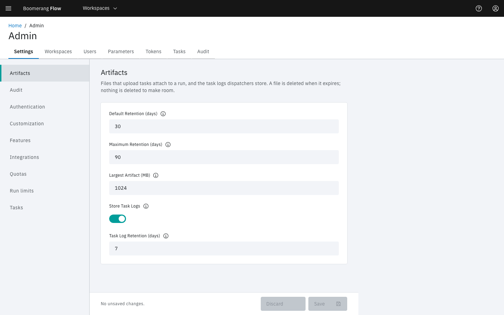

<!-- Written against flow.service.workflow 5.0.0-beta.39. -->
<!-- UI labels are source-verified at the tag (seed/settings.json, client-web), not seen in a running webapp. -->

# Task logs

A task's log comes from one of two places: a copy core stored when the task finished, or the dispatcher still holding the task. This page is for operators setting up both, and Loki as an optional live source.

## Before you start

- **A dispatcher** connected to core. See [Run the dispatcher](./dispatcher).
- **For stored logs,** the artifact store turned on. See [Connect the artifact store](./configuring#connect-the-artifact-store).
- **To change settings,** a platform admin who can open **Admin › Settings**.

## Where does a task's log come from?

Every read goes through core, `GET /api/v2/taskrun/{id}/log`, which is what a task's **View Log** in the webapp calls. Core checks that the reader may see the run, and scrubs the run's secret values from the log as it relays it.

| Source | Kept | Used |
| --- | --- | --- |
| The stored log | For **Task Log Retention (days)**, 7 by default | Once the task has ended |
| The dispatcher's live route | While the task's pod exists | While the task runs, and after it ends when no copy was stored |
| A message | — | When neither answers |

While a task runs, the live route answers even when a copy is stored. A copy stored during this attempt answers instead only when the dispatcher registered no live route, or its route fails before answering. A requeued task never shows its earlier attempt's log.

## Store finished logs

When a task ends, Flow's Kubernetes dispatcher reads the pod's log before the Job or TaskRun can be deleted, and uploads it to core. Core keeps it in the artifact store as part of the run. It outlives the pod, needs no dispatcher to read it, and is purged with the run.

| Setting or property | Where | Default | Meaning |
| --- | --- | --- | --- |
| **Store Task Logs** (`logs.enabled`) | **Admin › Settings › Artifacts** | On | Core stores uploaded logs. Off tells dispatchers their logs aren't stored; logs already stored are served until they expire. |
| **Task Log Retention (days)** (`logs.retention.days`) | **Admin › Settings › Artifacts** | `7` | Days a stored log is kept, apart from artifact retention |
| `flow.engine.task.log.max-bytes` (`FLOW_ENGINE_TASK_LOG_MAX_BYTES`) | Core | `10485760` (10 MiB) | The largest log core stores. A larger one is refused whole, never truncated. |
| `flow.dispatcher.logs.upload` (`FLOW_DISPATCHER_LOGS_UPLOAD`) | Dispatcher | `true` | Upload each finished task's pod log. `false` keeps logs in the pod only. |



A stored log isn't listed with the run's artifacts, can't be read through the artifact routes, and doesn't count toward artifact storage. Settings take effect without a restart.

The dispatcher logs `TaskRun (<id>) log stored (<n> bytes).` for each upload. When an upload fails, the task's outcome is unchanged:

| Dispatcher log | Cause | Fix |
| --- | --- | --- |
| `The engine stores no task logs (no artifact store); sending no more.` | Core's artifact store is off. The dispatcher stops uploading for the rest of its life. | Turn the store on (`FLOW_ARTIFACTS_ENABLED=true`), then restart the dispatcher |
| `TaskRun (<id>) log not stored: log storage is switched off.` | **Store Task Logs** is off | Turn it on. The dispatcher keeps offering logs. |
| `TaskRun (<id>) log not stored: …` with a `413` | The log is over `flow.engine.task.log.max-bytes` | Raise the limit on core, or log less. The log stays readable from the pod while it exists. |
| `Task (<id>) log not read from its pod: …` | The pod never existed or its log couldn't be read | Check the pod and the dispatcher's `pods/log` permission ([Grant the Kubernetes permissions](./dispatcher#grant-the-kubernetes-permissions)) |

> **Warning:** Without a stored copy, a finished task's log lasts only as long as its pod. Under the Deletion Policy **On Success** or **Always**, the pod goes when the task ends, and so does its log. See [Clean up finished tasks](./dispatcher#clean-up-finished-tasks).

## Follow a running task's log

The dispatcher serves a running task's log at `/api/v1/logs/stream`, on port 7702. At start, it registers that route's address with core, with a bearer token it generates. The route accepts only that token, so only core can read it: a pod log isn't scrubbed until core relays it.

| Property | Environment variable | Default | Meaning |
| --- | --- | --- | --- |
| `flow.dispatcher.logs.url` | `FLOW_DISPATCHER_LOGS_URL` | blank | The route's address as core reaches it, such as `http://flow-dispatcher.flow.svc:7702/api/v1/logs/stream`. Blank registers none, and running tasks have no live log. |

The earlier properties `flow.agent.service.host` and `flow.agent.logstream.url` are gone from core: nothing on core names a dispatcher. Don't route `/api/v1/logs` from your ingress; core reaches the dispatcher directly.

- **The log streams as the task writes it,** for up to two hours.
- **A quiet task:** after 10 minutes with nothing from the dispatcher, core stops following. Open the log again to see anything written since.
- **Before the container starts,** the log shows `Waiting for the task's container to start.`, then follows the log once it starts. After five minutes it says the container hasn't started yet.
- **Several replicas** of one dispatcher behind one address can refuse each other's reads. See [Run several dispatchers](./dispatcher#run-several-dispatchers).

When a read fails, the log shows one of these messages instead of an error:

| Message | Cause | Fix |
| --- | --- | --- |
| `No log is available for this task: no stored log was uploaded, and its dispatcher registered no live log route.` | No stored copy, and `flow.dispatcher.logs.url` is blank | Set `FLOW_DISPATCHER_LOGS_URL` on the dispatcher and restart it. Turn on stored logs for finished tasks. |
| `The live log cannot be read: the dispatcher running this task could not be reached or refused the read. …` | Core can't reach the registered address, or the dispatcher refused the token | Check the address from core's pod. With several replicas, register each pod's own address. |
| `The live log was cut off: the connection to the dispatcher failed. Open the log again to see the rest.` | The stream broke part way | Open the log again |
| `No Pod found yet for the requested Task.` | The task's pod doesn't exist yet, or was already deleted | Open the log again once the task starts. For finished tasks, use stored logs. |
| `Unable to retrieve logs. A server error has occurred.` | The dispatcher couldn't read the pod | Check the dispatcher's log and its `pods/log` permission |

## Read live logs from Loki

The dispatcher's live route reads the task's pod by default. Set `dispatcher.logging.type=loki` and it queries Loki instead. Use it when task pods are removed quickly and no artifact store keeps their logs, since a finished task's stored copy wins over the live route.

| Property | Environment variable | Default | Meaning |
| --- | --- | --- | --- |
| `dispatcher.logging.type` | `DISPATCHER_LOGGING_TYPE` | `default` | `default` reads the pod; `loki` queries Loki |
| `dispatcher.logging.host` | `DISPATCHER_LOGGING_HOST` | `localhost` | Loki's host |
| `dispatcher.logging.port` | `DISPATCHER_LOGGING_PORT` | `9200` | Loki's port. Set it: Loki usually listens on 3100. |

```properties
dispatcher.logging.type=loki
dispatcher.logging.host=loki.loki.svc.cluster.local
dispatcher.logging.port=3100
```

The dispatcher calls `GET http://<host>:<port>/loki/api/v1/query_range`, forward from the start, with this stream selector:

```text
{boomerang_io_taskrun_ref="<task run id>",boomerang_io_workflow_ref="<workflow id>",container=~"task|step-task"}
```

The upload of a finished log still reads the pod, not Loki.

### Map the pod labels in your log shipper

The dispatcher stamps each task pod with `boomerang.io/*` labels, but Loki doesn't index pod labels by itself. Your log shipper must write each stream with these labels:

| Loki label | From | Value |
| --- | --- | --- |
| `boomerang_io_taskrun_ref` | The pod label `boomerang.io/taskrun-ref` | The task run's ID |
| `boomerang_io_workflow_ref` | The pod label `boomerang.io/workflow-ref` | The workflow's ID |
| `container` | The container's name | `task` on the `kube-jobs` executor, `step-task` on Tekton |

The names are what a promtail or Grafana Alloy `labelmap` on the pod's labels writes, since Kubernetes service discovery turns `.`, `/` and `-` into `_`. Keep both pod labels and the container name on every task pod's stream.

When no stream matches, the log reads `Unable to retrieve logs. This could be due to data retention policy, activity cleanup, or unavailable in log store.` Compare the labels on a task's stream in Loki with the table.

The Loki client has limits:

- **Plain HTTP,** with no authentication and no tenant header. Loki must accept unauthenticated reads from the dispatcher.
- **Its own HTTP client,** which ignores the proxy and trust store settings. See [Loki task logs ignore the HTTP client settings](../introduction/known-issues#loki-task-logs-ignore-the-http-client-settings).
- **`elastic`,** a v3 value, now answers only `Unable to retrieve logs. The log option configured has been deprecated and no longer works.`

### Retire the v3 promtail configuration

The promtail configuration published for v3 relabels v3's pod labels into `bmrg_*` names, and drops any pod without them. v5 task pods carry none of them, so it drops every v5 task pod, and the v5 query asks for different names. Remove the v3 scrape job and map the labels in the table above instead. [Upgrading](./upgrading#connect-the-dispatcher-and-task-logs) lists this step for a v3 upgrade.

## Next steps

- [Run the dispatcher](./dispatcher): executors, the Deletion Policy and task pods.
- [Configuring](./configuring): the artifact store and core's other properties.
- [Runs](../fundamentals/runs): how long runs, artifacts and logs are kept.
