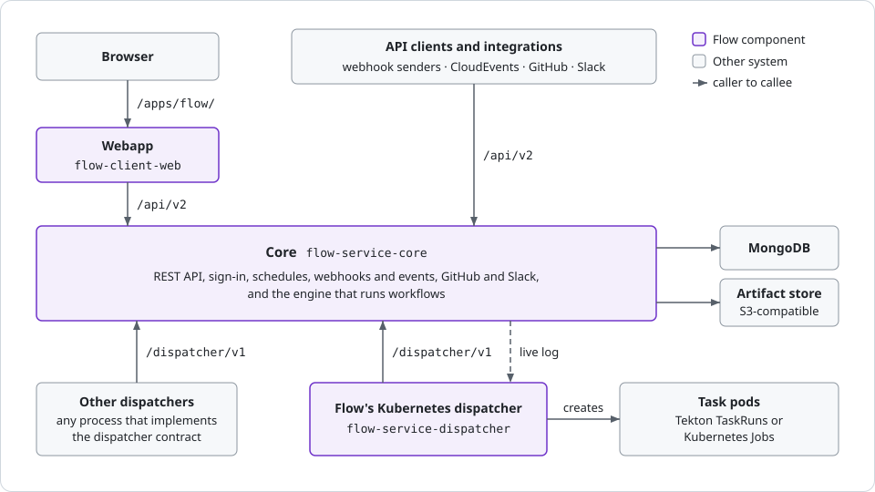

<!-- Written against flow.service.workflow 5.0.0-beta.39. -->

# Flow in five minutes

This page gives you the mental model: the pieces Boomerang Flow is made of, and how a run moves through them. Read it before [Getting started](./getting-started).

## What does Flow do?

Boomerang Flow builds and runs workflows: graphs of tasks that run as containers on Kubernetes. You draw a workflow on a canvas from ready-made tasks or your own images, start it by hand, on a timetable or from another system, and Flow records every run with its logs.

## What are the pieces?

**A workspace** holds workflows, members, parameters and quotas. Each member's role (owner, editor or reader) decides what they can change. See [Manage workspace](../webapp/manage).

**A workflow** is a graph of tasks that automates a process the same way every time. You link tasks on a canvas, and the links set the order they run in. Each save is a new version. See [Workflows](../fundamentals/workflows).

**A task** is one unit of work. Most run as a container: a catalogue task Flow ships, a task your workspace adds, or your own image. A few, such as approvals and sleeps, run inside Flow. A task placed on the canvas is a node. See [Tasks](../fundamentals/tasks).

**A run** is the record of one execution of a workflow: the version it ran, what started it, and a task run for every task. Each run and task run carries a status, the outcome you see (such as **Running** or **Succeeded**), and a phase, its place in the lifecycle. See [Runs](../fundamentals/runs).

**A trigger** is how a run starts: manual, schedule, webhook, event or GitHub. You turn each one on or off per workflow. See [Triggers](../fundamentals/triggers).

**A parameter** is a named value a task reads, written as a reference such as `$(params.region)`. Values come from five layers: global, workspace, workflow, task and the run's context. When two layers hold a value, the later one in that list wins. See [Parameters](../fundamentals/parameters).

**An action** is a point where a person decides: an approval, where someone approves or rejects, or a manual task, where someone does a step by hand. The run waits there without using up its timeout. See [Actions](../fundamentals/actions).

**A run workspace** is a volume the tasks of one run share, so one task can write a file and the next can read it. It's removed when the run completes. **An artifact** is a file a task uploads to keep: run-scoped, kept with its run, or workflow-scoped, kept for later runs. See [Artifacts and the run workspace](../fundamentals/artifacts).

**A dispatcher** runs the containers. It claims ready tasks, runs each one, and reports how it ended. Flow ships a Kubernetes dispatcher that runs each task as a pod; you can write your own. See [Dispatchers](../architecture/dispatchers).

Core is Flow's server: the API and the engine that runs workflows. Your browser talks only to the webapp. Dispatchers call core for work; core never pushes it.

## What happens when you run a workflow?

1. **Submit.** You select **Run it**, or a schedule, webhook, event, GitHub delivery or API call starts the run for you. Flow refuses it if that trigger is off or a workspace quota is reached.
2. **Admit the run.** Flow resolves the run's parameters, creates a task run for every task, and checks the graph. A run over its workflow's concurrency limit waits for a slot.
3. **Ready each task.** When the graph reaches a task, Flow resolves the task's parameters. Approvals, switches, sleeps and child workflows run inside Flow. A task that runs a container shows **Ready** until a dispatcher claims it.
4. **Run the container.** The dispatcher starts the container, and when it exits, reports how it ended, with the task's results. A non-zero exit code fails the task.
5. **Finish.** Each end unblocks the tasks linked after it, which go back to step 3. Once the graph is done, the run takes its final status.

[Overview](../architecture/overview) covers the same steps for operators.

Next: [Getting started](./getting-started), to build and run your first workflow.
