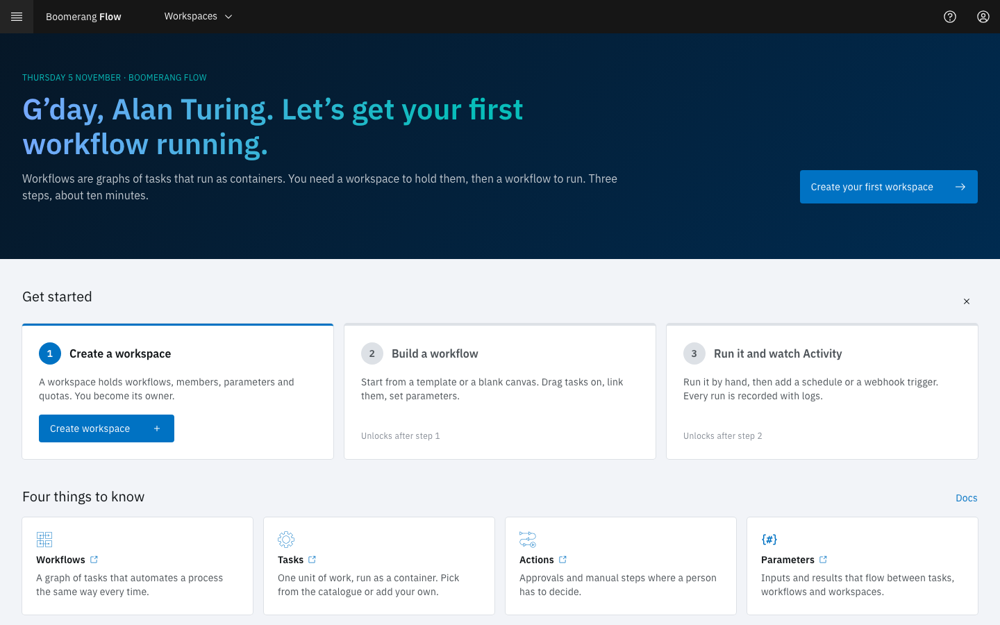
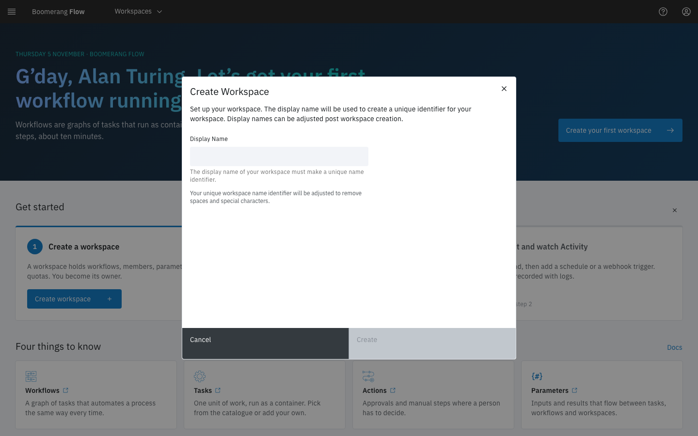
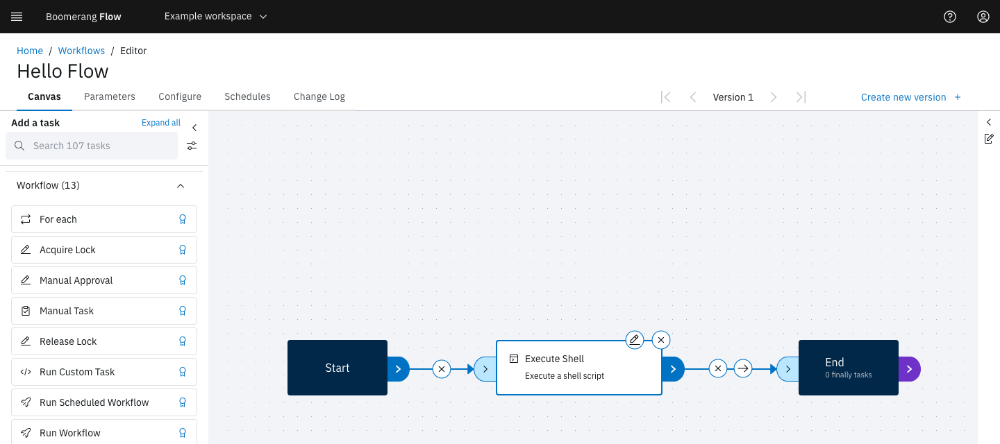
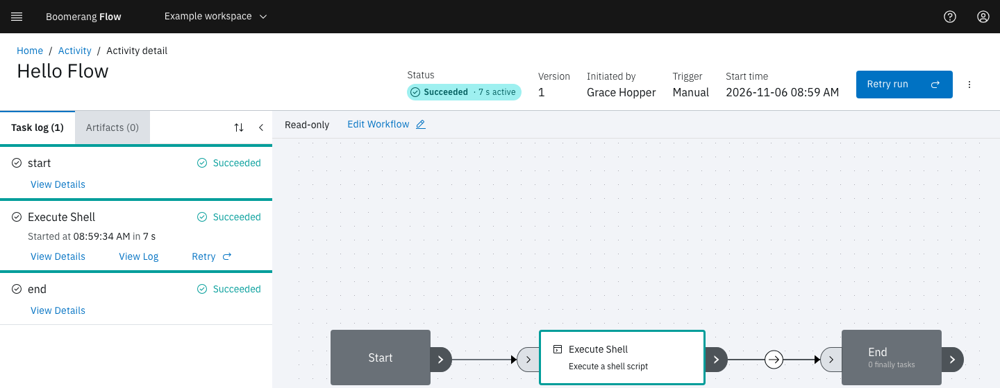

<!-- Written against flow.service.workflow 5.0.0-beta.39. UI labels checked against the live webapp (build 490ba3894, 2026-11-06): 53 of 63 bolded terms seen live; the rest are states the walk didn't reach or aren't labels, and were verified in client-web source. -->

# Getting started

This page takes you from your first sign-in to a workflow that has run successfully. You create a workspace, build a workflow with one task, save it, run it and watch the run in Activity. It's for workflow authors, and takes about ten minutes.

## Before you start

You need:

- **A Flow install you can sign in to.** If you run Flow yourself, see [Installing](../hosting/installing) and [Sign-in](../hosting/sign-in).
- **A dispatcher connected to Flow.** A dispatcher runs each task's container. Your operator sets one up with the install.
- **Permission to create a workspace.** Any signed-in user can, unless an admin has turned off **Workspace creation by users**. Otherwise, ask a workspace owner to add you to their workspace and skip to [Create a workflow](#create-a-workflow).

If you're new to Flow, read [Flow in five minutes](./flow-in-five-minutes) first: it explains the workspaces, workflows, tasks and runs this page uses.

## Sign in

Open Flow's address in a recent version of Chrome, Firefox, Safari or Edge.

- If Flow shows **You're not signed in**, select **Sign in** and sign in with your organisation's account.
- Some installs sign you in before Flow opens, and you go straight to Home.
- If Flow shows **G’day! Let’s activate Boomerang Flow**, nobody has activated this install yet. The operator who installed it has the activation code: see [Sign-in](../hosting/sign-in).

Flow opens on **Home**.

## Follow Get started on Home

Until you have a workspace, Home greets you with **G’day, {your name}. Let’s get your first workflow running.** Until you have a workspace, a workflow and a run, it also shows **Get started**: three steps that unlock in turn.

1. **Create a workspace**
2. **Build a workflow**
3. **Run it and watch Activity**

The sections below follow the same steps. A finished step shows **Done**. To hide the list, select the close icon beside **Get started**.

The side nav's workspace items, such as **Workflows** and **Activity**, are greyed out on Home. They work once you open a workspace.

> [!NOTE]
> On a new install, the person who activates it becomes the admin and the owner of the **System and Administration** workspace, which comes with three starter workflows. So they see **Welcome back** instead, with steps 1 and 2 of **Get started** already **Done**. To follow this page with a workspace of your own, select **New workspace** at the top of Home, then continue from step 2 below.



## Create a workspace

A workspace holds workflows, members, parameters and quotas. You become the owner of the workspace you create.

1. In step 1 of **Get started**, select **Create workspace**. (**Create your first workspace**, at the top of Home, opens the same dialog.)
2. In **Create Workspace**, enter a **Display Name**, such as `Getting started`. Flow shows the unique identifier it makes from the name, with spaces and special characters removed.
3. Select **Create**.



Flow confirms "Workspace created successfully", and step 1 shows **Done**.

If Home has no **Create workspace** button and says "Workflows live in workspaces, and you are not in one yet. Ask an administrator to add you to a workspace.", you can't create one. Ask a workspace owner or an admin to add you.

## Create a workflow

1. In step 2 of **Get started**, select **Go to workflows**. The workspace's **Workflows** page opens.
2. Select the **Create a new workflow** tile.
3. Leave **Start from scratch** selected, and enter a **Display Name**, such as `Hello Flow`. Flow fills **Name**, the workflow's identifier in the workspace, with `hello-flow`.
4. Optionally, add a **Description (optional)** and choose an icon under **Pick an icon (any icon)**.
5. Select **Create**.

The workflow editor opens on its **Canvas** tab, with two nodes: **Start** and **End**.

> [!NOTE]
> Home also lists ready-made starters under **Start a workflow**. Two of them use the HTTP Call tasks, which don't work in 5.0.0. See [Known issues](./known-issues). This page starts from scratch.

## Add a task

The panel on the left of the canvas, **Add a task**, lists the task catalogue by category.

1. In the panel's search box, type `shell`.
2. Drag **Execute Shell** onto the canvas. It's in the **Utilities** category.
3. Link the nodes: drag from **Start**'s right port to the left port of the Execute Shell node, then from that node's right port to **End**. Links set the order tasks run in.
4. Select the node's edit (pencil) icon. **Edit Execute Shell** opens.
5. Select the **Shell Script** field. In **Update Shell Script**, enter:

   ```bash
   echo "Hello from Boomerang Flow"
   ```

6. Select **Update**, then **Apply**.

Leave **Directory Path** and **Shell Interpreter** blank.



## Save a version

The canvas keeps your changes in the page until you save them as a new version of the workflow.

1. Select **Create new version**, to the right of the editor's tabs.
2. In **Create New Version**, enter a **Version comment**, such as `Add a shell task`. A comment is required, up to 128 characters.
3. Select **Create**.

Flow confirms "Successfully created workflow version". If you leave the editor before saving, your browser asks you to confirm, because unsaved changes are lost.

## Run it

The editor has no Run button: you run a workflow from the **Workflows** page.

1. Select **Workflows** in the breadcrumb.
2. On your workflow's card, select **Run it**.
3. In **Execute workflow**, select **Run and View**.

The run page opens. **Run** would start the run and keep you on the Workflows page instead. A workflow with parameters opens **Workflow Parameters** first, for you to enter their values.

## Watch it in Activity

On the run page:

- **Status** shows **Running**, then **Succeeded**, followed by the run's active time.
- The **Task log** tab lists each task with its status. Under **Execute Shell**, select **View Log**. The **Execution Log** includes the line `Hello from Boomerang Flow`.
- Selecting a node on the diagram scrolls the task log to that task.

To see every run in the workspace, select **Activity** in the side nav. Your run is listed with its trigger, `Manual`, and the status **Succeeded**. Select the row to open the run again.

Back on **Home**, **Get started** has gone, because all three steps are done, and **Recent activity** lists your run. You've built and run your first workflow.



## If the run doesn't succeed

| What you see | Cause | What to do |
| --- | --- | --- |
| Execute Shell stays **Ready** | No dispatcher has claimed the task. | Ask your operator to check that a dispatcher is connected. |
| Execute Shell is **Failed** | The script exited with an error. | Select **View Details**: the **Message** includes the container's exit code and the end of its log. Fix the script, create a new version and run again. |
| The run is **Timed Out** | The run took longer than its timeout, 30 minutes by default. | Set **Timeout** under **Configure › Run Options**, up to your workspace's quota. |
| **Run it** is disabled | The workspace has reached a run quota, or the workflow's Manual trigger is off. | Hover over the card's status icon for the reason. See [Run a workflow](../guides/run). |

## Next steps

- [Workflow editor](../guides/workflow-editor): configure tasks, branch with a switch, and add parameters.
- [Parameters](../fundamentals/parameters): pass values into a run and between tasks.
- [Actions](../fundamentals/actions): put a person in the loop with an approval.
- [Triggers](../fundamentals/triggers) and [Schedules](../webapp/schedules): start runs without selecting **Run it**.
- [Runs](../fundamentals/runs): statuses, pausing, retries and timeouts.
- [Known issues](./known-issues): what doesn't work yet in 5.0.0.
