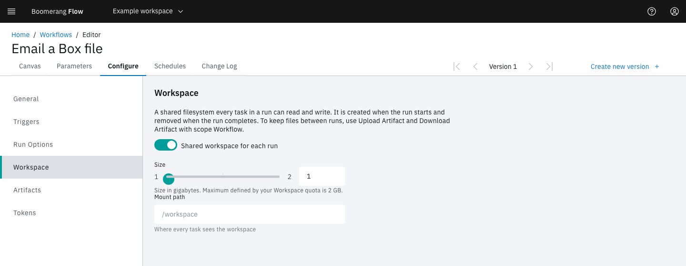
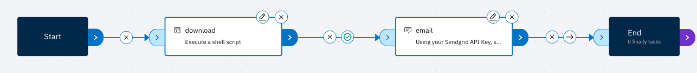

<!-- Written against flow.service.workflow 5.0.0-beta.39. UI labels checked against the live webapp (build 490ba3894, 2026-11-06): 43 of 57 bolded terms seen live; the rest are states the walk didn't reach or aren't labels, and were verified in client-web source. -->

# Email a file from Box

This tutorial builds a workflow that downloads a file shared on Box and emails it as an attachment through SendGrid. It's for workflow authors, and it shows how two tasks in one run share a file through the run workspace.

## Before you start

You need:

- the owner or editor role in a Flow workspace;
- a file on Box that anyone with the link can open, and its direct download URL. A Box direct link has the form `https://app.box.com/shared/static/<id>.pdf`;
- a SendGrid API key that can send mail, and a sender address that SendGrid has verified;
- a Flow installation that can create a run workspace, a Kubernetes volume, for each run. If you're not sure, ask your operator.

## Create the workflow

1. In the side nav, select **Workflows**.
2. Select **Create a new workflow**.
3. Leave **Start from scratch** selected, and enter a **Display Name**, such as `Email a Box file`. Flow fills in **Name** for you.
4. Select **Create**. The editor opens on the **Canvas** tab.

## Add the parameters

Parameters hold the values that change from run to run, and keep the API key out of the task. Tasks read a parameter as `$(params.<name>)`.

1. Select the **Parameters** tab.
2. Select **Add parameter**.
3. Fill in **Name**, **Type**, **Default value (optional)** and **Required** from the first row of the table below, then select **Add**.
4. Repeat for the other two rows.

| Name | Type | Default value | Required |
| --- | --- | --- | --- |
| `download-url` | URL | none | On |
| `file-name` | Text | `report.pdf` | On |
| `sendgrid-api-key` | Password | your SendGrid API key | Off |

A Password parameter is secured: Flow stores it encrypted and hides it in the webapp and in logs.

## Turn on the run workspace

Each task runs in its own container, so a file one task writes is gone when that task ends. The run workspace is a volume that every task in a run mounts. Flow creates it when the run starts and removes it when the run completes.

1. Select the **Configure** tab, then **Workspace**.
2. Turn on **Shared workspace for each run**.
3. Set **Size** to `1`.
4. Leave **Mount path** empty. Tasks then see the run workspace at `/workspace`.



## Add the download task

1. Select the **Canvas** tab.
2. In **Add a task**, open **Utilities** and drag **Execute Shell** onto the canvas.
3. Select the node's edit (pencil) icon.
4. Set **Task name** to `download`, **Directory Path** to `/workspace` and **Shell Interpreter** to `bash`.
5. Select **Shell Script**, paste the script below, then select **Update**.
6. Select **Apply**.

```bash
curl -fsSL "$(params.download-url)" --output "$(params.file-name)"
```

Flow replaces `$(params.download-url)` and `$(params.file-name)` with the run's values before the script runs. Because **Directory Path** is `/workspace`, the file is saved as `/workspace/<file-name>`. Leave **Directory Path** empty and the script runs in a scratch folder that no other task can see. The `-f` flag fails the task on an HTTP error instead of saving the error page as your file.

## Add the email task

1. In **Add a task**, open **Communication** and drag **Send Email with Sendgrid** onto the canvas.
2. Select its edit icon and fill in the form:

   | Field | Value |
   | --- | --- |
   | **Task name** | `email` |
   | **API Key** | `$(params.sendgrid-api-key)` |
   | **To** | the recipient's email address |
   | **From** | your SendGrid verified sender |
   | **Subject** | `Your file: $(params.file-name)` |
   | **Content Type** | `Text` |
   | **Body Content** | `The file you asked for is attached.` |
   | **Attachments** | `/workspace/$(params.file-name)` |

3. Select **Apply**.

**Attachments** takes one absolute path per line. A path that doesn't exist is logged and skipped, and the email is sent without it.

> [!NOTE]
> Use revision 3 or later of Send Email with Sendgrid. Revisions 1 and 2 report success without sending anything. A task you drop on the canvas now is on revision 3. A node on an older revision shows a yellow warning icon: select it, review the fields, then select **Update task**.

## Connect the tasks and save

1. Drag from the right port of **Start** to the left port of `download`. Link `download` to `email`, and `email` to **End** the same way.
2. A new link runs **always**. Select the condition icon on the `download` to `email` link until it shows success, so no email goes out when the download fails. The icon cycles through always, success and failure.
3. Select **Create new version**, enter a **Version comment** such as `First version`, then select **Create**.



## Run the workflow

1. Select **Workflows**, then **Run it** on the workflow's card.
2. In **Workflow Parameters**, enter **download-url** and **file-name**. Leave **sendgrid-api-key** blank to use its stored default.
3. Select **Run and View**.

The run page lists each task in the task log as it runs. When `download` and `email` both show **Succeeded**, the run's **Status** reads **Succeeded** and the email arrives with your file attached.

<!-- SCREENSHOT: The run page with Status Succeeded, and download and email Succeeded in the task log. (not capturable yet: A succeeded run needs a Box shared link and a SendGrid API key) -->

If `download` fails, select **View Log** on it. A `curl` error usually means the URL isn't a direct download, or the file isn't open to anyone with the link.

## Use a private Box file

For a file that isn't shared publicly, replace Execute Shell with **Download File From Box**, from the **Box** category. It signs in through a Box Platform app that uses server authentication (JWT), and takes six values from that app.

1. Add a Password parameter for each secret: `box-client-secret`, `box-private-key` and `box-passphrase`.
2. Add a Text parameter for each ID: `box-enterprise-id`, `box-client-id` and `box-public-key-id`.
3. In the task, set each **Authentication** field to its parameter, such as `$(params.box-private-key)` for the private key. The catalogue spells that field's label **Authnetication - Private Key**.
4. Set **File ID** to the file's Box ID, and **Path** to `/workspace/$(params.file-name)`.

<!-- UNVERIFIED: whether box-service 0.0.18 accepts a PEM private key entered in a single-line password field, which drops its line breaks. Test before publishing the private-file steps. -->

The task's own secret fields are password fields too, so Flow encrypts what you type there. Parameters keep the credentials in one place for every Box task in the workflow, and out of the canvas.

## Not seeing what you expected?

- [Why does the run stay **Ready** before `download` starts?](../introduction/troubleshooting#a-run-didnt-start)
- [Why did `download` fail with `ParamUnresolved`?](../introduction/troubleshooting#a-task-failed-with-paramunresolved)
- [Why did `email` succeed but no email arrive?](../introduction/troubleshooting#a-task-succeeded-but-did-nothing)

## Next steps

- [Parameters](../fundamentals/parameters): the layers a reference reads, and how secured values are kept.
- [Use an approval's results](./manual-approval-output): hold the email until a person approves it.
- [Execute Workflow](../guides/run): the other ways to start a run.
