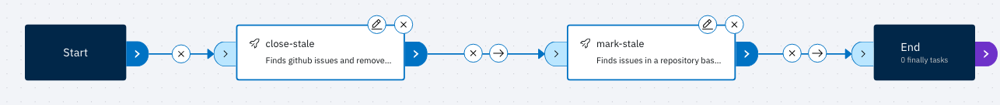
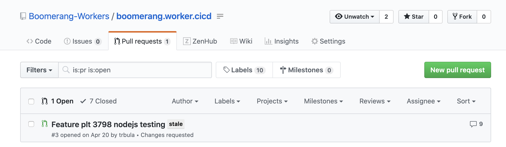
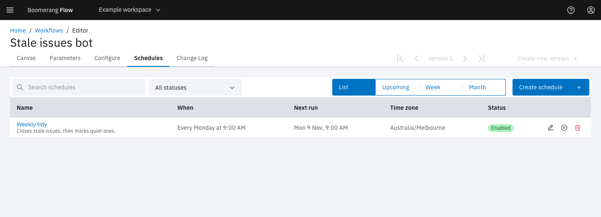

<!-- Written against flow.service.workflow 5.0.0-beta.39. UI labels checked against the live webapp (build 490ba3894, 2026-11-06): 47 of 56 bolded terms seen live; the rest are states the walk didn't reach or aren't labels, and were verified in client-web source. -->

# GitHub issues bot

This tutorial builds a bot that keeps a repository's issue list current. Once a week it closes the issues it marked stale the week before, then marks the ones that have gone quiet since. It's for workflow authors, and it uses two GitHub catalogue tasks and a schedule.

## Before you start

You need:

- the owner or editor role in a Flow workspace;
- the GitHub integration connected to the workspace, with **Share the installation token with tasks** turned on. The GitHub tasks then default their token and API URL to the shared values, `$(workspace.params.github-token)` and `$(workspace.params.github-url)`. See [Connect GitHub](../guides/connect-github);
- the GitHub App installed on the repository you want to tidy. For a first try, use a test repository.

No integration? Use a personal access token instead: see [Use a personal access token](#use-a-personal-access-token).

## How the two tasks work

| Task | What it does |
| --- | --- |
| **Find Issues and Label** | Searches the repository for open issues and pull requests that haven't been updated in **Days Since Activity** days and don't carry **Ignore Label**. It adds **Label** to each one and comments that it's stale. |
| **Find Issues and Remove** | Searches for open issues and pull requests that carry **Issue Label**, comments on each one and closes it. It doesn't check for activity since the label was added: its **Days Since Activity** only changes the wording of the comment. |

Each task handles up to 30 issues a run. Both put the label names into a GitHub search query as written, so use label names without spaces.

The bot runs Remove first, then Label. An issue marked this week stays open until the next run, which gives people a week to respond. To keep an issue open, remove its `stale` label. To keep an issue from ever being marked, give it the ignore label.

## Create the workflow

1. In the side nav, select **Workflows**.
2. Select **Create a new workflow**.
3. Leave **Start from scratch** selected, and enter a **Display Name**, such as `Stale issues bot`.
4. Select **Create**. The editor opens on the **Canvas** tab.

## Add the close task

1. In **Add a task**, open **GitHub** and drag **Find Issues and Remove** onto the canvas.
2. Select the node's edit (pencil) icon and fill in the form:

   | Field | Value |
   | --- | --- |
   | **Task name** | `close-stale` |
   | **API Endpoint** | leave `$(workspace.params.github-url)` |
   | **API Token** | leave `$(workspace.params.github-token)` |
   | **Owner** | the repository's owner or organisation, such as `my-org` |
   | **Repository** | the repository's name, such as `my-repo` |
   | **Days Since Activity** | `7` |
   | **Issue Label** | `stale` |

3. Select **Apply**.

**API Token** is a password field, but while it holds only a reference it shows as text, so you can see where the value comes from.

## Add the mark task

1. Drag **Find Issues and Label** onto the canvas.
2. Select its edit icon and fill in the form:

   | Field | Value |
   | --- | --- |
   | **Task name** | `mark-stale` |
   | **API Endpoint** | leave `$(workspace.params.github-url)` |
   | **API Token** | leave `$(workspace.params.github-token)` |
   | **Owner** | as for `close-stale` |
   | **Repository** | as for `close-stale` |
   | **Days Since Activity** | `30` |
   | **Label** | `stale` |
   | **Ignore Label** | `ignore` |

3. Select **Apply**.

## Connect the tasks and save

1. Drag from the right port of **Start** to the left port of `close-stale`. Link `close-stale` to `mark-stale`, and `mark-stale` to **End** the same way.
2. Leave each link's condition on always, so `mark-stale` still runs if closing fails.
3. Select **Create new version**, enter a **Version comment** such as `First version`, then select **Create**.

If the workspace doesn't share the GitHub token, Flow warns as you save: **Workspace parameters missing**, ending "This workspace does not provide them, so a run fails at that task." Turn sharing on, or follow [Use a personal access token](#use-a-personal-access-token).

## Test it

To see a change on a test repository with recent issues, set **Days Since Activity** on `mark-stale` to `1` and create a new version first. Set it back to `30` before you schedule the workflow.

1. Select **Workflows**, then **Run it** on the workflow's card.
2. Select **Run and View**.

The run page shows `close-stale`, then `mark-stale`, as **Succeeded**, and the run's **Status** reads **Succeeded**. In GitHub, each open issue or pull request that hasn't been updated in 30 days now carries the `stale` label and a comment from the bot.

To see what a task did, select **View Log** on it. A task that fails with `no such workspace param 'github-token'` ran in a workspace that doesn't share the GitHub token.

## Schedule it weekly

A schedule only runs while the workflow's Scheduler trigger is on.

1. Select the **Configure** tab, then **Triggers**.
2. Under **Scheduler**, turn on **Enable**.
3. Select **Create new version**, enter a **Version comment**, then select **Create**.
4. Select the **Schedules** tab, then **Create schedule**.
5. Enter a **Name**, such as `Weekly tidy`.
6. Under **When**, select **Weekly**.
7. Under **On**, select **Tu**, **We**, **Th** and **Fr** to clear them, leaving **Mo** selected.
8. Set **At** to `09:00` and **AM**, and check **Time zone**. The summary under **Time zone** shows the next run.
9. Select **Create**.

The schedule appears in the list with the status **Enabled**, and **Next run** shows the coming Monday at 9:00 AM. Each Monday, issues marked the week before are closed and newly quiet ones are marked.

## Use a personal access token

Without the shared token, give both tasks a token and API URL from workflow parameters.

1. Select the **Parameters** tab, then **Add parameter**.
2. Add `github-pat`, type **Password**, with your token as its **Default value (optional)**. The token must be able to write issues and pull requests on the repository, for example a classic token with the `repo` scope.
3. Add `github-api-url`, type **URL**, with the default `https://api.github.com`. For GitHub Enterprise Server, use `https://<host>/api/v3`.
4. On both tasks, set **API Endpoint** to `$(params.github-api-url)` and **API Token** to `$(params.github-pat)`, then select **Apply**.
5. Select **Create new version**, enter a **Version comment**, then select **Create**.

## Next steps

- [Schedules](../webapp/schedules): manage schedules across the workspace, including one-off and cron schedules.
- [Triggers](../fundamentals/triggers): start a workflow from a webhook, an event or GitHub instead.
- [GitHub teams and members](./github-teams): manage an organisation's teams with more GitHub tasks.
