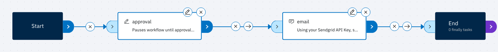
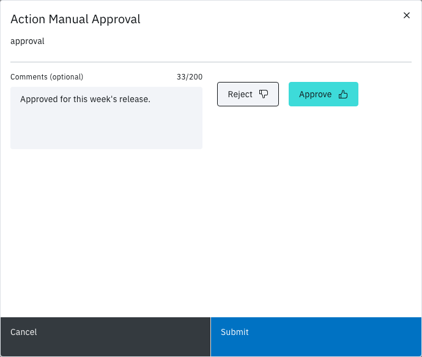

<!-- Written against flow.service.workflow 5.0.0-beta.39. UI labels checked against the live webapp (build 490ba3894, 2026-11-06): 41 of 56 bolded terms seen live; the rest are states the walk didn't reach or aren't labels, and were verified in client-web source. -->

# Use an approval's results

This tutorial builds a workflow that waits for someone to approve or reject it, then sends an email built from the results the Manual Approval task records. It's for workflow authors.

## Before you start

You need:

- the owner or editor role in a Flow workspace. These roles can also approve; the reader role can't;
- an email address on your Flow profile, because the email goes to whoever approves;
- a SendGrid API key that can send mail, and a sender address that SendGrid has verified.

## What an approval records

When a Manual Approval task ends, it sets five results, taken from the approver whose decision completed it:

| Result | Value |
| --- | --- |
| `approvalStatus` | `approved` or `rejected` |
| `approvalDate` | When that approver acted, in ISO 8601 UTC, such as `2026-11-04T05:12:44.120Z` |
| `approvalUserName` | The approver's name |
| `approvalUserEmail` | The approver's email address |
| `approvalComments` | The approver's comment, or empty |

A later task reads one as `$(tasks.<task name>.results.<result>)`. An approval ends the task **Succeeded**; a rejection ends it **Failed**. It records all five results either way.

## Create the workflow

1. In the side nav, select **Workflows**.
2. Select **Create a new workflow**.
3. Leave **Start from scratch** selected, and enter a **Display Name**, such as `Approval email`.
4. Select **Create**. The editor opens on the **Canvas** tab.

## Add the API key parameter

1. Select the **Parameters** tab.
2. Select **Add parameter**.
3. Enter the **Name** `sendgrid-api-key`, choose the **Type** **Password**, and enter your SendGrid API key as the **Default value (optional)**.
4. Select **Add**.

A Password parameter is secured: Flow stores it encrypted and hides it in the webapp and in logs.

## Add the approval

1. Select the **Canvas** tab.
2. In **Add a task**, open **Workflow** and drag **Manual Approval** onto the canvas.
3. Select the node's edit (pencil) icon.
4. Set **Task name** to `approval`.
5. Leave **Approver Group (optional)** and **Number of Approvals (optional)** empty. Any workspace owner or editor can then approve, and one decision completes the task.
6. Select the **Results** tab to see the five results, then select **Apply**.

To limit who can approve, create a group in **Manage workspace › Approver Groups** and choose it in **Approver Group (optional)**. Use **Number of Approvals (optional)** with a group to require more than one of its members. With no groups in the workspace, the field is disabled and reads "No approver groups configured for this workspace."

## Add the email

1. In **Add a task**, open **Communication** and drag **Send Email with Sendgrid** onto the canvas.
2. Select its edit icon and fill in the form:

   | Field | Value |
   | --- | --- |
   | **Task name** | `email` |
   | **API Key** | `$(params.sendgrid-api-key)` |
   | **To** | `$(tasks.approval.results.approvalUserEmail)` |
   | **From** | your SendGrid verified sender |
   | **Subject** | `Approval $(tasks.approval.results.approvalStatus) by $(tasks.approval.results.approvalUserName)` |
   | **Content Type** | `Text` |

3. Select **Body Content**, paste the text below, then select **Update**.
4. Select **Apply**.

```text
The approval ended with these results:

- status: $(tasks.approval.results.approvalStatus)
- date: $(tasks.approval.results.approvalDate)
- by: $(tasks.approval.results.approvalUserName)
- email: $(tasks.approval.results.approvalUserEmail)
- comments: $(tasks.approval.results.approvalComments)
```

Each reference names the task by the name you gave it, `approval`. The v3 form, `$(Task.<task name>.results.<result>)`, doesn't resolve.

> **Note:** Use revision 3 or later of Send Email with Sendgrid. Revisions 1 and 2 report success without sending anything. A task you drop on the canvas now is on revision 3. A node on an older revision shows a yellow warning icon: select it, review the fields, then select **Update task**.

## Connect the tasks and save

1. Drag from the right port of **Start** to the left port of `approval`. Link `approval` to `email`, and `email` to **End** the same way.
2. Leave the link from `approval` to `email` on always. A rejection ends `approval` **Failed**, and an always link still runs `email`, so the email goes out either way.
3. Select **Create new version**, enter a **Version comment** such as `First version`, then select **Create**.



## Run the workflow and approve it

1. Select **Workflows**, then **Run it** on the workflow's card.
2. In **Workflow Parameters**, leave **sendgrid-api-key** blank to use its stored default, then select **Run and View**.
3. On the run page, `approval` shows **Waiting** in the task log, with an **Action** button. Select **Action**.
4. In **Action Manual Approval**, select **Approve** and add a comment in **Comments (optional)**.
5. Select **Submit**.



You can also decide from **Actions** in the side nav: the **Approvals** tab lists every approval waiting in the workspace.

After you submit, `approval` and then `email` show **Succeeded**, and the run's **Status** reads **Succeeded**. The email arrives at your address:

```text
Subject: Approval approved by Ada Lovelace

The approval ended with these results:

- status: approved
- date: 2026-11-04T05:12:44.120Z
- by: Ada Lovelace
- email: ada@example.com
- comments: Looks good
```

To see the decision in Flow, select **View Action** on `approval`. **Manual Approval details** lists the **Approvers**, with each decision, date and comment.

<!-- SCREENSHOT: The run page with Status Succeeded, approval and email Succeeded in the task log. (not capturable yet: email succeeds only with a SendGrid API key and a verified sender) -->

Run the workflow again and select **Reject** instead. `approval` shows **Failed**, `email` still runs, and the email reports `status: rejected`.

## Next steps

- [Actions](../fundamentals/actions): approvals and manual tasks across the workspace.
- [Parameters](../fundamentals/parameters): every reference form a task can read.
- [Email a file from Box](./box-file-download): send a file as an attachment.
