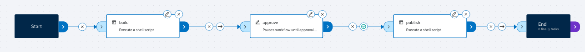
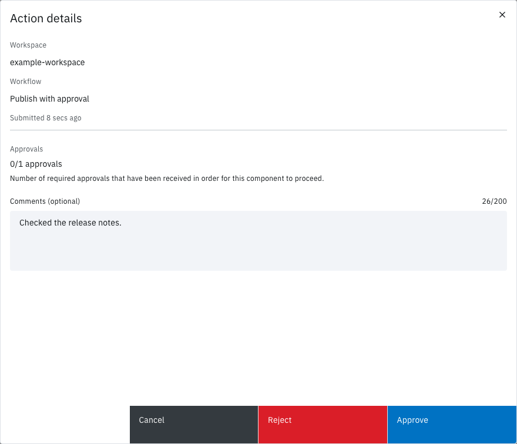
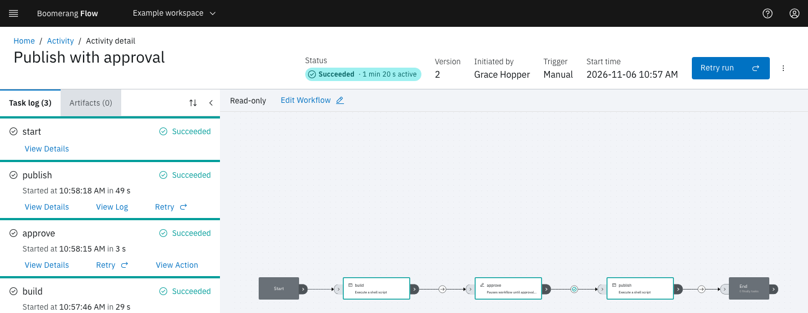
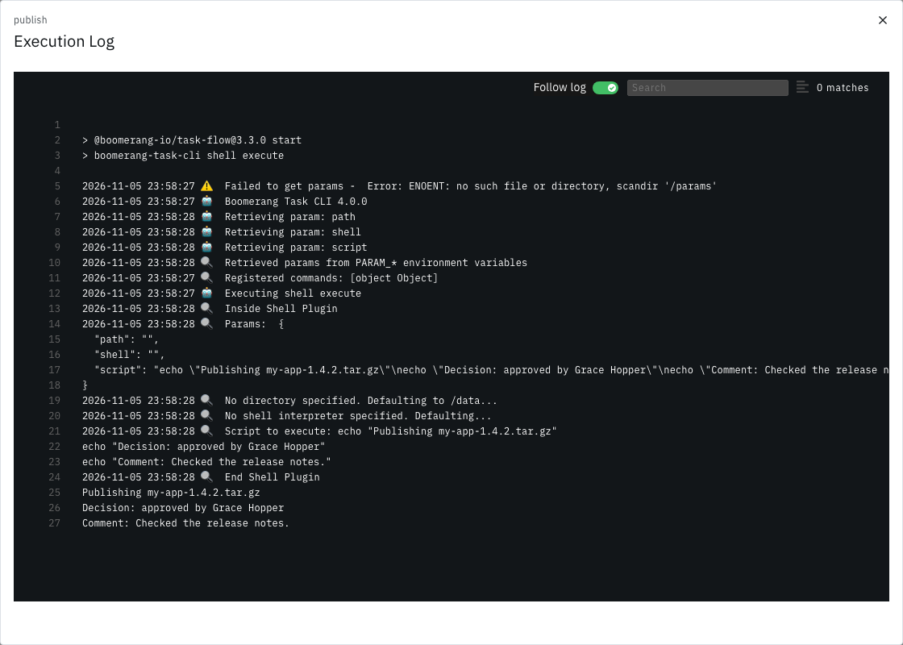

<!-- Written against flow.service.workflow 5.0.0-beta.39; steps run live on main e354e2c62. -->

# Pass results between tasks with an approval

This tutorial builds a workflow of three tasks. A shell task makes a file name from a parameter and returns it as a result, a Manual Approval waits for a person to decide, and a second shell task prints the file name and the decision. It's for workflow authors, takes about 15 minutes, and needs no accounts outside Flow.

## Before you start

You need:

- the owner or editor role in a Flow workspace. These roles can also approve; the reader role can't;
- a dispatcher connected to Flow to run the two shell tasks. If you've run the workflow in [Getting started](../introduction/getting-started), you have one.

## What you'll build

| Task name | Task | What it does |
| --- | --- | --- |
| `build` | Execute Shell | Makes `my-app-<version>.tar.gz` from the `version` parameter, and returns it as the result `filename` |
| `approve` | Manual Approval | Waits for someone to approve or reject, then records who decided and what they said |
| `publish` | Execute Shell | Prints `filename` and the approval's results |

Tasks read values through references, which Flow fills in before the task starts:

- `$(params.version)` reads the workflow parameter `version`;
- `$(tasks.build.results.filename)` reads the result `filename` from the task named `build`.

## Create the workflow

1. In the side nav, select **Workflows**.
2. Select **Create a new workflow**.
3. Leave **Start from scratch** selected, and enter the **Display Name** `Publish with approval`. Flow fills **Name** with `publish-with-approval`.
4. Select **Create**. The editor opens on the **Canvas** tab, with **Start** and **End**.

## Add the version parameter

1. Select the **Parameters** tab.
2. Select **Add parameter**.
3. Enter the **Name** `version` and the **Label (optional)** `Version`.
4. Leave **Type** as **Text**, and enter `1.0.0` as the **Default value (optional)**.
5. Select **Add**.

When a run starts, Flow asks for **Version**, with `1.0.0` filled in. Tasks read the value by the parameter's name, as `$(params.version)`.

> [!NOTE]
> Give the parameter a label. The dialog says an empty label shows the name, but in 5.0.0 a parameter without a label appears in **Workflow Parameters** as an unlabelled field.

## Add the build task

1. Select the **Canvas** tab.
2. In **Add a task**, search for `shell`, and drag **Execute Shell** onto the canvas. It's in the **Utilities** category.
3. Select the node's edit (pencil) icon. **Edit Execute Shell** opens.
4. Set **Task name** to `build`.
5. Select the **Shell Script** field. In **Update Shell Script**, enter the script below, then select **Update**.

   ```bash
   filename="my-app-$(params.version).tar.gz"
   echo "Built $filename"
   if [ -d "$RESULTS_PATH" ]; then
     printf '%s' "$filename" > "$RESULTS_PATH/filename"
   else
     printf '{"filename":"%s"}' "$filename" > "$RESULTS_PATH"
   fi
   ```

6. Under **Result Parameters**, enter the **Name** `filename` and the **Description** `The file the build made`. **Add** is available once both are filled. Select **Add**: the result appears below as `filename:The file the build made`.
7. Select **Apply**.

Flow replaces `$(params.version)` before the script runs, so with `1.4.2` the shell sees `filename="my-app-1.4.2.tar.gz"`.

A script returns a result by writing it to the path in the `RESULTS_PATH` environment variable. Depending on how your operator set up the dispatcher, that path is a directory holding one file per result, or a single file holding a JSON object; the `if` covers both. Flow keeps only the results the node declares under **Result Parameters**, so declare every result your script writes. [Develop a task](../guides/tasks#return-results) has the details.

## Add the approval

1. In **Add a task**, clear the search, open **Workflow**, and drag **Manual Approval** onto the canvas.
2. Select its edit icon. **Edit Manual Approval** opens.
3. Set **Task name** to `approve`.
4. Leave **Approver Group (optional)** and **Number of Approvals (optional)** empty. Any workspace owner or editor can then decide, and one decision completes the task.
5. Select **Apply**.

The **Results** tab in **Edit Manual Approval** lists the five results the task records when someone decides. This tutorial uses three:

| Result | Value |
| --- | --- |
| `approvalStatus` | `approved` or `rejected` |
| `approvalUserName` | The name of the person who decided |
| `approvalComments` | Their comment, or empty |

The other two are `approvalDate` and `approvalUserEmail`. See [Actions](../fundamentals/actions) for all five.

## Add the publish task

1. Drag another **Execute Shell** onto the canvas. Flow names it **Execute Shell 2**.
2. Select its edit icon, and set **Task name** to `publish`.
3. Select the **Shell Script** field, enter the script below, then select **Update**.

   ```bash
   echo "Publishing $(tasks.build.results.filename)"
   echo "Decision: $(tasks.approve.results.approvalStatus) by $(tasks.approve.results.approvalUserName)"
   echo "Comment: $(tasks.approve.results.approvalComments)"
   ```

4. Select **Apply**. This task returns nothing, so leave **Result Parameters** empty.

Each reference names a task by its **Task name**, `build` or `approve`. If you rename a task later, update the references to it.

## Link the tasks and save a version

1. Drag from the right port of **Start** to the left port of `build`. Link `build` to `approve`, `approve` to `publish`, and `publish` to **End** the same way.
2. Select the condition icon in the middle of the link from `approve` to `publish`, once. It changes from an arrow (always) to a tick (success): `publish` now runs only when `approve` succeeds, which it does when someone approves.
3. Select **Create new version**.
4. In **Create New Version**, enter a **Version comment** such as `First version`, then select **Create**.

Flow confirms "Successfully created workflow version".



## Run it

1. Select **Workflows** in the breadcrumb.
2. On the **Publish with approval** card, select **Run it**.
3. In **Workflow Parameters**, change **Version** to `1.4.2`, then select **Run and View**.

The run page opens, and **Status** shows **Running**. In the **Task log**, `build` shows **Succeeded** once its container has run, usually within a minute. Then `approve` shows **Waiting**, with an **Action** button. The run waits there until someone decides, and the wait doesn't count towards the run's timeout.

To see the result `build` returned, select **View Details** under `build`. **Results** lists `filename`, its description, and the value `my-app-1.4.2.tar.gz`. **Params** shows the script as it ran, with `$(params.version)` already replaced by `1.4.2`.

## Approve it from Actions

1. In the side nav, select **Actions**. The **Approvals** tab lists your approval: workflow **Publish with approval**, task `approve`, status **Waiting**, and **0/1 approvals**.
2. Select the row. **Action details** opens.
3. In **Comments (optional)**, enter `Checked the release notes.`
4. Select **Approve**.

Flow confirms "Success! Request to approve action submitted".



You can decide from the run page instead: select **Action** on `approve`, then in **Action Manual Approval** select **Approve**, add a comment and select **Submit**.

## Read the output

1. Return to the run: select **Activity** in the side nav, then the run's row.
2. Wait for `publish` and **End** to show **Succeeded**. The run's **Status** then reads **Succeeded**, with its active time.

   

3. Under `publish`, select **View Log**. The **Execution Log** ends with these lines, with your name in place of Grace Hopper's:

   ```text
   Publishing my-app-1.4.2.tar.gz
   Decision: approved by Grace Hopper
   Comment: Checked the release notes.
   ```

   

The lines above them come from the task's runner. Its warning `Failed to get params` is expected: the next lines show it read the parameters from environment variables instead.

`publish` read `filename` from `build`, which ran before the approval, and three results from `approve`. A result stays readable by every later task in the run, however long the run waited in between. To see who decided after the fact, select **View Action** under `approve`.

You've built a workflow that passes a parameter into a task, a result from one task to another, and a person's decision to the task after it.

## Variation: what happens on Reject

A rejection ends `approve` **Failed**. It still records its results, with `approvalStatus` set to `rejected`. The link from `approve` to `publish` decides what happens next.

| Link from `approve` to `publish` | After Approve | After Reject |
| --- | --- | --- |
| Success (tick), as built above | `publish` runs. The run ends **Succeeded**. | `publish` shows **Skipped**. The run ends **Failed**. |
| Always (arrow) | `publish` runs. The run ends **Succeeded**. | `publish` runs and prints `Decision: rejected by Grace Hopper`. The run ends **Succeeded**. |

To see the first case, run the workflow again, and in **Action details** select **Reject** instead of **Approve**. The run's **Status** reads **Failed**, because `approve` failed and the only path on from it needed a success. **End** still shows **Succeeded** in the task log.

To see the second:

1. In the editor's **Canvas** tab, select the condition icon on the link from `approve` to `publish` twice. Each select moves it on, from success to failure, then to always: the icon is an arrow again.
2. Create a new version, run the workflow, and reject it.

This time `publish` runs and its log prints `Decision: rejected by` and your name. The run ends **Succeeded**, though `approve` shows **Failed** in the task log: an always link carries on past a failure, so the run reached its end.

Use a success link when the next task should happen only on approval, such as a release. Use an always link when the next task reports the outcome either way, and read `approvalStatus` in it to tell the two apart. A failure link runs the next task only on a rejection, for example to tell someone their request was turned down.

## Not seeing what you expected?

- [Why does `build` stay **Ready**?](../introduction/troubleshooting#a-run-didnt-start)
- [Why did `publish` fail with `ParamUnresolved`?](../introduction/troubleshooting#a-task-failed-with-paramunresolved)
- [Why does the run stay **Waiting**?](../introduction/troubleshooting#a-run-is-stuck-waiting)

## Next steps

- [Parameters](../fundamentals/parameters): every reference form a task can read, and which value wins.
- [Actions](../fundamentals/actions): approver groups, more than one approval, and every place to decide.
- [Runs](../fundamentals/runs): statuses, retries and timeouts.
- [Develop a task](../guides/tasks): return results from a container of your own.
- [Use an approval's results](./manual-approval-output): email the decision with SendGrid.
