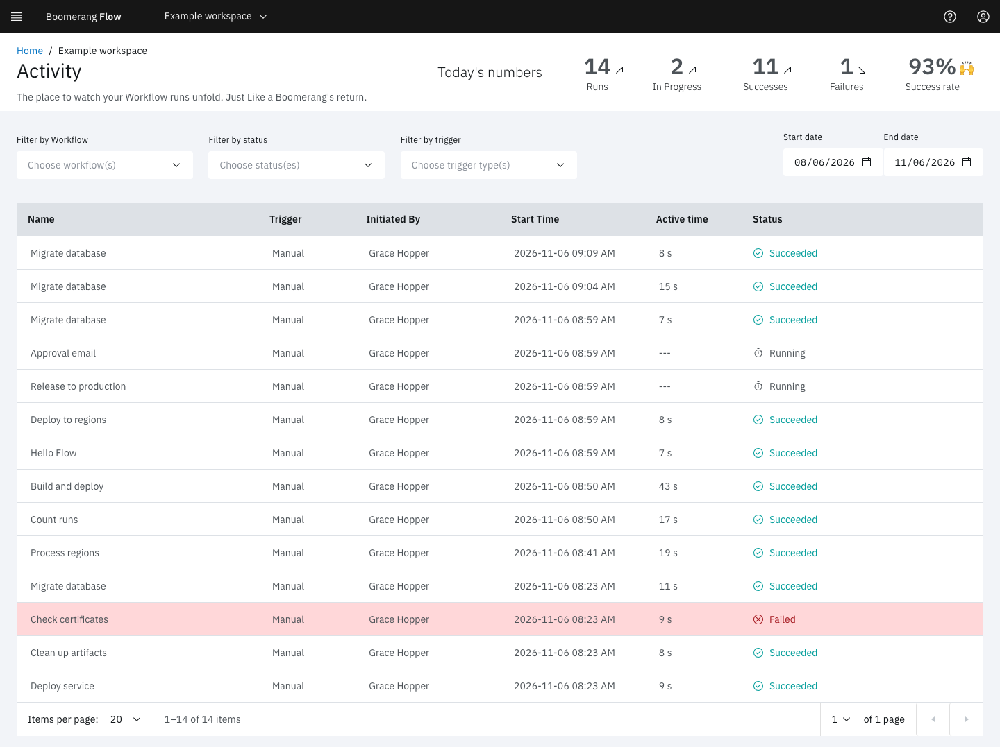

<!-- Written against flow.service.workflow 5.0.0-beta.39. UI labels checked against the live webapp (build 490ba3894, 2026-11-06): 26 of 27 bolded terms seen live; the rest are states the walk didn't reach or aren't labels, and were verified in client-web source. -->

# Activity

Activity lists every run of the current workspace's workflows, newest first. Use it to answer "did last night's run work?", to find a failure, and to open a run and read its logs.

Open it from **Activity** in the side navigation. A workflow card's **View Activity** opens it filtered to that workflow, and Home's **Runs today** tile and **All activity** link open it too. Every member of the workspace can see it. An administrator can turn Activity off for the whole install under **Admin › Settings › Features**.

## Today's numbers

The header counts today's runs in this workspace, whatever the filters below say:

- **Runs:** every run created today.
- **In Progress:** runs that are running or waiting.
- **Successes** and **Failures.**
- **Success rate:** successes and in-progress runs together, as a share of today's runs.

## Filter the list

| Filter | What it narrows to |
| --- | --- |
| **Filter by Workflow** | One or more workflows |
| **Filter by status** | One or more statuses, such as **Failed** or **Timed Out** |
| **Filter by trigger** | Runs started by **Schedule**, **Manual** or **Webhook** |
| **Start date** and **End date** | Runs created in that range. The default is the last 3 months, up to today. |

The filters are kept in the page's address, so you can bookmark or share a filtered view.

The trigger filter has no option for runs started by an event, GitHub, a parent workflow or a retry. To break those down, use [Insights](./insights), which filters on every trigger.

## Read the table

| Column | Shows |
| --- | --- |
| **Name** | The workflow's display name. Select the header to sort by it. |
| **Trigger** | How the run started: Manual, Schedule, Webhook, Event, Github, Task (a parent workflow), Retry or Engine |
| **Initiated By** | The person, or the token's name, that started a manual, webhook or event run. Runs started by a schedule, a parent workflow or a retry show `---`; the run page links to their origin instead. |
| **Start Time** | When the run started. A run that hasn't started yet, such as one waiting for a dispatcher or for a concurrency slot, shows `---`. |
| **Active time** | Time spent executing, once the run has finished. Waits for approvals, manual tasks and sleeps, and pauses, are left out. |
| **Status** | The run's [status](../fundamentals/runs#status-and-phase). When Flow recorded a reason, it shows under the status: `DeadlineExceeded` for a timeout, or `ConcurrencyLimit` for a run skipped over its workflow's concurrency limit. |

Select a row to open the run page. Pages hold 10 runs by default, and up to 100.

## How long runs are kept

Activity shows only the runs Flow still holds. Finished runs are deleted after the **Activity Retention (days)** setting, 365 days by default and never less than 60. See [Runs](../fundamentals/runs#how-long-runs-are-kept).

## Example: find out why last night's report failed

The "nightly-report" workflow runs on a schedule at 2:00 AM. In the morning:

1. Open **Activity**.
2. In **Filter by Workflow**, choose "nightly-report". In **Filter by status**, choose **Failed** and **Timed Out**.
3. Select the top row.
4. On the run page, find the task marked **Failed** in the task log and select **View Log**.

The last lines of the log, and the task's status message under **View Details**, usually name the cause: a missing file, a refused credential, or the container's exit code.

## Next steps

- [Runs](../fundamentals/runs): what the run page shows, and how to pause, cancel or retry a run.
- [Retry a run](../guides/retry-a-run): re-run a failed run from the task that failed.
- [Insights](./insights): success rates and durations over time.
