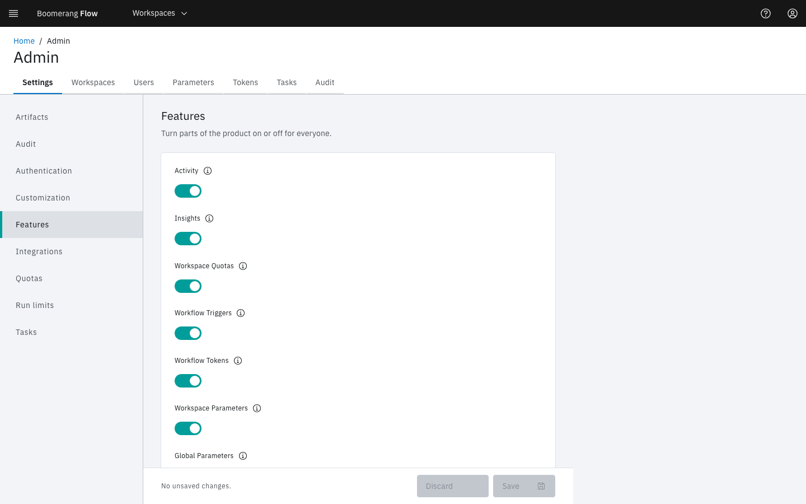

<!-- Written against flow.service.workflow 5.0.0-beta.39. UI labels checked against the live webapp (build 490ba3894, 2026-11-06): 95 of 98 bolded terms seen live; the rest are states the walk didn't reach or aren't labels, and were verified in client-web source. -->

# Admin

**Admin** is the platform's administration page: every setting, every workspace and user, global parameters and tokens, the task catalogue, and the audit trail. This page is for platform admins and operators. Deployment configuration, such as properties and environment variables, is on the operator pages: see [Configuring](../hosting/configuring).

The **Admin** link sits at the bottom of the side nav for users whose type is admin or operator. An operator sees the settings read-only.

## Tabs

Each tab appears when you hold the permission it reads. Four also need a feature on.

| Tab | Holds | Also needs |
| --- | --- | --- |
| **Settings** | The platform settings, in nine groups | — |
| **Workspaces** | Every workspace | **Settings › Features › Workspace Management** on |
| **Users** | Everyone who has signed in | **Settings › Features › User Management** on |
| **Parameters** | Global parameters | **Settings › Features › Global Parameters** on |
| **Tokens** | Global machine tokens | Flow running with security on |
| **Tasks** | The global task catalogue | — |
| **Audit** | The audit trail | — |

## Settings

The groups are listed on the left. Each value is described in a tooltip beside its label. Change values, then select **Save**, or **Discard** to drop the changes. A secured field shows **Set** when it holds a value: type over it to replace it, or select **Clear**.

| Group | Settings (default) |
| --- | --- |
| **Artifacts** | **Default Retention (days)** (30) · **Maximum Retention (days)** (90) · **Largest Artifact (MB)** (1024) · **Store Task Logs** (on) · **Task Log Retention (days)** (7) |
| **Audit** | **Enabled** (on) · **Level** (`WRITE`) · **Retention Days** (365, at least 60) |
| **Authentication** | **OIDC Issuer** · **OIDC Client ID** (both blank) |
| **Customization** | **App Name** (`Flow`) · **Platform Name** (`Boomerang`) · **Display Platform Logo** (on) · **Logo URL** (blank) |
| **Features** | **Activity** · **Insights** · **Workspace Quotas** · **Workflow Triggers** · **Workflow Tokens** · **Workspace Parameters** · **Global Parameters** · **Workspace Management** · **Workspace creation by users** · **Auto-Create Users** · **User Management** · **Workspace Tasks** (all on) |
| **Integrations** | The GitHub App's **GitHub App ID**, **GitHub Private Key**, **GitHub App Name**, **GitHub Client ID**, **GitHub Client Secret** and **GitHub Webhook Secret**; the Slack app's **Slack Auth Token**, **Slack App ID**, **Slack Client ID**, **Slack Client Secret** and **Slack Signing Secret** (all blank) |
| **Quotas** | **Maximum Concurrent Workflows** (4) · **Maximum Number of Workflows** (10) · **Max WorkflowRuns per month** (20) · **Max WorkflowRun Duration** (30 minutes) · **Max Workspace Storage** (`2Gi`) · **Max Artifact Storage** (`5Gi`) |
| **Run limits** | **Maximum Child Workflow Nesting Depth** (5) · **Maximum For-Each Items** (256) · **Finally Timeout (minutes)** (5) · **Activity Retention (days)** (365, at least 60) |
| **Tasks** | **Enable Debug** (on) · **Default Image Path** (`boomerangio/task-flow:3.3.0`) · **Deletion Policy** (Never) · **Enable Verified Tasks to be edited** (off) · **Maximum task duration** (0: tasks inherit the run's timeout) |

Some settings that need more than a sentence:

- **Audit › Level** takes `DESTRUCTIVE` (deletes only), `WRITE` (every change) or `ALL` (adds sensitive reads and exports). Any other text reads as `WRITE`.
- **Features › Workspace creation by users** lets any signed-in user create a workspace. Admins and operators always can.
- **Features › Auto-Create Users**, switched off, lets in only people who are already users or whom an admin has added to a workspace. See [Decide who else may sign in](../hosting/sign-in#decide-who-else-may-sign-in).
- **Features › Workspace Parameters** and **Global Parameters**, switched off, also stop those layers resolving in runs. See [Parameters](../fundamentals/parameters).
- **Run limits › Activity Retention (days)** deletes each finished run older than it, with its task runs, actions, run-scoped artifacts and logs, once an hour.
- **Tasks › Deletion Policy** decides when a finished task's Kubernetes Job or Tekton TaskRun is removed: **Never (keep until the retention period)**, **On Success (remove when a task succeeds)** or **Always (remove when a task ends)**. The log read from the worker goes with it; a stored task log stays.

The **Authentication** and **Default Image Path** settings are usually set at install time. See [Sign-in and the first admin](../hosting/sign-in) and [Set the task image](../hosting/configuring#set-the-task-image). The quota defaults are explained on [Quotas](./quotas).

## Workspaces

Every workspace, with its users, workflows and status. Select a row to open its [Manage workspace](./manage) page. **Create Workspace** asks for a **Display Name**; Flow turns it into the workspace's unique identifier. There's no delete here: an owner deletes a workspace from **Manage workspace › Settings**.

## Users

Everyone who has signed in, with their **Role** (**Admin**, **Operator** or **User**), **Status** and **Last sign-in**. There's no invite: people join by signing in, or when someone adds their email to a workspace.

Select a user to see their workspaces, labels and details. **Change role** sets their platform role to **Admin** or **User**. See [Sign-in and the first admin](../hosting/sign-in) for how the first admin is made, and how an identity provider can decide admins.

## Parameters

Global parameters, which every workspace can read as `$(global.params.<name>)`. A workspace parameter of the same name wins. See [Parameters](../fundamentals/parameters).

## Tokens

Global machine tokens, for services, scripts, AI agents and dispatchers.

1. Select **Create token**.
2. Enter a **Name**, and choose the **Actor**: **Service** (a system, script or dispatcher, the default), **Agent** (an AI agent) or **None** (a person's token).
3. Choose a **Role** (**Admin** or **Operator**), or open **Customise permissions**.
4. Optionally set an **Expiration Date (optional)** and a **Description (optional)**, then select **Create**.
5. Copy the token. Flow shows it once.

See [Machine tokens](../hosting/machine-tokens) for tokens declared in configuration, the bootstrap token and rotation.

## Tasks

The global task catalogue, in the same Task Manager screens a workspace uses. A verified task can be edited only while **Settings › Tasks › Enable Verified Tasks to be edited** is on. See [Tasks](../fundamentals/tasks).

## Audit

A read-only record of who did what. The tiles count **Events**, **Success**, **Failed** and **Denied** for the period, 30 days by default. Filter by actor, outcome, action, level and date, and expand a row to see the event as JSON.

Deleting a workspace, parameter, workflow, schedule, artifact or run, and revoking a token, are recorded at the `DESTRUCTIVE` level. Every other change is `WRITE`. A change to a secret names the secret, never its value. With **Settings › Audit › Enabled** off, the page shows **Audit capture is off**, and nothing new is recorded.

## Next steps

- [Configuring](../hosting/configuring): deployment properties.
- [Sign-in and the first admin](../hosting/sign-in).
- [Machine tokens](../hosting/machine-tokens).
- [Manage workspace](./manage): one workspace's own settings.
