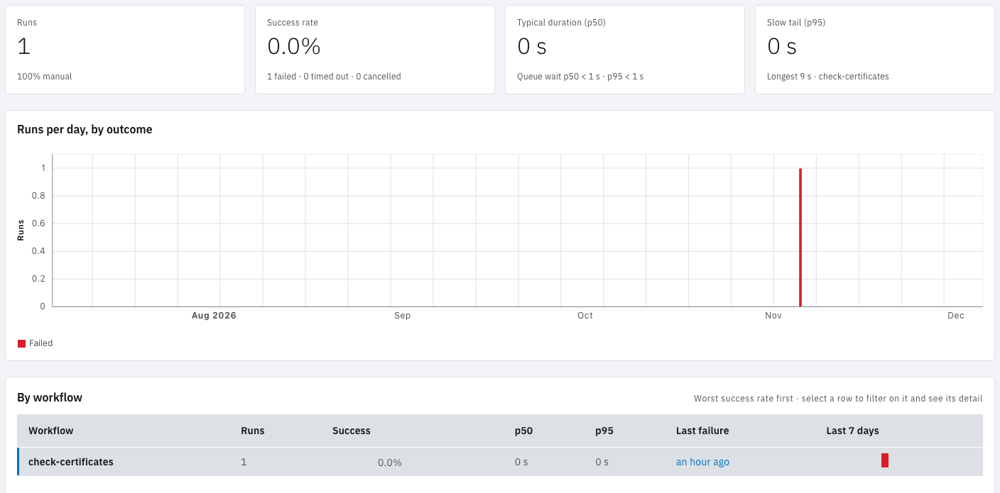

<!-- Written against flow.service.workflow 5.0.0-beta.39. UI labels checked against the live webapp (build 490ba3894, 2026-11-06): 30 of 33 bolded terms seen live; the rest are states the walk didn't reach or aren't labels, and were verified in client-web source. -->

# Insights

Insights shows how reliable and how fast a workspace's workflows are over a period you choose. It answers four questions in order: are runs succeeding, are they getting slower, what fails and why, and where the time goes.

Select **Insights** in the side navigation. Every member of the workspace can see it. An administrator can turn it off for the whole install under **Admin › Settings › Features**.

## Choose the period and the runs

The filters under the header narrow every section:

- **Filter by Workflow**, **Filter by status** and **Filter by trigger.** The trigger filter offers every way a run starts: Manual, Schedule, Webhook, Event, GitHub, Engine, Task and Retry.
- **Filter by label:** one or more `key=value` pairs, applied when you press Enter or leave the field.
- **Start date** and **End date:** the last 3 months by default.
- **Compare with previous period:** adds to each headline tile how it changed against the period of the same length immediately before.

## What each section shows

**Headline tiles.** Four numbers for the period:

| Tile | Value | Detail line |
| --- | --- | --- |
| **Runs** | How many runs | The top three triggers by share |
| **Success rate** | Succeeded runs as a share of the runs that succeeded, failed, timed out or were invalid. Cancelled and unfinished runs are left out. | How many failed, timed out and were cancelled |
| **Typical duration (p50)** | Half the runs took less than this | How long runs waited in the queue before starting |
| **Slow tail (p95)** | 95 in 100 runs took less than this | The longest run, and its workflow |

Durations are taken over succeeded runs, and are active time: waits for approvals and other gates, and pauses, are left out.

**Runs per day, by outcome.** Stacked bars of each day's runs: **Succeeded**, **Failed**, **Timed out**, **Cancelled** and **Other**.

**By workflow.** One row per workflow, worst success rate first, with its runs, success rate, p50 and p95 durations, **Last failure** (a link to that run) and a strip of the **Last 7 days**. Select a workflow's name to filter the page to it and open its detail underneath:

- **Where the time goes:** each task's p50 duration over its succeeded task runs, the queue wait, and how many of the runs were retries.
- **Why it fails:** each way the workflow's runs ended badly, counted by task and reason, each linking to the newest run that ended that way.
- **Model usage,** when the workflow ran an AI task.

**Duration spread, by workflow.** A bar from p5 to p95 for each workflow with a mark at p50, on a log scale. A red mark shows the workflow's run timeout, so you can see how close its slow runs come to it.

**Task runs.** The period's task runs grouped by **Task**, **Task type**, **Workflow**, **Model**, **For-each item** or a run **Label**, over the whole period or per hour, day or month. Each row has runs, failures, and mean, p50, p95 and maximum duration over its succeeded task runs; tokens and cost appear when AI tasks reported them. **Wall clock by run label** measures, for each value of a run label, the time from the first task run's start to the last one's end across the runs that share it. **Slowest task runs** lists the ten slowest, each linking to its run. This section takes the workflow, label and date filters, not the status and trigger filters, and shows at most 1,000 groups.

**Model usage.** Shown when an AI task ran in the period: total tokens, cost as the model endpoints reported it, the number of AI task runs, and a row per model.

## Which runs are counted

Insights reads the runs Flow still holds. Runs older than the Activity retention, 365 days by default, are gone, and so are the runs of deleted workflows. The workspace's monthly run quota still counts those, so the two numbers can differ. See [Runs](../fundamentals/runs#how-long-runs-are-kept).

## Example: find out why a workflow has slowed down

You notice that "nightly-report" now finishes after people start work.

1. Open **Insights** and switch on **Compare with previous period**. **Slow tail (p95)** is up 40% on the previous 3 months.
2. In **By workflow**, select "nightly-report". **Where the time goes** shows that its "export-data" task's p50 has doubled, while the other tasks are unchanged.
3. Under **Task runs**, set **Group by** to **Task** and **By time** to **Month** to see when "export-data" started to slow.

The month it changed points to the cause: here, the month the source table grew past a size the export handles quickly.

## Next steps

- [Activity](./activity): every run, one row at a time.
- [Runs](../fundamentals/runs): timeouts, retries and concurrency limits.
- [Use AI tasks](../guides/use-ai-tasks): the tasks behind Model usage.
