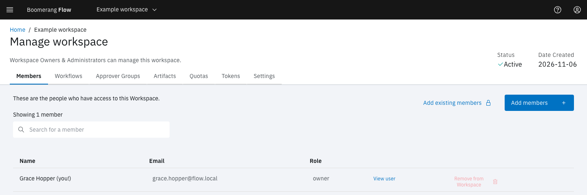

<!-- Written against flow.service.workflow 5.0.0-beta.39. UI labels checked against the live webapp (build 490ba3894, 2026-11-06): 37 of 39 bolded terms seen live; the rest are states the walk didn't reach or aren't labels, and were verified in client-web source. -->

# Manage workspace

**Manage workspace** is one workspace's own administration: its members, approver groups, artifacts, quotas, tokens and settings. This page is for workspace owners and editors, and for members who want to know what their role allows.

Open it from **Manage workspace** in the side nav, which appears while **Admin › Settings › Features › Workspace Management** is on. The header shows the workspace's **Status** and **Date Created**. The workspace's parameters, tasks and integrations have their own side-nav pages: see [Parameters](../fundamentals/parameters), [Tasks](../fundamentals/tasks#add-your-own-tasks-in-task-manager) and [Integrations](./integrations).

## What can each role do?

Every member has one of three workspace roles. Here's what each grants in the workspace.

| Role | In this workspace |
| --- | --- |
| `owner` | Everything, including deleting workflows, schedules, runs, artifacts, parameters, approver groups, members, tokens and the workspace itself |
| `editor` | View, create and change; run workflows, cancel and retry runs, and approve. Can't delete. |
| `reader` | View only |

Whoever creates a workspace becomes its owner. Platform admins and operators act in every workspace: an admin can do everything, and an operator everything but delete.

Changing anything on these tabs needs the **Workspace Management** feature on, the workspace active, and the owner or editor role (or a platform admin or operator). Otherwise the controls are disabled, and most tabs show a **Read-only** notice.

## Members

The people who can use the workspace, with their role.

- **Add members:** enter each person's **Email** and **Role** (**editor** by default), select **Add**, then **Add member**. Someone who hasn't signed in yet gets an account, which their first sign-in activates. Flow sends no invitation.
- **Add existing members:** platform admins only. Pick people who already have an account; each joins as an editor.
- **Remove from Workspace:** removes a member, who loses access to the workspace's workflows. Removing members needs the owner role.

To leave a workspace yourself, open the overflow menu on its card on **Home** and select **Leave**.

## Workflows

A read-only list of the workspace's workflows, with links to **View/edit** each one and see its **Activity**.

## Approver Groups

An approver group is a named set of members that a Manual Approval task can name as its approvers. Only people in the group can decide that approval, and a machine token can't.

1. Select **Create new group**.
2. Enter a **Group name**, unique in the workspace.
3. Select the members to include, then **Create group**.

Owners and editors create and edit groups. Deleting a group needs the owner role, and removes the group from every approval that names it. See [Actions](../fundamentals/actions).

## Artifacts

Every artifact the workspace's runs uploaded, filtered by **Scope** (**All**, **Run** or **Workflow**) and **Show expired**. While quotas are on, it shows the storage used against the **Artifact Storage** quota. See [Artifacts and the run workspace](../fundamentals/artifacts).

## Quotas

The workspace's limits and current usage. Every member can see them; in the webapp, only a platform admin can change them. See [Quotas](./quotas).

## Tokens

Tokens that let a service call Flow's API on this workspace's behalf. The tab is hidden when Flow runs without security.

1. Select **Create token**.
2. Enter a **Name**: lowercase letters, digits and dashes.
3. Choose a **Role** (**Editor**, **Owner** or **Reader**), or open **Customise permissions** to pick resources and actions.
4. Optionally set an **Expiration Date (optional)** and a **Description (optional)**, then select **Create**.
5. Copy the token. Flow shows it once.

Owners and editors can create tokens. Deleting a token stops anything still using it from working. See [Machine tokens](../hosting/machine-tokens).

## Settings

- **Basic details:** the **Display Name**, which the edit icon changes, and the **Unique Identifier Name** that appears in URLs. Renaming changes the identifier too. A workspace created through the API with an external reference also shows its **External Reference**.
- **Labels:** key-value pairs, useful when you query the API.
- **Delete Workspace:** permanently removes the workspace with its workflows, task templates, runs and tokens. Members lose access. This needs the owner role.

> [!WARNING]
> Deleting a workspace can't be undone, and the tokens on its **Tokens** tab stop working.

## Next steps

- [Quotas](./quotas).
- [Admin](./administer): platform administration.
- [Actions](../fundamentals/actions): approvals and approver groups in use.
