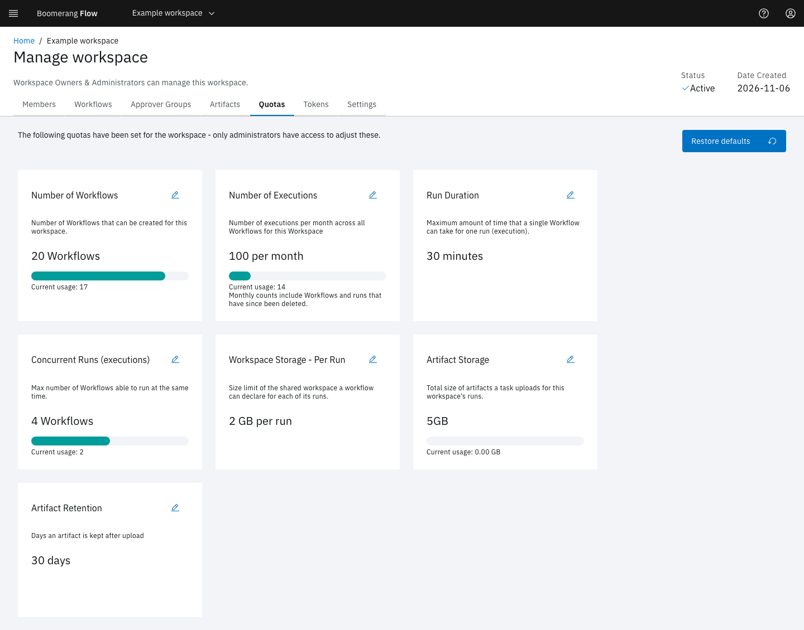

<!-- Written against flow.service.workflow 5.0.0-beta.39. UI labels checked against the live webapp (build 490ba3894, 2026-11-06): 27 of 29 bolded terms seen live; the rest are states the walk didn't reach or aren't labels, and were verified in client-web source. -->

# Quotas

A quota is a limit on what one workspace can use: workflows, runs, run time, and storage. Admins set the defaults every workspace starts with, and can override them for one workspace. This page is for workspace members and admins.

## What does each quota limit?

The first column is the card on **Manage workspace › Quotas**. The default comes from **Admin › Settings › Quotas**, except Artifact Retention, which comes from **Admin › Settings › Artifacts**.

| Quota | Default setting | Default | Counts | Checked when |
| --- | --- | --- | --- | --- |
| **Number of Workflows** | **Maximum Number of Workflows** | 10 | The workspace's workflows, active or inactive | A workflow is created |
| **Number of Executions** | **Max WorkflowRuns per month** | 20 | Runs created this calendar month (UTC), including runs since deleted | A run is submitted or retried |
| **Run Duration** | **Max WorkflowRun Duration** | 30 minutes | The longest timeout a run may have | A run is submitted |
| **Concurrent Runs (executions)** | **Maximum Concurrent Workflows** | 4 | The workspace's runs that haven't finished | A run is submitted or retried |
| **Workspace Storage - Per Run** | **Max Workspace Storage** | `2Gi` | The size of one run's run workspace | A workflow is saved, or a run is submitted with its own size |
| **Artifact Storage** | **Max Artifact Storage** | `5Gi` | Every artifact being uploaded or available, run- and workflow-scoped; stored task logs don't count | An upload starts, and when it finishes |
| **Artifact Retention** | **Default Retention (days)** | 30 days | Days a run-scoped artifact is kept | An artifact is uploaded |

The storage defaults must be whole `Gi`, such as `2Gi`. Artifact Retention never goes above **Maximum Retention (days)**, 90 by default. A run with no timeout of its own takes the **Run Duration** quota as its timeout.



## What do 0 and an unset quota mean?

Each of a workspace's quotas is in one of three states:

- **Not set:** the workspace inherits the default, read each time, so it follows a later change to the default.
- **`0`:** unlimited, and the cards read **Unlimited**.
- **A number:** the limit.

A few quotas treat `0` in their own way:

- **Run Duration `0`** removes the ceiling on a timeout a workflow declares. A run that declares none still takes the platform default, 30 minutes unless an admin changed it.
- **Workspace Storage - Per Run `0`** removes the ceiling. A workflow saved without a size still gets the platform default size, `2Gi`.
- **Artifact Retention `0`** gives run-scoped artifacts no expiry date, unless the upload task sets **Retention days**. They stay until their run is purged. See [Artifacts and the run workspace](../fundamentals/artifacts#how-long-is-an-artifact-kept).
- **Artifact Storage** and **Artifact Retention** can't be set to `0` in the webapp, whose lowest value is 1. Set `0` through the API.

## What happens at a limit?

Flow refuses the request with `QUOTA_EXCEEDED` (HTTP 429) and names the quota, for example:

```text
A quota has been exceeded. Number of Workflows: 10 / 10
```

- A burst of simultaneous submits can't go over a run limit: Flow re-checks each run after admitting it, and discards one that went over.
- Quotas aren't checked again once a run is going.
- An automatic retry that a quota refuses is only logged.
- An upload over the Artifact Storage quota fails its task and its file is deleted. Flow never deletes other artifacts to make room.

The monthly count resets at the start of each calendar month, UTC. Flow counts runs from the audit trail, so deleting a workflow and its runs doesn't lower the count while **Admin › Settings › Audit › Enabled** is on.

## Turn quotas off

Quotas apply while **Admin › Settings › Features › Workspace Quotas** is on, which it is by default. Turned off, Flow skips the limits, and run-scoped artifacts take the default retention instead of the workspace's **Artifact Retention**. **Run Duration** still applies: it caps a run's timeout, and is the timeout of a run that declares none.

## View or change a workspace's quotas

**Manage workspace › Quotas** shows each quota with the current usage. Every member can see it.

In the webapp, only a platform admin can change a workspace's quotas:

1. On a card, select **Edit**, enter the new value, and select **Save**.
2. To go back to the defaults, select **Restore defaults**, check the list of default values, and select **Save**. Every quota returns to not set, so the workspace follows the defaults from then on.

To change the defaults for every workspace, edit **Admin › Settings › Quotas** and the retention settings in **Admin › Settings › Artifacts**. See [Admin](./administer#settings).

## Next steps

- [Manage workspace](./manage).
- [Artifacts and the run workspace](../fundamentals/artifacts): storage and retention in use.
- [Admin](./administer): the platform defaults.
