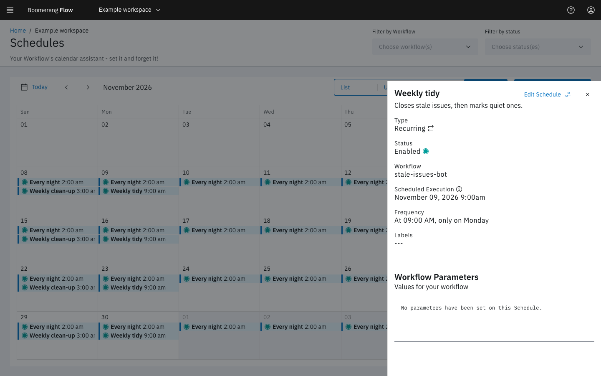

<!-- Written against flow.service.workflow 5.0.0-beta.39. UI labels checked against the live webapp (build 490ba3894, 2026-11-06): 36 of 37 bolded terms seen live; the rest are states the walk didn't reach or aren't labels, and were verified in client-web source. -->

# Schedules

A schedule runs a workflow at a time you set, once or on a repeating timetable, with the parameter values each run starts with. Use one for anything that should happen without someone pressing **Run it**: a nightly report, a weekly clean-up, a one-off job at the end of the month.

A workflow can have several schedules, each with its own times and values. They only fire while the workflow's **Scheduler** [trigger](../fundamentals/triggers) is on.

## Where schedules live

- **Schedules** in the side navigation shows every schedule in the workspace, with a **Workflow** column and filters by workflow and status.
- The **Schedules** tab in the workflow editor shows only that workflow's schedules.

Both offer four views: **List**, **Upcoming** (the next 30 days), **Week** and **Month**. Select a schedule's name or calendar entry to open its details. In **Week** and **Month**, select today or a later day to create a run-once schedule on it. The list shows each schedule's name, when it runs in words, its **Next run** in your browser's time zone, its time zone and its status.

## Create a schedule

Select **Create schedule**, then fill in:

1. **Workflow** (on the Schedules page only), **Name** and **Description (optional)**.
2. **When:** one of **Once**, **Hourly**, **Daily**, **Weekdays**, **Weekly** or **Custom (cron)**, and its settings, such as the date and time, the minute past the hour, or the days of the week.
3. **Time zone:** your browser's zone unless you choose another. The line under it says when the schedule runs, such as "Runs every day at 9:00 AM (Australia/Sydney) · next Thu 30 Oct, 9:00 AM".
4. **Parameters:** the values every run from this schedule starts with. Required parameters come first. A secured parameter you leave blank uses the workflow's default.
5. **Labels (optional):** key and value pairs, to find the schedule later.

Select **Create**. The schedule starts **Enabled**, or **Trigger Disabled** if the workflow's **Scheduler** trigger is off.

### Write a cron expression

**Custom (cron)** takes a five-field expression: minute, hour, day of month, month, day of week. **Cron syntax and examples** under the field explains each field. Some common ones:

| Expression | Runs |
| --- | --- |
| `0 18 * * 1-5` | 6:00 PM, Monday to Friday |
| `30 2 * * *` | 2:30 AM every day |
| `0 * * * *` | At the start of every hour |
| `0 0 1 * *` | Midnight on the first of each month |

Flow checks the expression as you type and says what it reads, or why it can't. A six- or seven-field Quartz expression, the form v3 used, is converted to five fields.

## Manage schedules

Each schedule's menu offers **Edit**, **Enable** or **Disable**, and **Delete**. A schedule shows one of these statuses:

| Status | Means |
| --- | --- |
| **Enabled** | Fires at its next time |
| **Disabled** | Paused by someone; it stays paused until enabled again |
| **Trigger Disabled** | Paused because the workflow's **Scheduler** trigger is off |
| **Completed** | A run-once schedule that has fired |
| **Error** | Can't fire, for example a run-once schedule enabled after its time has passed |

Turning the **Scheduler** trigger off and on again restores exactly the schedules that were enabled before; ones you disabled stay disabled.

## What a scheduled run looks like

A scheduled run has the trigger `schedule` and counts against the workspace's [quotas](./quotas) like any other run. On the run page, **Initiated by** links back to the schedules for its workflow.

Flow checks for due schedules every 30 seconds. If Flow was down when a schedule was due, it fires once when Flow is back, not once for every time it missed. A run that can't be submitted is tried again, 3 times in all.

To schedule a run from inside a workflow, use the **Run Scheduled Workflow** task. It creates a run-once schedule for a workflow at a set interval from now.

## Example: a weekday report at 6 PM Sydney time

1. Open the "sales-summary" workflow and select the **Schedules** tab.
2. Select **Create schedule**. Name it "Weekday close".
3. Under **When**, choose **Weekdays**, set **At** to 6:00 and choose **PM**.
4. Set **Time zone** to Australia/Sydney.
5. Under **Parameters**, set `region` to `APAC`.
6. Select **Create**.

The schedule appears as **Enabled**, with **Next run** shown in your own time zone. Each weekday evening a run appears on the Activity page with the trigger **Schedule** and `region` set to `APAC`.

## Next steps

- [Triggers](../fundamentals/triggers): the Scheduler trigger and the other ways a run starts.
- [Runs](../fundamentals/runs): what happens once a scheduled run starts.
- [Parameters](../fundamentals/parameters): the values a run starts with.
